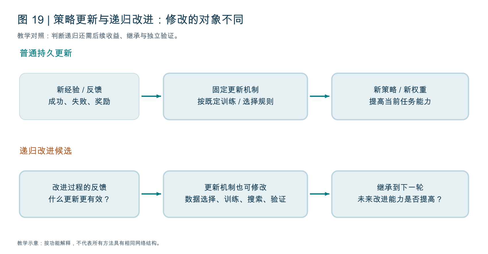

# P2：怎样判断真正的递归自我改进

原文：The Last AI Built by Humans: Toward Genuine Recursive Self-Improvement。Yi Duan 等，arXiv:2609.11873v3，2026-09-22，79 页。此版本为预印本。[公开记录](https://arxiv.org/abs/2609.11873)。

## 1. 标题是一种研究愿景



读图：上排修改策略权重，下排还修改用于改进的规则。下排是递归改进候选；是否真的提高以后改进能力，需要独立证据。训练一次更好模型与递归自我改进不能直接画等号。

“人类构建的最后一个 AI”并不是本文已经证明的事实。它的核心问题是：AI 能否把经验变成持久能力，并且进一步改善未来获得、选择和验证改进的方法？

普通优化使当前系统更好。Recursive Self-Improvement（RSI）要求进一步关注“怎样改进”本身能否被系统修改、继承和再次使用。一次正确回答、一次自我反思、一次性能提升，都不足以单独证明 RSI。

## 2. 三种变化必须区分

任务内改进：机器人第一次抓空后换一个姿态，最终成功，任务结束后没有留下能力变化。

持久自我改进：系统把“杯子把手会妨碍当前抓取”保存成经验证的技能，后续任务也会使用；或者从真实交互更新策略参数。

递归自我改进：系统发现原有技能更新规则常常把偶发失败当成通用规律，于是修改诊断与验证机制；这个新机制被后续改进轮次实际使用，并使下一批改进更可靠或更有效率。

最后一种变化的对象包含改进机制。它不要求一定修改模型权重，也可能修改验证规则、数据选择、搜索策略或改进流程。是否称为 RSI，还需说明允许自主修改的边界与证据。

## 3. 本文 B0 与 L1–L5 的自主性路线

| 层级 | 自主性的重点 | 杯子教学例子 |
|---|---|---|
| B0 | In-Task Improvement，任务内改进 | 当前抓空后重试，能力没有跨任务保留 |
| L1 | Improvement Execution，改进执行 | 按既定配方收集、训练、验证更新 |
| L2 | Improvement Strategies，改进策略 | 根据失败选择补数据、改提示或调训练方法 |
| L3 | Future Learning Experience，未来学习经验 | 自主选择下一批训练任务、探索和课程 |
| L4 | Deployment / Environment Adaptation，部署与环境适应 | 在变化场景中持续诊断、更新并管理持久状态 |
| L5 | Meta-Improvement，元改进 | 修改并继承指导以后改进的机制 |

这是该论文的分类，不是 P5 的分级。P5 的 L1 是人工改进，L4 才明确表示受限领域内的 RSI，两篇层级编号不能互换。

自主性指哪些决策由系统承担，不是模型参数数量、是否多人协作、自动执行多久，也不代表每项决策完全脱离人类边界。

## 4. 最有用的阅读工具：追踪一个完整改进循环

每读一个案例，都询问：什么事件触发改进？谁诊断？谁提出修改？谁验证？什么内容持久保存？后继系统如何使用？下一轮的改进机制是否真的改变？

```text
版本 x_t = 当前策略、记忆、工具与改进机制
证据 = 执行轨迹 + 失败结果 + 独立检查
候选修改 = 改进机制(版本 x_t, 证据)
在可比条件下验证候选修改
通过后保留新版本 x_(t+1)
下一轮实际使用保留的能力 / 机制
```

这是教学抽象。拒绝的候选、退化和回滚同样需要记录，不能只保留成功故事。

## 5. 结构递归与有效递归

Structural Recursion 表示改进机制被修改、继承并用于下一轮。Effective Recursion 进一步要求它帮助后续系统产生更好的改进，且比较条件和预算合理。

比如自动修改训练数据选择代码，下一轮确实运行了这份代码，说明结构发生了变化；但如果同样预算下结果没有改善，不能说已经实现有效递归。

尤其需要区分“当前模型得分更高”和“当前系统更擅长创造更好的后继系统”。前者是任务性能，后者是改进能力，评价对象不同。

## 6. HCI 应该怎样理解

本文用 Headroom-Closed Index（HCI）描述基准剩余提升空间被填补的比例。在稳定协议与可比评分下，简化形式为：`HCI = 100 × (当前分数 - 起始基线) / (100 - 起始基线)`。

教学例子：起始分数 60，当前 80，满分 100，HCI 为 50，表示相对于起始基线填补了一半可提升空间。这不是“智力达到人类的 50%”，也不是不同任务可以无条件统一比较的证明。

论文还处理来源权重、基准协议家庭与跨年份汇总等问题。图中的后续 RSI 延伸具有示意性质，不能把预测区域当成已经观察到的性能。HCI 本身也不能建立“RSI 导致了性能增长”的因果结论。

第一遍掌握含义和比较条件即可，不必逐项复算全部跨基准数据。

## 7. 为什么机器人中的 RSI 更难

软件常可重复运行测试、还原版本；机器人碰倒杯子后，恢复代码版本不能把杯子重新放回去。现实交互还有任务重置、人力、硬件磨损和安全约束。

经验是内生的：当前策略决定能到达哪些状态，从而决定下一轮看到的数据。一个只会在容易位置抓取的机器人，可能一直缺少困难状态的学习证据。

失败归因也更复杂。抓空可能来自相机、标定、感知、动作生成、控制或物体性质。若把所有失败都写成“需要重新训练”，更新可能没有触及真正瓶颈。

所以持续学习、世界模型、数据课程、技能库都与 RSI 有关，但它们不自动构成最高层级的递归改进。

## 8. 读案例时怎样衡量证据强弱

公开演示说明系统可能完成某些任务；可复现实验能说明特定条件下的收益；跨任务、跨多轮、独立验证与预算匹配的结果，才能更有力支持持久改进和递归效果。产业案例与初步实证具有参考价值，但证据强度不应混为一谈。

本文明确讨论自主性归因、持久状态可靠复用和长时程评估。不要只从文章标题推断已经出现无限加速或通用自我进化。

## 9. 第一遍阅读建议

先读第 3–7 页的动机，第 9–12 页的概念边界，第 12–35 页各层级的开头与总结；再读第 46–49 页的挑战与结论。具身相关可重点看第 74–76 页附近的 Appendix C.2，那里把环境、技能、策略、世界模型与评估器放进同一个改进循环。

第一遍产业案例可以选一两个理解机制，其余作为后续索引。不要花大量时间记公司名。

## 10. 小实验与自测

学习实验可比较固定改进规则与自适应规则：两者使用相同初始策略、任务划分和总预算，分别统计每轮增益、旧任务退化、人工介入、拒绝更新和最终成本。若要宣称元改进，还应在新任务上冻结并检验学得的改进机制是否有帮助。

你应能回答：变化是否跨任务保留？后继系统是否真正调用？改进机制有没有变？收益能否由更多计算或更强底座解释？独立评价是否避免了反复针对同一测试集优化？

这些问题比“系统是否会反思”更能帮助你判断前沿工作。
