# 算法图解详解：从数据到策略与世界模型

为偏算法背景的初学者编写，更新于 2026-10-24。本章是对仓库导读的实质扩写：先把算法写成输入、输出、监督信号和执行流程，再解释为什么这样设计。公式、数字、示意图和伪代码均为教学材料；与某篇论文实现有关的细节会明确给出来源。

建议先读第 1 至 7 节建立动作学习基础，再读第 8 至 13 节理解强化学习、世界模型与长期决策。第 14 至 17 节补齐几何、导航、实验与选题。你不需要一次背下所有模型名；每节末尾的“读懂检查”用来判断是否需要回看。18 张图既嵌在本文中，也保存在图解目录中，附有矢量 PDF 原图。

## 1. 算法背景进入具身：先改变哪几个思维习惯

### 1.1 监督学习的输出现在会改变下一次输入

普通图像分类里，你把一张图片判错，不会因此改变下一张测试图片。机器人策略不同：它抓偏了，杯子被推到新位置，下一次看到的图像就变了。于是“输入 → 预测”变成“输入 → 动作 → 新输入”的闭环。算法必须在自己造成的状态变化中继续工作。

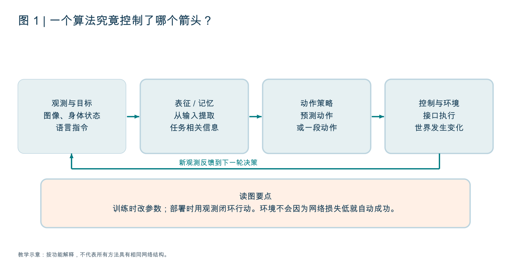

图中策略与环境之间的箭头是新手最容易漏掉的部分。模型可以在离线测试里准确模仿专家，却在真实执行里进入专家没经历过的状态。训练损失与任务成功率因此必须分开测量。

具身智能 AI（Artificial Intelligence，人工智能）不要求每个模块都用神经网络。一个完整系统可以用学习视觉编码器、传统运动规划器和经典控制器；也可以用端到端策略，但接口、时间同步和物理执行仍然存在。

### 1.2 先写一张符号表，读公式就不会一直停下来

| 符号 | 本章含义 | 抓杯子例子 |
|---|---|---|
| t | 机器人交互时刻 | 合爪前、合爪后、抬起后 |
| o_t | 当前可获得的观测 | 相机图像与关节传感器读数 |
| s_t | 描述环境的状态 | 杯子真实位姿、速度、接触等 |
| q_t | 机器人关节位置等身体变量 | 机械臂关节角；这里 q 不代表价值函数 |
| g | 目标 / 指令 | 把红杯子放进水槽 |
| c_t | 策略的条件信息 | 编码后的图像、状态、语言及必要历史 |
| a_t | 一个时刻的动作 | 关节目标或末端增量 |
| A_t | 从当前开始的动作块 | [a_t, a_(t+1), …, a_(t+H-1)] |
| H | 预测动作的步数 | 一次预测未来 20 步 |
| K | 本轮执行后重新观测的间隔 | 执行前 4 步就再次推理 |
| θ | 可学习模型参数 | 编码器和动作网络的权重 |

观测 o_t 不等于状态 s_t。杯子背后有没有把手、是否装水、是否稳定接触，未必从图像中完整可知。算法有时直接使用仿真状态，有时只看图像；比较方法时必须对齐观测权限。

E 表示在数据、轨迹或随机噪声上求期望，也就是对很多样本求平均；πθ 表示参数为 θ 的策略；p 表示概率分布。下标与括号的精确定义依论文而定，同一个字母在不同论文里可以承担不同角色。

### 1.3 看一篇算法论文，先回答四个接口问题

输入包含什么？输出是什么动作表示？训练时谁提供监督？部署时如何与环境交互？先回答这四项，再看网络层数。

例如“基于 Transformer 的机器人算法”仍然很模糊。Transformer 可以做视觉编码、动作解码、动态预测或语言规划。只有知道它预测的是动作、状态还是文本，你才能理解它在解决哪种问题。

读懂检查：你能否解释“模型推理成功”“低层控制成功”“任务成功”分别意味着什么？前者只代表程序得到输出，中间一项代表运动被执行，最后一项才代表目标完成。

## 2. 数据到张量：动作学习真正的地基

### 2.1 训练样本是轨迹中的一个窗口

一条轨迹记录从开始到结束的交互。训练时通常不会每次读取整条轨迹，而是在时刻 t 截取条件窗口和未来动作标签。IL（Imitation Learning，模仿学习）使用专家行为作为监督；BC（Behavior Cloning，行为克隆）是其中直接监督拟合动作的常见方法。

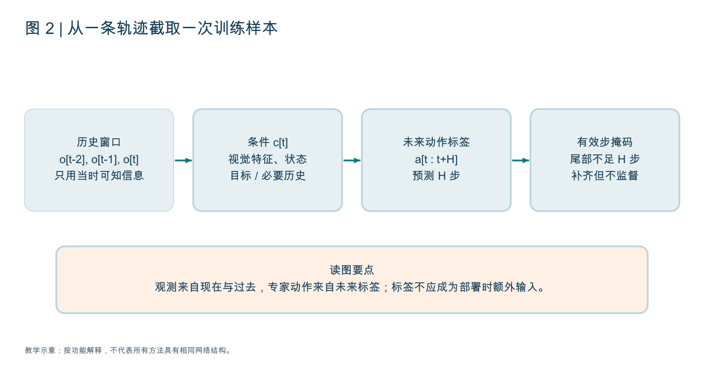

图中“未来动作”只在训练时作为标签使用。预测它们是任务，不能在部署时偷偷把真实未来动作输入网络。某些条件生成方法训练时会编码未来动作形成潜变量，那是训练后验的一部分，推理必须换成可获得的先验；ACT 正好需要理解这个区别。

教学张量例子：批量 B=16，两路相机，三帧历史，每帧 RGB（Red, Green, Blue）图像 224×224，图像可以是 `[16, 3, 2, 3, 224, 224]`；未来动作 H=20，动作维数 d=7，则标签是 `[16, 20, 7]`。B 在这里是 Batch Size，不是十亿参数的 Billion。具体轴顺序由实现决定。

如果模型使用单帧，时间维可能省掉；如果先编码图像，每张图可能变成一串 patch token（图像块词元）；如果使用点云，则输入可能是 `[B, N, 3]` 加颜色或其他特征。形状只能告诉你数量，不能告诉你动作单位与语义。

### 2.2 七维动作为什么会有完全不同含义

一个模型输出七个数，可以是六个关节加夹爪，也可以是末端三维平移、三维旋转加夹爪。双臂动作维数更高，但拼接方式也依本体不同。旋转又可以用欧拉角、轴角或其他表示。抓杯子时的方向很关键，不能只监督 xyz。

绝对动作指定目标值，例如“关节转到 0.5 弧度”；增量动作指定相对变化，例如“再转 0.02 弧度”。位置动作、速度动作、力矩动作对应不同控制接口。相同数字进入不同接口，物理结果会完全不同。

算法实验必须固定动作表示。否则“加一个模型模块”的结果变化，可能实际来自改了动作单位、控制模式或反归一化。

### 2.3 归一化、补齐、掩码到底在做什么

归一化把不同量纲调整到易训练的尺度。标准化示意为 `a_norm = (a - μ) / (σ + ε)`，μ、σ 是训练集统计量，ε 是防止除零的小常数。部署时用 `a = a_norm × σ + μ` 还原。某些仓库使用分位数缩放或将夹爪维单独处理，不能只复制这个公式。

为什么重要？位置量可能是 0.1 米，角度可能是 1 弧度，夹爪可能是 0 或 1。如果所有维度直接求平方差，数值较大的维度可能主导梯度。归一化改善优化，但不会统一动作的物理意义。用错统计文件，动作可能系统性抓偏。

轨迹最后剩余步数不足 H 时，常补齐张量，并用 Padding Mask（补齐掩码）忽略无效标签。补齐的零不是“专家要求停在零位置”。不仅损失要忽略补齐，注意力网络也可能需要忽略补齐输入。

```text
采样轨迹中的时刻 t
取允许使用的观测历史，构造条件 c
取未来 H 个专家动作，不足部分补齐
构造有效步 mask
用训练集统计量归一化动作
预测动作块，与有效标签比较
更新参数
```

### 2.4 增强与划分要保留控制语义

图像裁剪改变目标在像素中的位置；水平翻转可能改变左右语义；点云坐标变化可能需要同步变换动作。如果只翻图像、没有正确处理“向左移动”的标签，增强会制造错配。实际是否可用取决于任务、标定与模型输入。

训练、验证、测试应按轨迹、场景、对象或任务合理划分。按帧随机划分容易让相邻帧跨越训练和测试。用测试场景统计动作或选超参数，也会降低独立评测的可信度。

读懂检查：拿到一个数据集，你能否说清楚每个动作维、单位、时刻对应关系，以及补齐部分是否被监督？不能回答时，先不要改网络。

## 3. 表征与注意力：为什么不是把图片和文字简单拼起来

### 3.1 从像素到可供动作网络利用的条件

视觉编码器把图像变成特征。CNN（Convolutional Neural Network，卷积神经网络）擅长局部处理；ViT（Vision Transformer，视觉 Transformer）常把图片切成块，通过注意力建模关系。它们都可以产生全局或局部特征。

全局向量紧凑，但可能丢掉小杯柄的位置；稠密特征保留局部空间关系，但占更多算力。点云、深度和几何可以补空间信息，但还要处理传感器噪声和坐标对齐。“特征更强”需要落实到任务需要保留什么。

CLIP（Contrastive Language-Image Pre-training）与 SigLIP（Sigmoid Loss for Language-Image Pre-training）学习图文关联；DINO（Self-Distillation with No Labels）学习可迁移视觉特征。图文对齐帮助选择红杯子，稠密视觉特征帮助跟踪杯柄，但它们都不自动提供抓取动作。

冻结 Encoder（编码器）是固定其参数，只训练下游头。优点是省训练成本、减少小数据过拟合；缺点是任务所需信息可能没有充分编码。微调可适配任务，但可能破坏原有通用能力，并增加数据与优化需求。比较冻结与微调时要报告训练参数、预算与独立任务成功。

### 3.2 Attention 中 Q、K、V 的实际含义

Self-Attention（自注意力）常写为 `Attention(Q,K,V) = softmax(QK^T / sqrt(d)) V`。这里 Q、K、V 分别是 Query、Key、Value（查询、键、值），是特征的可学习线性投影。Q 问“我该关注谁”，K 用于计算相关程度，V 提供聚合内容；softmax 把分数变成归一化权重。

这套 Q / K / V 与强化学习的 Q 值不是同一个概念。本章动作长度 K 也与注意力键 K 不同。上下文决定符号含义。

如果动作查询需要预测“夹爪下一步怎么动”，它可能关注杯柄的图像 token、当前关节状态和语言目标。Cross-Attention（交叉注意力）允许一组 token 查询另一组 token；它是一种信息交互机制，不保证学到的关注位置符合人的直觉。

Position Encoding（位置编码）告诉网络 token 的空间或时间身份。否则模型看到一组特征，很难分清第几帧、哪路相机或哪个未来动作槽位。Causal Mask（因果掩码）限制访问未来信息，Padding Mask 屏蔽补齐位置；两者解决不同问题。

### 3.3 几种融合选择与它们的研究问题

早期融合将不同模态较早放在共同网络中；后期融合先分别提特征再组合；交叉注意力让一种模态按需要查询另一种。没有一种设计对所有任务最好。语言很少变化、视觉需要高频更新时，还可以缓存静态条件，但缓存必须与当前任务和观测一致。

读懂检查：一张架构图上的“视觉 backbone + language token + action head”不够。你还应追踪模态在哪里交互、哪个模块更新、动作查询能看见哪些信息，以及训练和部署是否使用同样条件。

## 4. BC：简单方法为什么仍是重要基线

### 4.1 最直接的监督目标

BC 学习 `a_hat = πθ(c)`，用专家动作 a 作标签。如果输出是确定性连续值，可以使用 L1（绝对误差）或 L2（平方误差）；如果输出概率分布，可以使用负对数似然；扩散和流匹配也能用于模仿学习，但使用不同监督构造。

平方误差例子：对一个动作维，专家为 0.3，预测为 0.1，误差平方是 0.04。多维动作要考虑尺度和重要性。闭环成功还取决于误差在哪些阶段出现：远离障碍时差一厘米，与插孔时差一厘米，后果不同。

### 4.2 多模态：一个条件可能允许多个正确动作

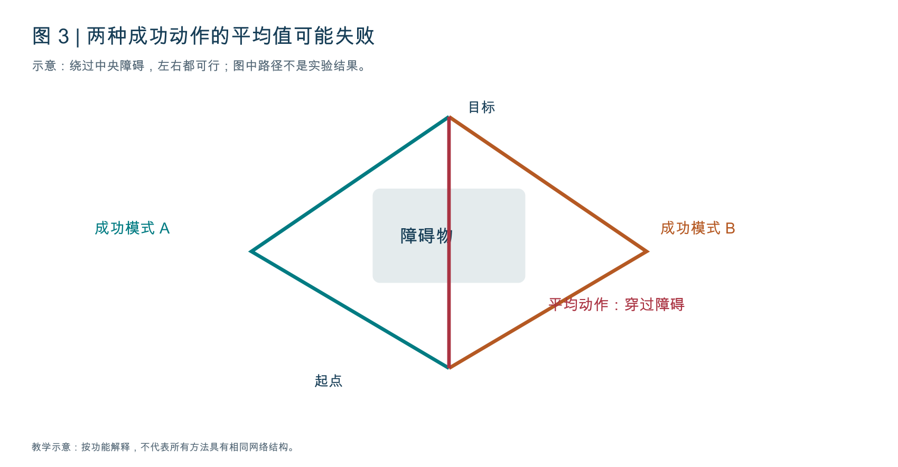

图中左右绕行都是专家可行模式。确定性均方回归在理想化情况下倾向条件均值；当数据同时包含左右动作，这个均值可能穿过障碍。这里没有说所有回归策略都会失败，而是说明“用单点平均表达多种合理行为”可能不合适。

可以用多模态概率分布、潜变量、扩散或流匹配表达多个行为模式。生成动作分布有助于减少平均化问题，但仍需选择样本、保持时间连贯，并满足物理约束。随机性不是任务成功的保证。

### 4.3 协变量偏移：训练时跟着专家，部署时跟着自己

Covariate Shift（协变量偏移）在这里指策略访问的状态分布与演示不同。第一次抓偏一点，第二次更陌生，第三次可能完全偏离。增加演示可以补覆盖，但不一定覆盖所有失败后的状态。

DAgger（Dataset Aggregation，数据集聚合）是一类补救思路：让当前策略执行，请专家在它遇到的状态给出动作标签，再将数据加入训练。专家标签可以来自遥操作或可用控制器；现实中查询成本和干预风险要单独考虑。

```text
先用初始演示训练策略
重复:
    让当前策略访问环境状态
    获取这些状态下专家应采取的动作
    聚合新标签与旧数据
    重新训练 / 更新策略
用独立任务检验恢复与泛化
```

这个过程补的是状态覆盖，不是简单把原演示复制更多遍。若没有可用专家，不能直接把它当成免费的训练改进。

### 4.4 Loss 低却抓不到，怎么逐层定位

先看相机图像和动作标签是否正确；再看反归一化动作是否落在合理范围；检查单步预测能否对齐专家；然后观察闭环何时偏离；最后按抓空、碰撞、滑落、进度丢失等模式分类。数据损坏、接口错配、模型表达不足和状态分布偏移需要不同改进。

读懂检查：为什么某个复杂模型必须与小 BC 基线比较？因为只有在相同数据和协议下超越简单拟合，才能判断复杂机制是否有实际收益。

## 5. ACT：把潜变量、动作分块与融合分开理解

### 5.1 三个设计分别解决什么

ACT（Action Chunking with Transformers）用 Transformer 一次预测一段动作。它还通过 CVAE（Conditional Variational Autoencoder，条件变分自编码器）建模演示中不完全由当前观测解释的变化；部署可进行 Temporal Ensembling（时间集成），融合不同推理时刻对同一执行时刻的预测。

动作分块表达局部连贯行为；潜变量帮助训练时解释不同演示风格；时间集成减少部分动作不连续。三个机制不能互相替代。动作分块本身不提供长期记忆，也不自动解决所有分布外状态。

### 5.2 训练图：为什么要把专家未来动作送进一个编码器

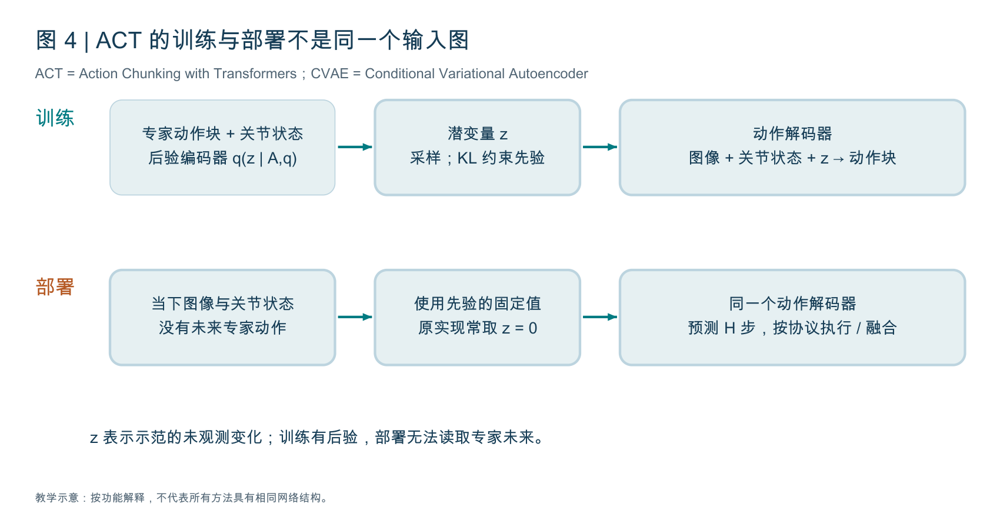

原始 ACT 参考实现的后验编码器读取专家动作块和当前关节状态，得到潜变量分布的均值 μ 和对数方差 log σ²。通过重参数化 `z = μ + σ × ε` 采样，其中 ε 来自标准正态分布。这样能将随机采样的梯度路径写成可学习变换。

动作解码器接收图像特征、关节状态和 z，预测未来动作块。z 可以解释同一观测下演示中的未观测差异；它不是杯子的完整物理状态，也不是长期任务数据库。

教学目标：`L_ACT = L_reconstruction + β × KL(q(z | A,q) || N(0,I))`。重建项比较预测与专家动作；KL（Kullback-Leibler Divergence，KL 散度）约束后验不要任意偏离标准正态先验；β 控制权重。

参考代码使用有效步上的 L1 动作差异与 KL 项。β 太弱时，后验可能过分依赖训练未来；太强时，潜变量可能被忽略。具体调参还要看数据、实现和任务成功，不能只根据一句原理给固定数值。

### 5.3 部署图：没有专家未来，潜变量从哪里来

部署时专家未来动作不可用，因此不运行这个后验编码器。原始 ACT 常将 z 固定为零，通过同一个动作解码器输出动作块。零是先验的中心值，不能解释为“把机器人关节置零”。一些变体可能使用不同策略，应查实现。

ACT 被称为带潜变量的生成式模型，不意味着官方部署每次都随机采样很多动作并挑最优。训练结构和使用方式必须分别理解。

### 5.4 分块长度 H、执行间隔 K 与时间集成

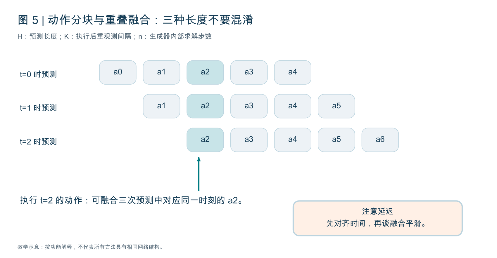

t=0 预测未来多个动作，t=1 又预测一段；到 t=2 时，它们各有一个对应 t=2 的预测。时间集成融合的是“同一执行时刻”的这些预测，不能把 t=2 与 t=5 的动作随意平均。

可以示意为 `a_t = sum_i w_i a_hat_t^(i) / sum_i w_i`，i 表示不同推理时刻的预测。权重规则依实现而定；越新越可信或越旧越平滑都不是通用定律。

如果 H=20，K=4，代表一次预测 20 步，执行前 4 步后重新观测；不是每次无反馈执行整段。时间集成模式也可每步推理。H 越大，长期标签和计算负担越大；K 越大，重规划更少，但反馈更迟。

### 5.5 训练与部署伪代码

```text
训练:
    读取当前图像、关节状态、专家未来动作块
    后验编码器生成 μ, log方差
    重参数化采样 z
    动作解码器(图像, 关节状态, z) → 动作块
    有效步 L1 + β × KL → 更新参数

部署:
    读取最新图像与关节状态
    z = 先验的固定中心值（原始 ACT 常为零）
    解码得到未来动作块
    反归一化；按部署协议执行或融合
    重新观测
```

读懂检查：你能否解释图中的“专家动作作为训练输入”为什么不等于作弊，以及部署如何移除对它的依赖？若只记住“一次输出一段动作”，还没有真正读懂 ACT。

来源：[ACT 主页与论文](https://tonyzhaozh.github.io/aloha/)、[原始策略损失代码](https://github.com/tonyzhaozh/act/blob/main/policy.py)、[后验与动作解码器](https://github.com/tonyzhaozh/act/blob/main/detr/models/detr_vae.py)。本章解释原始结构，XPolicyLab 适配器与后来变体可能有额外差异。

## 6. Diffusion Policy：去噪的是动作，不是机器人世界

### 6.1 三种“时间”要先分开

机器人交互时刻 t、动作块中未来位置 h、扩散噪声等级 k 是不同索引。一张图若写 “step”，先问它是哪一种步数。训练时间标签 k 不是“机器人执行第 k 个动作”。

Diffusion Policy（扩散策略）学习条件动作分布，条件 c 包括观测及任务信息，生成对象是未来动作块 A。它可以使用卷积时序网络或 Transformer 去噪器，网络类型与扩散监督不是同一层。

### 6.2 训练：为何预测噪声也能学会动作分布

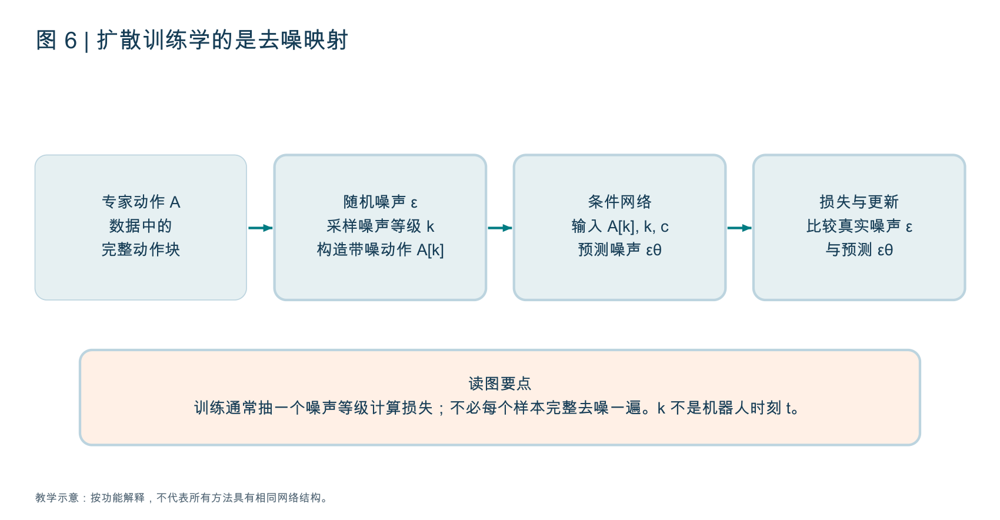

一种常见噪声预测形式为 `A_k = sqrt(α_bar_k) A + sqrt(1 - α_bar_k) ε`。A 是专家动作，ε 是标准正态噪声；α_bar_k 由噪声日程决定，控制保留多少数据。网络 εθ(A_k,k,c) 预测加进去的噪声。

教学损失：`L_diffusion = E[ ||ε - εθ(A_k,k,c)||² ]`。平方差监督的目标是噪声，不是直接把不同专家动作取平均。网络在不同噪声等级学习条件去噪关系，配合相应反向采样过程恢复动作分布。

原理直觉：轻噪声时修细节，重噪声时依条件组织整体动作。这个描述帮助理解，不代表每个模型都有可解释的“粗规划层”和“精修层”。一些方法预测干净样本或速度而非噪声，推理更新式必须与训练参数化匹配。

```text
采样专家动作块 A 与条件 c
采样噪声等级 k 和随机噪声 ε
按日程构造 A_k
网络预测 ε_hat
比较 ε_hat 与 ε，更新参数
```

训练通常随机选一个 k 计算损失，不必对每个训练样本完成一次全程去噪。这就是为什么训练图与推理图不同。

### 6.3 推理：一次求解改变整段动作

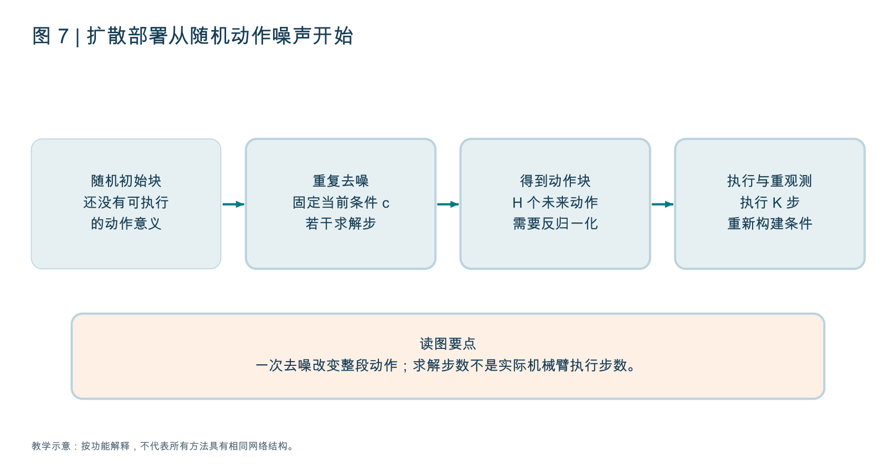

部署从随机动作噪声开始，固定当前条件 c，经若干去噪步得到动作块。随后反归一化，执行前 K 步，再根据新观测重新生成。一次去噪更新整段张量，不对应夹爪的一次物理动作。

```text
c = 编码当前观测与必要历史
A = 标准正态随机动作块
for k in 规定的反向噪声日程:
    ε_hat = 去噪网络(A, k, c)
    A = 对应采样器的一步更新(A, ε_hat, k)
反归一化 A
执行前 K 步；获取新观测
```

DDPM（Denoising Diffusion Probabilistic Model）与 DDIM（Denoising Diffusion Implicit Model）代表不同采样建模 / 求解路线。减少采样步可能降低延迟，也可能损伤质量；蒸馏或一致性方法尝试减少迭代成本，但需要额外训练与验证。不要只改循环次数而忽略采样器配置。

### 6.4 它有什么优点，又没有解决什么

扩散较适合表达多个可行动作模式，并联合生成连续动作序列。但观测或数据不正确时，去噪也会生成错误动作；碰撞与动作限制也不会自动满足。采样随机性、迭代延迟和反馈频率需要与任务配合。

DP3（3D Diffusion Policy，三维扩散策略）主要改变视觉 / 空间条件表示，引入点云等信息。是否更好，取决于几何需求、点云质量、相机设置和计算预算，不是“3D”三个字自动提高所有任务成绩。

读懂检查：扩散策略与视频扩散世界模型的区别是什么？前者生成动作，后者生成观测或未来表示；共享扩散机制不意味着共享用途。

来源：[Diffusion Policy 原论文与项目](https://diffusion-policy.cs.columbia.edu/)、[代码](https://github.com/real-stanford/diffusion_policy)、[DP3](https://github.com/YanjieZe/3D-Diffusion-Policy)。

## 7. 流匹配：从噪声到动作学习一条连续路径

### 7.1 训练的标签是速度场，不是实际关节速度

Flow Matching（流匹配）学习一个连续变化的向量场，让随机噪声逐渐变成符合条件的动作样本。这个向量场定义在动作块的生成空间中；它的“速度”不等于机械臂在真实时间里转动的速度。

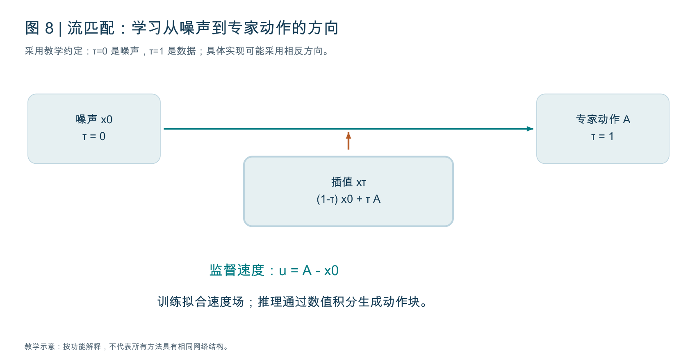

采用一种便于理解的约定：τ=0 是噪声 x0，τ=1 是专家动作 A，定义 `xτ = (1-τ)x0 + τA`。τ 是生成过程的插值时间，不是机器人交互时刻 t。直线路径的目标速度为 `u = A - x0`。

网络 vθ(xτ,τ,c) 根据带噪动作、生成时间和条件，预测这个变化方向。教学损失为 `L_flow = E[ ||vθ(xτ,τ,c) - (A-x0)||² ]`。它没有要求模型在部署时获得专家 A；A 只用于训练构造样本和监督。

“直线路径”指训练时两个样本之间的插值构造，不意味着推理轨迹一定是直线，更不意味着机器人应该沿空间直线抓杯子。学习到的条件向量场与数值求解共同决定生成结果。

### 7.2 推理的数值积分到底在更新什么

推理从噪声出发，通过 ODE（Ordinary Differential Equation，常微分方程）求解器积分 `dx/dτ = vθ(x,τ,c)`，得到动作块。最简单的欧拉步可示意为 `x_next = x + Δτ × vθ(x,τ,c)`。具体模型可能使用相反的时间方向、其他路径或更好的求解器，应与训练定义一致。

```text
训练:
    采样专家动作块 A、噪声 x0、插值时间 τ
    xτ = (1-τ)x0 + τA
    监督网络预测 A-x0

部署:
    x = 随机噪声动作块
    for τ in 求解网格:
        x = 数值积分的一步(x, 网络预测速度, 步长)
    反归一化；执行前 K 步
```

整个 H×d 动作块在每个求解步一起更新。这与扩散策略同样需要区分“生成内部迭代”和“实际动作执行”。减少积分步数可降时延，但效果要通过动作质量与闭环成功检验。

### 7.3 扩散、流匹配与动作回归怎样比较

确定性回归直接预测一个动作或动作块；扩散与流匹配从简单随机分布生成条件样本。后两者有相关理论联系，但训练参数化、路径、日程和求解器并不完全相同。不要仅凭“都从噪声开始”将代码混用。

对偏算法的学习者，比较时先固定条件编码器与数据，再看动作分布表达、生成成本、优化稳定性和反馈频率。复杂生成器在小而单一的任务上未必优于简单回归；多种可行动作、丰富数据和复杂条件可能增加它的价值。

读懂检查：图中的 τ、机器人时刻 t、动作块长度 H 与执行间隔 K，你能否分别指出？不能分开时，读动作生成论文会反复混淆。

## 8. VLA：共同的输入骨架，不同的动作概率模型

### 8.1 视觉语言能力如何延伸到动作

VLM（Vision-Language Model，视觉语言模型）处理图像与语言；VLA（Vision-Language-Action，视觉语言动作模型）进一步与动作生成关联。视觉语言预训练提供语义与表示，机器人数据把这些条件与具体动作接口连接起来。识别“杯子”不等于已经知道该机械臂如何控制夹爪。

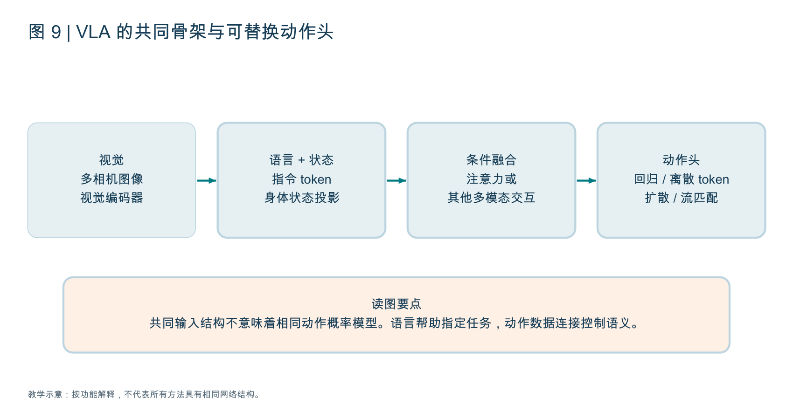

一种常见路线是视觉编码器提取图像 token，语言 tokenizer（词元化器）产生指令 token，身体状态经投影变成条件；网络融合后交给动作头。实际可以是统一 Transformer、双专家、独立动作解码器或其他结构。

输入里没有语言的视觉动作策略有时称 VA（Vision-Action）。语言通常是任务条件之一：同一桌面可以要求“拿红杯子”或“把碗向右推”。如果测试所有指令都对应同一动作，模型忽略语言也可能得高分；应设计目标冲突、颜色变化等检验。

### 8.2 离散动作 token：把控制问题改写成序列预测

一种方法将连续动作的每个维度划到离散区间，模型预测对应 token，再转换回连续值。若范围为 [-1,1]、256 个区间，教学例子中一个区间宽度约为 2/256。真实 tokenizer 可能使用分位数、压缩编码或联合表示，不能把这个例子当成所有模型的配置。

自回归预测写为 `p(A | c) = product_j p(token_j | c, token_<j)`。训练使用 Cross-Entropy（交叉熵）监督，并常用 Teacher Forcing（教师强制）：前文来自真实 token；推理前文来自自己生成的 token。预测误差可以在 token 序列中累积。

离散动作有利于接入现有语言模型训练框架，但量化误差、token 数量与生成延迟影响控制。更细的离散区间提升表示精度，也可能增加学习负担。动作 tokenizer 是把机器人动作组织成模型单位，不是简单将数值打印成字符串。

原始 OpenVLA 是理解这条路线的重要入口，其后续动作分块、并行解码或优化变体应分别看实现。不能把某一版本的推理行为外推到所有带同名词的模型。

### 8.3 连续动作头：视觉语言主干与生成器怎样分工

π0 系列提供流匹配动作头的代表例子；openpi 中 π0-FAST 使用自回归方式与 FAST（Frequency-space Action Sequence Tokenization，频域动作序列词元化）表示。FAST 是动作表示工具，不是一个机械臂控制器，也不等于流匹配求解器。

一个模型家族可以同时存在不同动作头。比较“π 系列”和“自回归”时不能把家族名称当成互斥分类。更稳妥的标签是：条件含哪些模态，动作如何表示，使用何种生成机制，预测与执行长度是多少。

连续动作生成器可以接受视觉语言主干提供的条件表示。冻结主干、训练动作头，可以节省成本；一起微调可以让表示适配动作，但会增加训练开销和遗忘风险。不同设计对梯度传播、缓存和动作延迟都有不同影响。

### 8.4 大规模预训练、微调与部署为何不能只看参数量

预训练学习多任务、多场景行为；SFT（Supervised Fine-Tuning，监督微调）用目标数据更新模型；LoRA（Low-Rank Adaptation，低秩适配）等 PEFT（Parameter-Efficient Fine-Tuning，参数高效微调）只训练部分增量。它们降低部分更新成本，却不能消除基础权重、激活、渲染和数据加载开销。

多本体训练还要处理动作空间、维数、单位和相机差异。可以通过本体条件、独立输出头、统一动作表示、填充掩码等方法组织，但没有一种简单格式就能让所有本体动作等价。一个机器人能抬起的杯子，另一个机器人可能因为抓爪宽度不可达。

“零样本”需要说明没有针对哪种目标训练：新场景、新对象、新任务还是新本体。模型在公开数据里见过相似任务，不等于严格未见；不同数据来源还可能共享轨迹。

### 8.5 模型清单如何变成理解清单

| 方法入口 | 优先理解的机制 | 先问的一个问题 |
|---|---|---|
| ACT | 动作分块、CVAE、时间集成 | 训练与部署的潜变量来源一样吗？ |
| Diffusion Policy / DP3 | 条件动作去噪、空间条件 | 生成对象和噪声等级是什么？ |
| OpenVLA | 视觉语言表示、动作 token | 连续动作如何被编码与还原？ |
| π0 / openpi | 流匹配动作头、条件与微调 | 内部积分步数与反馈周期如何设置？ |
| Octo | 通用条件策略与扩散式动作生成 | 缺失模态、目标条件如何组织？ |
| RDT-1B | Robotics Diffusion Transformer，大规模机器人扩散 Transformer | 跨本体动作信息怎样表示？ |
| GR00T 系列 | 跨本体条件、动作生成与系统分工 | 具体版本实际输出什么控制量？ |

这里列方法作为机制锚点，不构成最新能力排序。GR00T 等品牌名称保留官方名称，不为每个字符编造全称。

读懂检查：一个新 VLA 有更高成功率，你能否区分收益来自表示、动作头、更多数据、执行频率还是后训练？没有对照实验不能把所有收益归给主干。

来源：[OpenVLA](https://github.com/openvla/openvla)、[openpi](https://github.com/Physical-Intelligence/openpi)、[π0 论文](https://arxiv.org/abs/2410.24164)、[FAST 论文](https://arxiv.org/abs/2501.09747)、[Octo](https://octo-models.github.io/)、[RDT](https://rdt-robotics.github.io/rdt-robotics/)。

## 9. RL：奖励、价值、优势与策略更新

### 9.1 强化学习与行为克隆的根本区别

RL（Reinforcement Learning，强化学习）优化交互产生的长期回报，而不是要求每个状态复制专家标签。示意目标 `J(π) = E[sum_t γ^t r_t]`，γ 是折扣因子，r_t 是奖励。奖励来自任务设计或其他可信评价信号，不一定是人的实时打分。

MDP（Markov Decision Process，马尔可夫决策过程）用状态、动作、转移、奖励和折扣描述问题；POMDP（Partially Observable Markov Decision Process，部分可观测马尔可夫决策过程）强调机器人只看到部分观测，需要历史或状态估计。把单帧图像当作充分状态是建模假设，不总成立。

### 9.2 Reward、Return、Value、Q 与 Advantage

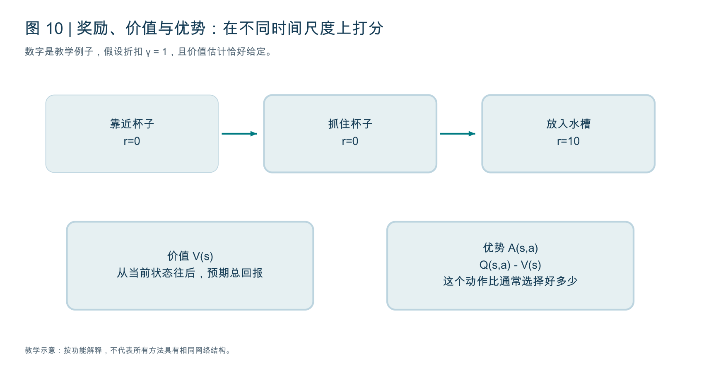

Reward（奖励）是当前反馈；Return（回报）是此后累计的奖励；Vπ(s) 是从状态 s 开始按策略 π 行动的预期回报；Qπ(s,a) 是先采取动作 a、之后按 π 行动的预期回报。Advantage（优势）`Aπ(s,a)=Qπ(s,a)-Vπ(s)` 衡量这个动作相对于该状态通常表现好多少。

例子：从抓杯子的状态开始，常规策略预计能得到 6 分，某个稳健动作的预期 Q 值是 8，优势为 +2。它不是“动作准确率 2%”，而是在当前奖励定义下的相对收益。V 与 Q 都是估计值，可能偏差很大。

Critic（价值评价器）学习预测回报，Actor（策略网络）产生动作。这里 Critic 不是语言模型写一句评价，而通常是可学习的数值函数。Actor-Critic（策略与价值联合学习）利用评价信号更新策略。

### 9.3 Bellman 关系把长期问题拆成一步

一个基本关系是 `Vπ(s)=E[r + γVπ(s_next)]`。它说长期价值等于当前奖励加后续折扣价值。用网络估计价值时，可以构造一步目标 `y=r+γ(1-d)V_target(s_next)`，其中 d 表示真正终止。

如果是时间预算截断，而不是任务真实结束，是否允许 bootstrap（用估计后续价值接续）取决于问题定义。把所有超时都当作真正终止，可能系统性压低价值；相反，已经成功结束却继续接续也会错。

TD（Temporal Difference，时间差分）误差可写成 `δ=y-V(s)`。这个误差用于学习价值，并与某些优势估计有关。它不是物理时间差，而是当前估计与一步更新目标的差异。

### 9.4 为什么策略梯度会提高较好动作的概率

一个示意梯度为 `E[ gradθ log πθ(a|s) × A(s,a) ]`。优势为正时，提高该动作的概率；优势为负时，降低其概率。减去基线可以减少估计方差，但基线与优势估计本身也可能不准确。

PPO（Proximal Policy Optimization，近端策略优化）常用概率比值 `ρ=πθ(a|s)/π_old(a|s)` 和裁剪目标限制一次更新幅度。它不是严格保证全局最优，也不是把机器人动作幅度直接裁小。概率更新裁剪与动作物理限幅是不同层。

GAE（Generalized Advantage Estimation，广义优势估计）组合多步时间差分信号，在偏差与方差之间取舍。初学阶段先理解它为“利用轨迹估计相对回报”，后续再推导公式。

### 9.5 奖励塑形与探索的实际问题

只在成功时给奖励，训练可能很少见到有效信号；增加距离、姿态、稳定性奖励，可以帮助学习，但策略也可能利用漏洞。奖励夹爪高度，机器人可能空手抬起；奖励杯子移动，机器人可能把杯子撞飞。

Sparse Reward（稀疏奖励）与 Dense Reward（稠密奖励）描述信号分布；Reward Shaping（奖励塑形）设计额外反馈。任何塑形都要检查是否鼓励真正目标，以及在独立成功判据下有没有收益。

探索需要有机会发现更好动作。现实机器人每次重置都可能耗费人力；大量失败轨迹也可能有风险和磨损。并行仿真可降低采样成本，但仿真动力学、渲染和动作接口必须足够匹配任务。

读懂检查：高奖励却低成功率可能说明什么？可能是奖励错位、终止处理错误、价值估计偏差或评测协议不同，不能简单判定“模型需要更大”。

## 10. 离线 RL 与后训练：为什么不能直接给生成策略套 PPO

### 10.1 On-Policy、Off-Policy、Offline、Online 是两组轴

On-Policy（同策略）与 Off-Policy（异策略）讨论更新所用数据与当前策略的关系；Offline RL（离线强化学习）只用固定数据训练；Online RL（在线强化学习）持续交互收集新经验。在线算法也可以使用经验回放，因此在线不等于同策略。

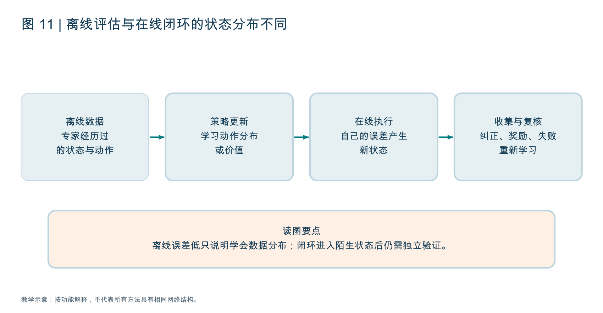

Replay Buffer（经验回放池）存储交互供训练采样。离线数据可以含专家、随机策略和失败轨迹。BC 直接拟合动作，离线 RL 还试图借奖励与价值改进动作选择。

### 10.2 离线价值为什么容易高估未见动作

数据只记录采取过的动作，价值网络可能对未见动作胡乱给高分；策略优化又会主动选择这些高分区域。于是价值误差被策略利用，产生 Distribution Shift（分布偏移）。保守估计、行为约束或数据支持内优化等方法试图减轻这类问题。

不要理解成“有失败数据，RL 就能自动学会恢复”。失败轨迹能提供反馈，但如果缺少可成功的替代行为、奖励不能区分恢复、价值估计不可靠，仍然难以学会。

### 10.3 生成动作策略的概率接口与后训练方法

标准 PPO 需要动作概率或可用的对数概率比值。流匹配与扩散策略通过多步生成过程输出动作，不能直接把网络输出速度或预测噪声当作 `log π(a|s)`。这不表示生成模型在数学上绝对没有密度，而是现成训练接口未必能提供适合策略梯度的精确、可负担概率计算。

后训练可采用不同路径：用优势加权或优势条件化学习；在基座之外学习动作残差；选择或优化初始噪声；用改进策略采集数据再蒸馏；为生成过程建立合适概率目标。它们更新的对象不同，不能统一称为“套 PPO”。

Residual Policy（残差策略）在已有动作上加调整，便于限制改动，但基座差时残差不一定能救回来。Distillation（蒸馏）把教师行为或改进轨迹学到部署策略中，便于运行，但教师的偏差与数据覆盖也会传给学生。

### 10.4 一套可解释的后训练实验

先用同一个预训练权重做 BC / SFT 基线，再固定任务和计算预算比较后训练方法。分开报告新交互量、人类干预、奖励、独立成功率和延迟。若后训练用了更多任务数据，不能把全部收益都说成算法更优。

读懂检查：你研究的后训练到底更新主干、动作头、残差、初始噪声分布还是数据配方？要能指出图中的具体对象。

## 11. 世界模型：学动态，再决定怎样利用动态

### 11.1 最小定义与动作条件

WM（World Model，世界模型）预测环境在时间与动作作用下的变化。最简单形式是 `z_next = fθ(z,a)`，其中 z 是观测编码后的状态表示，a 是候选动作。随机模型预测的是分布，历史模型还包含记忆。

只预测“常见视频接下来怎样”，与预测“这个机器人执行某个动作后怎样”，不是同一问题。前者可学外观与一般动态，后者需要可靠的动作条件、时间对齐和本体关联。潜在动作可以连接两种数据，但必须验证怎样映射到可执行指令。

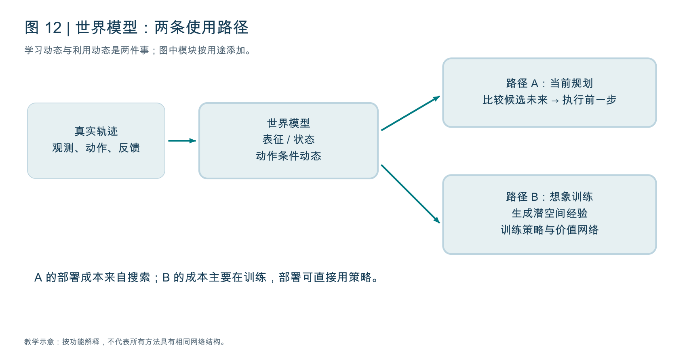

图中的动态模型不自动决定动作。路径 A 是当前使用模型规划；路径 B 是用想象轨迹训练策略。世界模型还可以只作为辅助学习目标，训练更好的表示而在部署时不运行预测分支。

### 11.2 预测对象：像素、特征、对象、网格与几何

预测像素提供丰富视觉信息，也消耗很多资源；预测特征压缩成本，但依赖编码器保留任务所需量；对象状态让位置、接触等易检查，但对象识别和结构先验更强；网格保留空间邻接，分辨率与范围影响内存；几何场提供可渲染空间表示，但动态与接触还需另建机制。

假设杯柄是关键，编码器却只保留“这是一只杯子”的语义，特征预测再准确，也可能不够精确地控制夹爪。于是学习目标不能只问“预测误差多少”，还要问“预测表示包含什么，对任务是否充分”。

### 11.3 RSSM：先预测，再用观测校正

RSSM（Recurrent State-Space Model，循环状态空间模型）结合确定性记忆 h 与随机状态 z。h 汇总历史和动作，z 表达模型对当前状态的随机变化或不确定估计。它不是简单地把所有原图存进缓存。

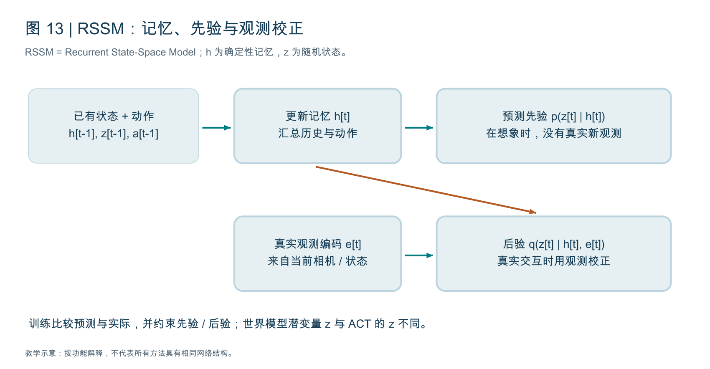

一个教学形式是：`h_t = F(h_(t-1),z_(t-1),a_(t-1))`；先验 `pθ(z_t|h_t)` 在没有新观测时预测状态；后验 `qθ(z_t|h_t,e_t)` 加入真实观测编码 e_t，校正估计。

真实训练或环境交互时有 e_t，可用后验；想象未来时没有真实未来观测，只能依赖预测先验。训练需要使先验逐步学会跟上由观测校正的状态，并保留可预测任务信息。先验与后验的差异是世界模型训练中的关键问题之一。

这里 z 与 ACT 的潜变量 z 不同。ACT 的 z 主要解释演示动作变化；RSSM 的 z 属于时序状态建模。同一个字母不意味着模型共享同一功能。

### 11.4 损失由用途决定，不是把所有损失都加上

常见目标包括观测重建、特征或状态预测、奖励预测、终止 / 继续概率预测、先验后验 KL、多步一致性。像素重建关注外观，奖励头关注任务信号，动态一致性关注展开稳定。

教学形式可以写作 `L_WM = L_prediction + λ_r L_reward + λ_d L_continue + λ_kl L_KL`。这只是功能示意，不是 DreamerV3 的完整官方损失；实际实现可能使用梯度分离、分布参数化、不同尺度处理和额外正则。

JEPA（Joint Embedding Predictive Architecture，联合嵌入预测架构）强调预测表示而非完整像素。V-JEPA（Video Joint Embedding Predictive Architecture）是视频表示路线。DINO-WM 利用预训练视觉特征学习动态与规划；DINO 本身是视觉表征模型，不能直接等同于动作条件世界模型。

Collapse（表示坍缩）意味着所有不同观测都被编码成近乎相同特征。预测这种特征很容易，但没有任务信息。停止梯度、教师编码器、表示约束或预训练结构等方法可缓解，具体要看方法。低损失本身不能排除坍缩。

### 11.5 Dreamer：在想象经验里训练动作策略

Dreamer 系列在真实经验上学习潜空间世界模型，再从真实历史估计的状态出发，使用模型预测先验展开想象轨迹。奖励预测与价值估计支持策略更新；部署时通常依据观测更新模型状态，并由策略选择动作。

“想象训练”不是凭空编造知识，而是借已学动态生成额外训练信号。如果动态对某些动作错误，策略可能在想象中高分、真实环境失败。限制展开长度、增加真实覆盖、改进估计与独立验证都可能重要。

```text
真实环境收集经验 → 更新世界模型
从真实经验中抽取起始状态
在模型中用当前策略产生动作与未来状态
预测奖励与继续概率，估计回报
更新 Actor / Critic
重新到真实环境检查效果，补充经验
```

它与 MPC 不同：不是部署每一步都必须搜索很多候选；主要在训练时利用模型优化策略。实际算法可以组合两种思想。

### 11.6 分层指标：预测像、动态准、控制好

PSNR（Peak Signal-to-Noise Ratio，峰值信噪比）、SSIM（Structural Similarity Index Measure，结构相似性指标）反映部分图像差异；FVD（Fréchet Video Distance，弗雷歇视频距离）比较视频特征分布。它们有用，但不能证明接触和动作因果正确。

还应看位置 / 姿态误差、多步误差、动作敏感性、对象持续存在、碰撞预测、任务成功、延迟与校准。对比两个不同动作时，预测是否合理改变，特别能帮助检查模型是否忽略了动作条件。

读懂检查：你的世界模型在哪个表示空间预测、怎样获得动作条件、部署是否需要运行、最终提升哪个任务指标？若只能回答“生成视频很逼真”，还没有完整解释用途。

来源：[DreamerV3](https://github.com/danijar/dreamerv3)、[DINO-WM](https://github.com/gaoyuezhou/dino_wm)、[V-JEPA 2](https://github.com/facebookresearch/vjepa2)，以及随包 P4 世界模型综述。

## 12. MPC 与搜索：预测怎样变成下一次动作

### 12.1 用一个小数字例子走一遍规划

MPC（Model Predictive Control，模型预测控制）从当前估计状态出发，优化未来一段动作，只执行一部分，再根据新观测重规划。动态模型可以是已知方程或学习世界模型；因此 MPC 不等于神经世界模型。

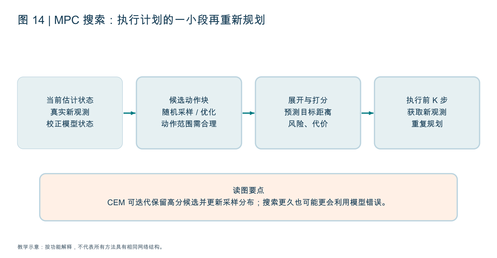

教学打分：`score = -目标距离 - 2×碰撞风险 - 0.1×动作代价`。候选 A 预测距离 0.2、碰撞风险 0.3、代价 1，得分 -0.9；候选 B 距离 0.4、风险 0、代价 1，得分 -0.5。此时 B 更好，因为模型认为绕路更稳妥。数字与权重只是说明评分如何影响选择，不是通用配置。

若碰撞风险预测错，评分再精确也没用。目标函数还要有合理量纲、终止价值与动作限制。模型偏好某条路线，未必代表真实世界也偏好它。

### 12.2 CEM 为什么能比一次乱采样更有效

CEM（Cross-Entropy Method，交叉熵方法）是一种采样优化思路。先从分布采样动作序列，模型展开并评分，保留高分候选，再用它们更新采样分布，重复若干轮。其名称与分类训练的交叉熵损失相关，但这里承担搜索优化功能。

```text
初始化动作序列采样分布
重复若干搜索轮:
    采样 N 条候选动作序列
    用模型展开未来并打分
    保留高分的少量精英候选
    更新采样分布，适当保留探索
执行最优序列前 K 步
用真实新观测重新开始规划
```

采样更多、预测更长，可以增加搜索成本，也可能让优化器更善于发现模型漏洞。必须同时比较搜索预算、延迟、任务成功和真实预测误差。

### 12.3 梯度规划、特征目标与风险

如果动态模型和目标可微，可以直接对动作序列求梯度。可微不代表好优化：非凸目标、错误梯度、动作约束和接触突变仍可能造成失败。采样与梯度方法也可以组合。

DINO-WM 这类特征规划路线可比较预测特征与目标图像特征距离，不必每一步生成像素。目标图像应与任务相关，特征距离也需能表达“完成”而不是只匹配背景。

Uncertainty（不确定性）估计可用于风险评分，但必须检查 Calibration（校准）：预测很确定时是否真的准确。多个模型意见一致不保证它们没有共享训练偏差。

读懂检查：你把预测时域翻倍后成功率提高，能否排除只是计算预算翻倍？应比较相同预算下的预测长度、候选数量和反馈间隔。

## 13. 长时程、记忆与分层：算法要知道任务走到哪了

### 13.1 一个短策略为何完成不了整条任务链

任务“开柜门 → 拿杯子 → 倒水 → 清理”含依赖关系。拿杯子要求门真的打开；倒水要求杯子真的被抓住。动作块可以覆盖几秒连续行为，但不必然记录几分钟前的事实和任务进度。

在理想化的独立步骤假设下，每步成功概率为 0.9，10 步全部成功约为 0.9^10≈0.35。真实步骤往往相关，也可恢复，因此这不是普适成功率公式；它只说明很多小误差会使长任务更难。

### 13.2 记忆存什么、更新什么、取什么

短期历史窗口保留最近帧；循环状态压缩过去；显式记忆保存任务事实、对象位置或技能结果；检索机制从历史中取相关记录。这些设计在容量、更新规则、可解释性和时延上不同。

“杯子刚放到左柜子”比整段重复视频更直接，但如果记录来自错误识别，会形成错误事实。记忆应附时间、来源和可信度，在环境变化后能够校正。只增加历史帧数并不能证明记忆模块真的更好。

### 13.3 计划、执行、验证、恢复

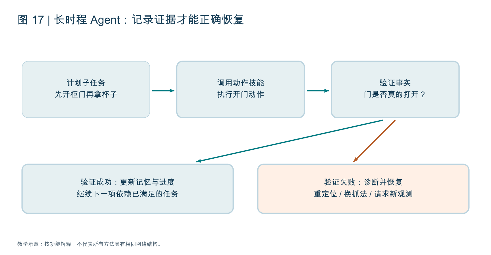

LLM（Large Language Model，大语言模型）可提出子任务或调用工具，动作策略执行，验证器根据环境证据确认结果。Harness（运行支撑框架）组织上下文、记忆、工具接口、进度和异常处理。

如果控制接口返回“动作已发送”，只能证明发送成功，不能证明柜门打开。验证应检查环境事实，失败后选择重定位、换策略或重新观察。无限重试可能增加表面成功率却牺牲时间和可靠性，协议应报告重试与干预。

Slow / Fast System（慢 / 快系统）按职责与频率分工：慢系统组织语义和子目标，快策略与控制器跟踪运动。它可以是一个模型不同模块，也可以是多个模型；“双系统”不必然意味着固定两个网络。

### 13.4 五篇学长推荐论文放回算法主线

P1 Agentic Robots 帮你把策略放回 Model、Data、Environment、Harness 系统；P3 长时程综述讨论依赖、记忆、验证和持续执行；P4 世界模型综述讨论未来预测的表示、时间建模与用途。

P5 Path to RSI 与 P2 Last AI 讨论 RSI（Recursive Self-Improvement，递归自我改进）。策略更新、世界模型更新、改进机制更新是不同层。只把失败加进训练不自动构成递归改进；还要看负责寻找、选择或验证改进的机制是否被修改、继承并在后续更有效。

因此偏算法的第一遍建议先 ACT / DP、VLA、世界模型，再读长任务与系统，最后读两篇 RSI。保留广度，但不要在还不清楚动作和训练目标时直接钻进递归框架。

读懂检查：如果记忆方法更好，如何证明收益来自记忆而非更多图像和算力？设计相同预算、相同历史信息的对照，并用确实依赖历史的任务评测。

## 14. 几何、视觉与图形：偏算法也需要的最低接口知识

### 14.1 从像素到机器人坐标

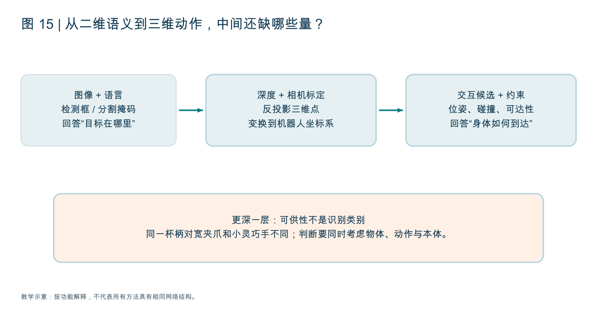

检测框说目标在哪片图像，分割掩码区分目标像素，深度提供距离，相机内参连接像素与射线，外参连接坐标系。一个简化针孔相机反投影为 `X=(u-cx)Z/fx`、`Y=(v-cy)Z/fy`；这里 Z、焦距和主点定义需与相机约定一致。

变换到机械臂基座需要旋转和平移，示意为 `p_base = R p_camera + t`。相机内参、机器人时刻和外参一旦错配，模型输出可以很稳定却持续抓偏。深度是相对尺度时还不能直接当作米。

FK（Forward Kinematics，正运动学）由关节求末端位姿；IK（Inverse Kinematics，逆运动学）由末端目标求关节。IK 有解不保证整条轨迹无碰撞。Pose（位姿）包含位置与朝向，DoF（Degrees of Freedom，自由度）描述独立变量数量。

### 14.2 点云处理、配准和表示稳定性

点云太密会增加开销，也含噪声与背景。体素下采样把空间划格并选代表点；FPS（Farthest Point Sampling，最远点采样）逐步选择距离已有集合较远的点，帮助覆盖空间。这里 FPS 不代表视频 Frames Per Second（每秒帧数）。

ICP（Iterative Closest Point，迭代最近点）通过匹配与变换对齐点云，依赖初值与有效对应。几何数据增强应同步处理坐标、动作和本体状态，不能把对象旋转了却保持标签不变。

几何对应需要局部细节，语言检索需要语义关联，动作策略需要任务相关表示。同一个视觉编码器对这三种目标不必同样合适。

### 14.3 Affordance、2D / 3D / 4D 分别是什么

Affordance（可供性）描述在某个本体与动作条件下可能的交互。杯柄是一个可抓区域，但宽夹爪可能进不去；门把手可抓，不代表往任意方向拉都能开门。可供性可以输出热图、交互点、方向或动作参数。

2D（Two-Dimensional）视觉处理图像；3D（Three-Dimensional）视觉处理空间；4D（Four-Dimensional）通常指三维加时间的变化建模。它不是“维数更高就更智能”，而是是否保留任务需要的空间与时间结构。

Grounding（落地关联）把文字或抽象表示对应到环境对象、区域和动作。SAM（Segment Anything Model）系列做提示分割，Grounding DINO 以文本找对象；组合能提供可检查中间输出，但仍需动作规划与控制。

### 14.4 重建、渲染、动态预测不能互相替代

NeRF（Neural Radiance Fields，神经辐射场）学习场景的密度与视角相关外观，支持新视角渲染；3DGS（3D Gaussian Splatting，三维高斯泼溅）用三维高斯表示场景并快速渲染。漂亮渲染不自动提供质量、摩擦、碰撞体或物体未来动作。

Real2Sim（Real-to-Simulation，现实到仿真）可用重建形成场景资产，但通常还需物理属性、关节和碰撞表示。Sim2Real（Simulation-to-Reality，仿真到现实）考虑视觉、动力学、延迟与噪声差异。Differentiable Rendering（可微渲染）可以将图像误差传回场景参数，不等于所有接触物理都容易求导。

读懂检查：看到论文加了 3D 表示，应问它改进了几何精度、跨视角泛化、动作条件还是数据生成？这些是不同贡献。

## 15. 导航、全身控制与其他分支：广度怎样保留

### 15.1 导航的任务、系统结构与训练设置是不同轴

ObjectNav（Object-Goal Navigation）寻找物体类别；ImageNav（Image-Goal Navigation）去到目标图像位置；VLN（Vision-and-Language Navigation）按语言导航；PointNav（Point-Goal Navigation）到指定点。这些目标形式决定感知与探索的难点。

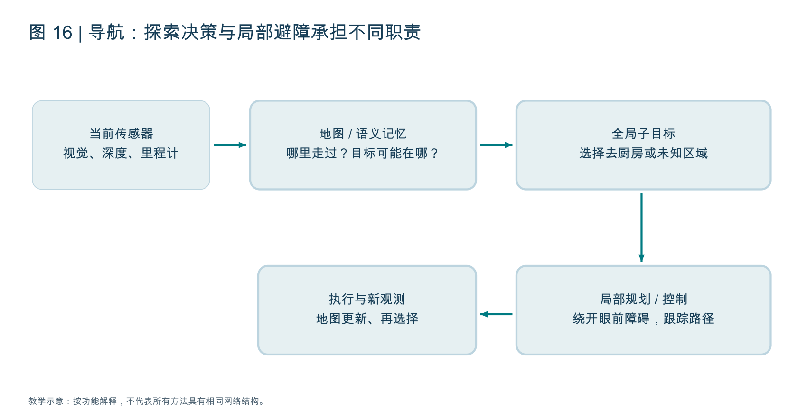

模块化系统可包含地图、探索 / 全局子目标、局部规划和控制；端到端系统可直接从观测与目标生成动作。Zero-Shot（零样本）是训练 / 迁移设置，不能严格与“模块化”“端到端”作为互斥结构分类：一个模块化或端到端模型都可能在特定目标上零样本测试。

地图告诉机器人哪里走过、哪些位置可通行；探索决策告诉它优先去哪里找冰箱；局部避障让它不撞眼前椅子。语义常识认为冰箱可能在厨房，不代表厨房可达，也不能替代实时碰撞检查。

导航可研究视觉定位、地图表示、记忆、探索、目标落地与动作生成，不是只有路径搜索。SLAM（Simultaneous Localization and Mapping，同时定位与建图）同时估计位置和地图，并不限于已经有地图的场景。仓库中的简化对比需要以这些实际边界理解。

### 15.2 运动学习与全身控制

WBC（Whole-Body Control，全身控制）协调躯干、腿、手臂等部位满足运动与约束；PID（Proportional-Integral-Derivative，比例积分微分控制）跟踪误差；学习策略可能给关节目标，低层控制执行。稳定性、接触、平衡、控制延迟尤其重要。

仿真训练常使用机器人状态、速度目标和奖励；部署还涉及状态估计、动作限幅与摩擦、质量、执行器差异。模仿运动与动作重定向 Retargeting 将一种身体的运动映射到另一种，但需要解决形态与动力学不一致。

若你更偏视觉与深度学习，可以先从操作策略、VLA、潜空间世界模型进入；若喜欢优化和动力学，可以考虑基于模型 RL、控制与规划。两条路线都要识别动作与评测接口，但不要求一开始成为完整控制工程师。

### 15.3 无人机、驾驶和医疗有何不同

UAV（Unmanned Aerial Vehicle，无人机）强调高速闭环、飞行稳定与探索；自动驾驶强调动态参与者、轨迹预测和场景泛化；医疗操作可能涉及柔性组织、接触感知、专家示范和严格任务条件。相同“策略 / 世界模型”框架可以迁移，但动作频率、观测、风险和验证证据不同。

本章保留这些分支的机制地图，具体方法清单与行业案例请回仓库算法篇第 (10) 节。这里没有逐篇深读所有应用论文；覆盖位置与深度在 11 覆盖核对文档中明确列出。

读懂检查：你能否用“任务目标、观测、动作、监督、部署约束、评测”六项描述一个新分支，而不先背模型名单？

## 16. 代码与实验：从理解跨到可验证的小问题

### 16.1 第一个实验建议只检验一件事

如果尚未决定方向，先选择一个任务、小量公开演示和 ACT / Diffusion Policy 基线。目标是让一条数据经过加载、归一化、预测、反归一化、执行与评测；不是先跑一个最大模型。

不必现在安装全部环境。纯理解阶段可以先画样本窗口、手算一个动作误差、查看参考代码 forward 的输入输出和训练 / 推理分支。实际配置依仓库版本与设备支持，不承诺某个固定显存能跑所有设置。

### 16.2 阅读代码时的顺序

先找 Dataset / DataLoader（数据集与加载器），检查字段与单位；再看 Model.forward（前向函数），追张量形状；然后看 loss（损失）和哪些参数更新；接着看 inference / sample（推理 / 采样）；最后看环境执行与 evaluator（评测器）。

在 ACT 原始代码中，policy.py 组织 L1 与 KL 损失，detr/models/detr_vae.py 展示后验潜变量与动作解码；部署调用再决定如何取动作和集成。理解这条链比逐行阅读所有工具函数更直接。

同理，扩散项目先追条件编码、噪声构造、训练目标、采样器与执行切片；世界模型先追真实后验状态、想象先验展开、奖励 / 价值信号和环境验证。代码里名字相似的变量不一定同义。

### 16.3 实验矩阵与消融

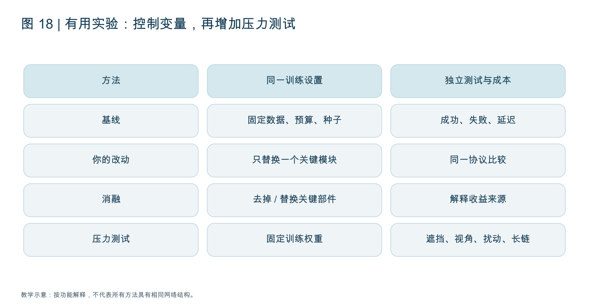

Ablation（消融）去掉或替换关键模块，检查收益来源；Baseline（基线）提供参照；压力测试在固定权重下变化遮挡、视角、对象、扰动与长期依赖。训练数据、观测权限、重试预算、控制频率和计算预算应尽量对齐。

除了 SR（Success Rate，成功率），报告失败类型、试验数、多个随机种子、均值与波动、推理延迟、训练成本和人类干预。几个百分点变化在少量试验下可能只是噪声。

### 16.4 三个算法方向的小问题卡片

| 候选方向 | 可验证的问题 | 必要对照与边界 |
|---|---|---|
| 动作分块与反馈 | H 固定时，改变执行间隔 K 是否改善受扰动任务？ | 固定模型与测试扰动；同时报告延迟与动作平滑 |
| 特征世界模型 | 相同编码器下，多步动态训练是否改善动作选择？ | 不用模型、一步模型、多步模型；对齐搜索预算 |
| 历史 / 记忆 | 相同输入信息与预算下，压缩记忆是否提升遮挡后恢复？ | 确实依赖历史的任务；与简单窗口、随机记忆比较 |

这些是学习实验，不承诺天然构成论文贡献。形成研究需要查已有工作、定位缺口、重复验证和解释条件。小但可独立验证的问题，通常比同时换编码器、数据、动作头和规划器更容易判断。

读懂检查：你能否写出一个“只改变一个核心因素”的实验，并明确什么结果会否定你的假设？

## 17. 前沿进展怎样读：用问题线索代替追模型名字

### 17.1 四条值得优先跟踪的算法线索

动作生成：回归、离散 token、扩散、流匹配如何平衡多模态与延迟？后训练：演示、自主交互、纠正与奖励如何提高覆盖和可靠性？预测与记忆：未来模型、历史状态怎样进入训练或部署？可信评测：如何区分任务拟合、数据重叠与真实泛化？

仓库 2026 工作清单提供发现论文的入口。这里按机制讲解，没有将每条仓库描述都当作已独立复核的实验结论，也没有把商业发布等同于公开可复现算法。数据引擎与评测重要，不意味着网络架构已经没有研究价值。

### 17.2 偏算法的推荐阅读顺序

第一轮：本章 1 至 7，配合仓库 Robot Learning 与经典 ACT / Diffusion Policy，建立数据与动作生成基础。第二轮：本章 8 至 12，配合 S2 VLA 与 P4 世界模型综述，从动作表示与动态用途比较方法。第三轮：本章 13 至 16，配合 P1 / P3，把算法放回记忆、验证、执行与评测。最后读 P5 / P2，分清持久更新和递归改进。

如果更喜欢算法理论，优先补概率分布、变分推断、策略梯度和模型预测控制；如果更喜欢深度学习实现，优先追动作窗口、条件融合、生成器与评测入口。广度阶段能描述各方向问题就够了，深度阶段只选一条主线精读代表方法与代码。

### 17.3 数学预备知识：学到能解释用途

期望：对随机样本平均；条件概率：已知观测后动作分布；负对数似然：让真实样本更可能；KL：比较分布并约束偏离；梯度：参数小变化对目标的影响；数值积分：沿速度场一步步更新；Bellman：把长期价值拆成当前与未来。

这些概念应与本文实例对应。不会推完整推导并不妨碍先理解系统，但想研究方法改进时，需要回到原论文的精确定义和推导条件。

## 18. 常见疑问与答案：读完后应能自己解释

问题一：ACT 与 Diffusion Policy 都输出动作块，为什么还算不同方法？因为动作块只是输出组织；ACT 使用条件解码与潜变量训练，扩散使用带噪动作监督和迭代生成。共同输出形状不代表共同概率模型。

问题二：流匹配速度就是机器人关节速度吗？不是，它是生成空间里动作块随 τ 变化的向量场；最终动作块才按其定义进入实际控制接口。

问题三：世界模型与策略能用同一个 Transformer 吗？可以共享或联合建模，但仍要分别说明预测对象、动作选择与训练信号。功能合并不意味着无需区分作用。

问题四：语言模型说“门已开”能当奖励或任务完成吗？只有经过适当环境证据验证才可靠。模型陈述、控制指令发送与真实完成不是同一件事。

问题五：特征预测不用像素，就一定省算力又更好？可能省部分生成成本，但编码、预测长度与特征数量仍占资源，且可能漏掉关键物理量；最终要测任务收益。

问题六：预训练 VLA 微调少量样本后表现好，是不是证明我的架构好？还可能来自预训练数据、任务相似性或执行协议。应与相同基座、相同数据预算的基线比较。

问题七：加长动作块和加长记忆是一回事吗？前者预测未来，后者使用过去；一个机器人可以预测很长却不记得几分钟前放下的物体。

问题八：模拟成功能代表真机成功吗？只能支持相应模拟条件下的结果。视觉、接触、延迟、标定和重置差异需要进一步验证；当前没有真机也可以做清楚的仿真研究。

问题九：两篇 RSI 的等级编号能直接对照吗？不能，它们的分类依据不同。先写论文名、定义和具体机制，再讨论递归层次。

问题十：我什么时候该开始读代码？当你能讲清任务、条件、动作、损失和推理流程时，就从一条样本的路径开始；不必等背完整个领域，也不必一次啃完仓库。

## 19. 来源、覆盖深度与本章边界

仓库来源为 [Embodied-AI-Guide 算法篇](https://github.com/TianxingChen/Embodied-AI-Guide/blob/3e3abf3e687737c84113f0fe8a78587582c54eb6/topics/algorithm.md) 与控制 / 基础设施篇。2026-10-23 重新读取公开分支的五份 Markdown，内容与此前快照一致；本章图解成稿于 2026-10-24。具体覆盖见 11 仓库覆盖核对与算法阅读地图。

ACT、Diffusion Policy、OpenVLA、openpi、DreamerV3、DINO-WM 的官方代码 / 项目说明用于核对机制；涉及算法的公式为便于理解的简化表达，不替代完整论文推导。18 张图为原创教学图，并非论文原图或实验结果。

本章深入解释数据、表征、BC、ACT、扩散、流匹配、VLA、RL、世界模型与规划；几何、导航、控制与应用分支提供机制和接口层说明；没有复制仓库的全部链接清单，也没有逐篇复核其所有前沿与行业条目。文档是否足够，应由是否能解释这些机制和接口判断，不能只按页数判断。
