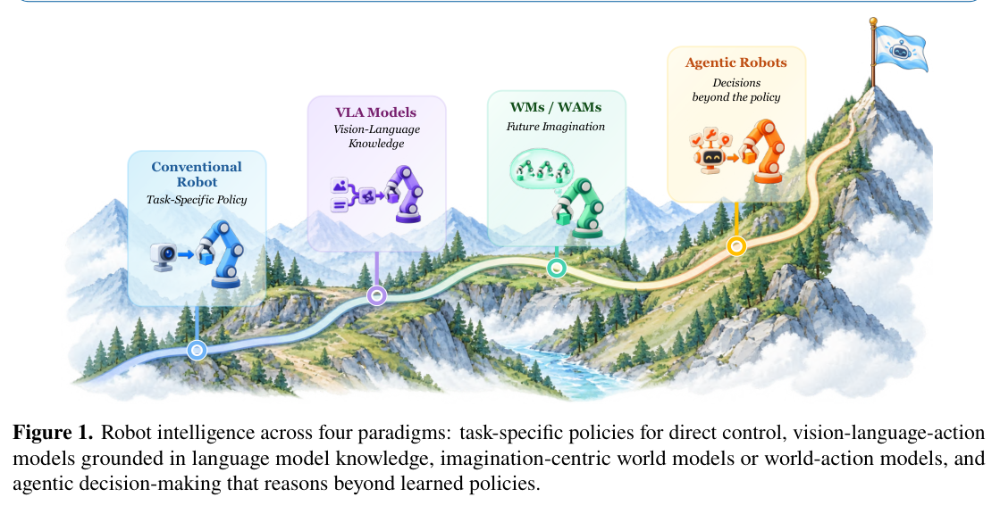
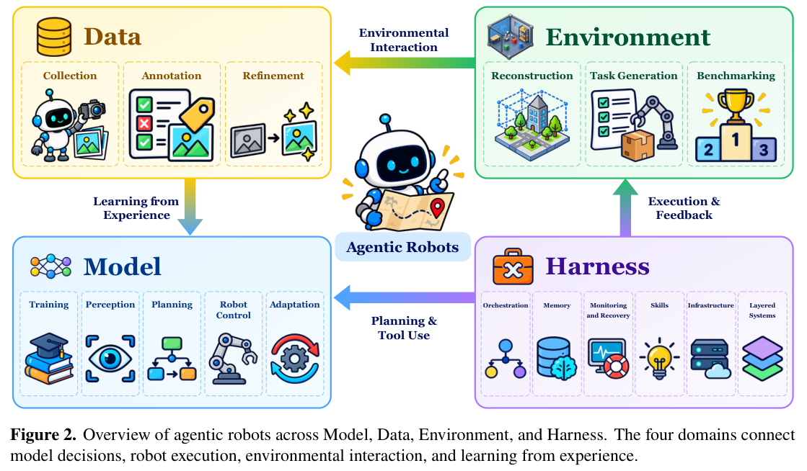
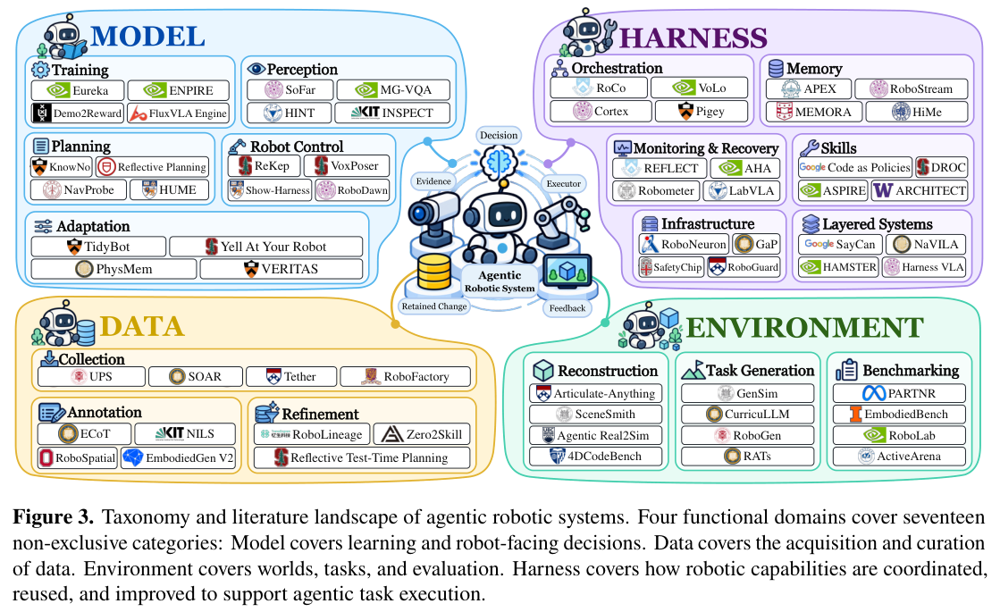
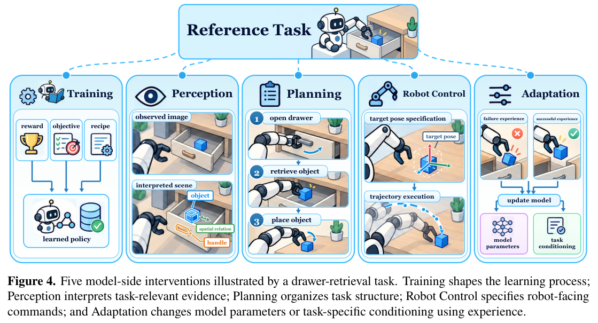
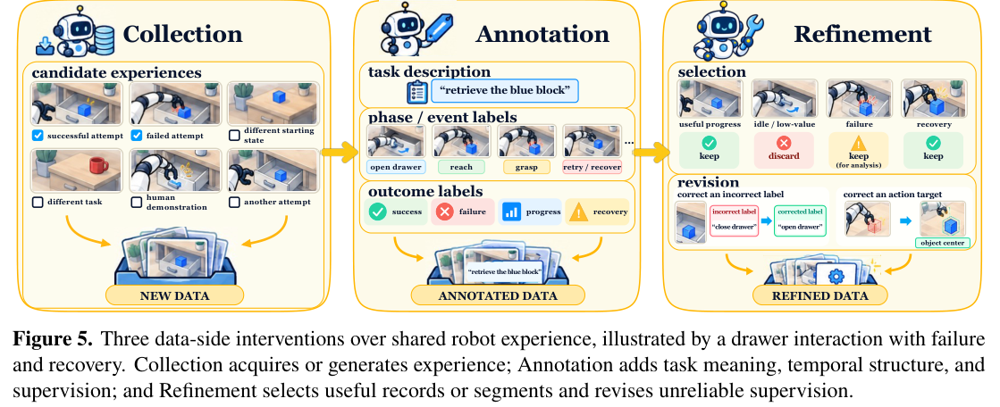
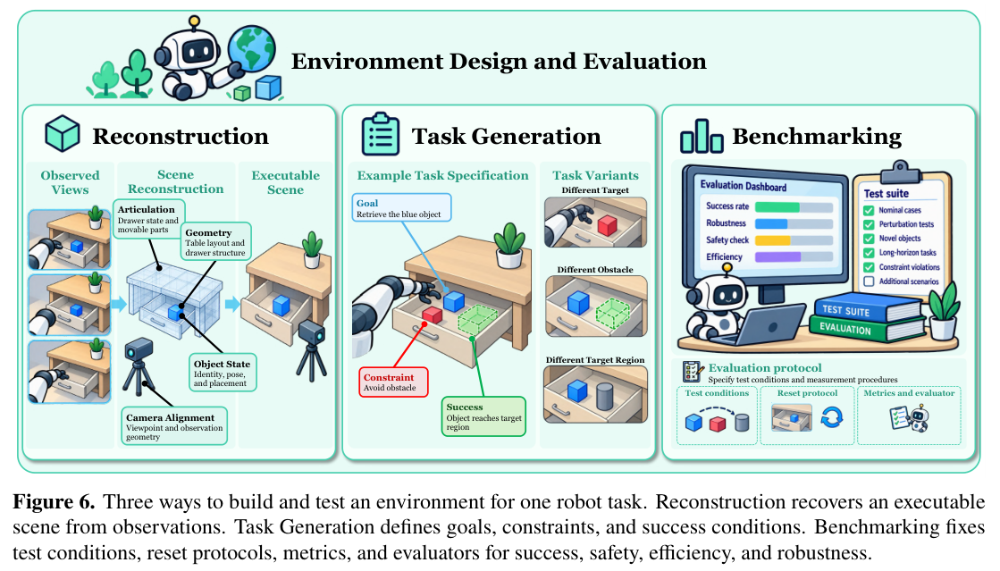
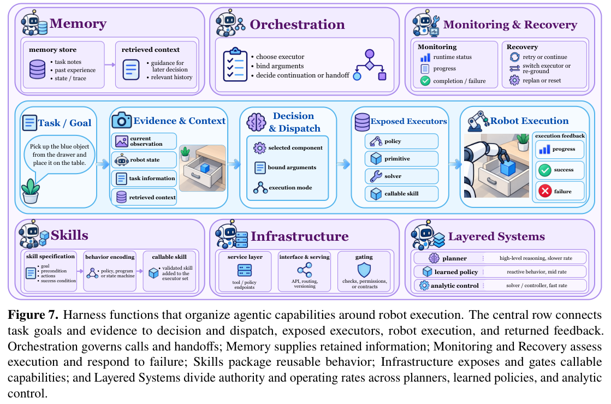

# Towards Agentic Robots：逐段中文解析与引用导航

更新于 2026-11-06。对应随包原文 arXiv:2610.20442v1，2026-10-14，79 页；物理页 1–48 为正文，49–79 为参考文献。本版按该固定 PDF 解析，不声称核验了每篇引用的最新版。

## 使用方式

先读逐段解析：每段有中文原意、机制提示和自测。遇到工作名，打开同编号工作卡；同一工作在多个段落重复引用时合并一张卡，列出不同出现位置。不要按编号从头读完工作辞典。

全部 469 条参考文献均有查询卡；其中表2–18有307个不同条目，合并重复后保留386次表格出现。其余条目包含背景方法、模型、软件与综述，按实际角色区分。关键代表方法有进一步的人工编写机制说明，其余以本综述证据和接口解释为主。

每卡包含“是什么、核心功能、核心实现、与其他工作的对比、教学伪代码、注意事项”。当综述只给名称或并列引用时，会明确说实现信息不足；通用接口骨架不是该方法的官方实现。

中文原意段落以已有机器译稿为底稿，进行了结构恢复、术语和典型误译修正；新增机制提示、比较问题、工作卡和自测由导读编写。它不是未经标记的纯翻译，也不宣称逐句学术审校已完成。

原始七幅总图恢复为完整截图，配中文读图；所有原表保留原页图片核对，原文79页一并保留在解析PDF末尾，以保证图标、公式与复杂表格可查。正文不展示失效替换字符，图标类字段标为“见原表”，不将丢失图标猜成是/否。

数字与模型能力均是该综述的转述。预印本、游戏、仿真、离线视频或理想真值实验不等于真机部署；工作卡中的比较通常比较设计轴，不是公平性能排名。

### 原文第 1 页 · 段落 p01-002

中文原意：基础模型（Foundation Model） 正在推动机器人智能的范式转变，超越低层动作预测，转向目标导向的数据收集、模型训练、任务规划和实际执行的编排。我们将这种新兴范例描述为 智能体式机器人（Agentic Robots），其中智能体对人类指令进行推理，与机器人环境交互，自主纠正执行错误，并动态调整操作策略。尽管这一领域发展很快，但目前的研究还没有很好的联系。对于如何将不同的智能体功能组合成一个完整的机器人系统，研究人员没有一致的看法。

解析：把本段看作研究地图的说明：作者希望追踪智能体做了什么决定、改变了什么对象、怎样获得反馈。四域是功能分类；同一系统可以同时出现在数据、训练和技能条目中。

贯穿例子是开抽屉取杯子：训练决定动作能力，数据提供经验，环境提供世界与判据，Harness组织步骤与失败恢复。后续工作卡都可放回这条链上理解。

自问：本段是在定义概念、解释接口还是汇报实验？证据支持到哪一层？

### 原文第 1 页 · 段落 p01-003

中文原意：本文对 智能体式机器人（Agentic Robots） 的现有研究进行了统一概述。我们首先追踪从机器人策略到智能体系统的发展，涵盖视觉语言动作（Vision-Language-Action）模型、世界模型（World Models）和世界动作模型（World-Action Models）。然后，我们阐明了 智能体式机器人（Agentic Robots） 的定义和范围，并将现有研究组织为跨四个功能域的 17 个类别：模型、数据、环境和 运行支撑框架（Harness）。在这些领域中，我们研究智能体如何塑造模型学习和机器人决策，收集和管理机器人数据，构建用于学习和评估的世界、任务和测试，以及组织机器人使用的能力。最后，我们讨论了开放的挑战并概述了未来研究的方向。展望未来，我们希望这项工作有助于更清楚地了解 智能体式机器人（Agentic Robots），并支持新的方法，使它们更加强大、可靠和适应性更强。

解析：把本段看作研究地图的说明：作者希望追踪智能体做了什么决定、改变了什么对象、怎样获得反馈。四域是功能分类；同一系统可以同时出现在数据、训练和技能条目中。

贯穿例子是开抽屉取杯子：训练决定动作能力，数据提供经验，环境提供世界与判据，Harness组织步骤与失败恢复。后续工作卡都可放回这条链上理解。

自问：本段是在定义概念、解释接口还是汇报实验？证据支持到哪一层？

### 图 1：四种相互重叠的机器人智能范式

中文读图：从任务策略，到利用视觉语言知识的VLA，再到预测未来的WM/WAM，最后到组织能力与反馈的Agentic系统。箭头是发展线索，不是四种互斥架构。

### 图 2：四个功能域的闭环

中文读图：Model决定怎样学习和行动，Data形成经验，Environment提供世界与测试，Harness组织执行与反馈；同一失败可能跨多个域。

### 原文第 3 页 · 段落 p03-004

中文原意：在过去的几年里，包括大语言模型（LLM）和多模态大语言模型（MLLM）在内的基础模型（Foundation Model）极大地推进了机器人策略学习。它们通过扩展机器人数据集和模型大小，赋予机器人传统特定任务模型所缺乏的新功能，特别是在场景和任务理解和跨场景泛化方面[20, 256]。作为该领域的主导技术解决方案，视觉语言动作（Vision-Language-Action）（VLA）模型利用离散动作标记或基于扩散或流匹配的连续动作预测策略来连接机器人动作预测和预训练LLM中嵌入的语义知识[13,19,269]。然而，仅改进动作预测并不能保证 长时程（Long-Horizon） 任务的可靠执行。这些任务要求机器人跟踪任务进度、根据环境变化调整计划并从故障中恢复。 VLA 策略本身无法始终如一地提供这些功能。

解析：动作预测解决“眼下怎样动”，长时程执行还需要“接下来做哪一步、上一动作是否成功、失败后怎样继续”。例如杯子没抓住时，即使策略能生成合理轨迹，系统仍要发现抓空并决定重看还是重抓。

VLA提供动作能力，Agentic系统组织这些能力。两者可以在一个模型内实现，也可以分成多个模块；不能用是否调用大语言模型这一点来判断系统已经具备可靠恢复。

自问：本段是在定义概念、解释接口还是汇报实验？证据支持到哪一层？

本段引用：[π0 [13]](引用工作卡.md#工作-013)；[RT-2 [19]](引用工作卡.md#工作-019)；[RT-1 [20]](引用工作卡.md#工作-020)；[Octo [256]](引用工作卡.md#工作-256)；[π0.5 [269]](引用工作卡.md#工作-269)

### 原文第 3 页 · 段落 p03-005

中文原意：为什么智能体式机器人（Agentic Robots）很重要？最近，智能体式机器人（Agentic Robots）在研究界引起了极大的关注，它代表了将基础模型（Foundation Model）推理与具身智能体和环境交互能力相结合的新一代具身智能系统。 GPT-6 Astra [258] 和 Gemini 4 Argon [87] 等 通用（General-Purpose） 模型为此类系统开辟了新的可能性。例如，GPT-6 Astra 展示了作为机器人操纵智能体的有前途的功能，使用视觉观察来生成末端执行器命令并根据执行反馈调整其动作无需针对特定任务的微调[439]。在 RoboDojo 上，它在 42 个模拟任务中实现了 22.48% 的平均成功率，优于经过训练的机器人策略 DM0.5 (19.34%) [59]、GalaxeaVLA G0.5 (14.88%) [76]、Xiaomi-Robotics-1 (13.93%) [384]、OpenWAM-𝛼 (11.92%) [363]和π 0 . 5 (6.91%) [269]。尽管取得了这些进展，推理延迟和资源成本凸显了 基础模型（Foundation Model） 如何集成到机器人系统中的重要性。除了优化和缩放模型参数之外，智能体式机器人（Agentic Robots） 还使用 基础模型（Foundation Model） 来规划操作、监控任务进度并根据执行反馈修改决策。因此，它们的能力取决于模型和环境中可用的工具、观察结果和反馈。智能体机器人范例解决了先前机器人解决方案的“缸中之脑”限制，将机器人智能从静态模式匹配转向自适应自主操作。

解析：这段数字用于说明通用模型参与机器人执行的可能性。机器人系统的分数还受到工具、执行器、可见信息和预算影响；同一模拟任务集上的转述结果，不能推出它在真实机器人或所有任务上更强。

把案例画成“相机观察 → 模型决策 → 机器人命令 → 执行反馈 → 再决策”。理解这里的变化是模型开始组织闭环，再查各引用卡确认具体执行接口。

自问：本段是在定义概念、解释接口还是汇报实验？证据支持到哪一层？

本段引用：[OpenDM / DM0.5 [59]](引用工作卡.md#工作-059)；[Galaxea G0.5 [76]](引用工作卡.md#工作-076)；[Gemini 4 Argon [87]](引用工作卡.md#工作-087)；[GPT-6 Astra [258]](引用工作卡.md#工作-258)；[π0.5 [269]](引用工作卡.md#工作-269)；[OpenWAM [363]](引用工作卡.md#工作-363)；[Xiaomi-Robotics-1 [384]](引用工作卡.md#工作-384)；[GPT-6 Astra Robot Evaluation [439]](引用工作卡.md#工作-439)

### 原文第 3 页 · 段落 p03-006

中文原意：智能体式机器人（Agentic Robots） 需要分类。 尽管人们的兴趣日益浓厚，但对 智能体式机器人（Agentic Robots） 的研究仍然分散在模型学习、数据采集、环境构建和运行时系统设计方面。

解析：把本段看作研究地图的说明：作者希望追踪智能体做了什么决定、改变了什么对象、怎样获得反馈。四域是功能分类；同一系统可以同时出现在数据、训练和技能条目中。

贯穿例子是开抽屉取杯子：训练决定动作能力，数据提供经验，环境提供世界与判据，Harness组织步骤与失败恢复。后续工作卡都可放回这条链上理解。

自问：本段是在定义概念、解释接口还是汇报实验？证据支持到哪一层？

### 原文第 4 页 · 段落 p04-007

中文原意：这些方向通常是单独研究的，尽管它们的贡献在机器人系统内相互作用。诸如体现智能体、自主机器人和自我改进（Self-Improving）机器人系统等相关术语强调不同的功能，而没有一致地澄清其边界，从而进一步模糊了该领域的范围。总之，这些问题使得很难确定智能体在哪里做出决策以及这些决策如何对整个系统做出贡献。因此，统一的分类法应该区分各个组件的角色，同时解释它们如何协同工作。为此，我们将 智能体式机器人学（Agentic Robotics） 组织为四个功能域：模型、数据、环境和 运行支撑框架（Harness），跟踪每个域内智能体的决策及其在整个系统中的影响。图 2 显示了这四个领域如何在智能体机器人系统中协同工作。 关键问题

解析：把本段看作研究地图的说明：作者希望追踪智能体做了什么决定、改变了什么对象、怎样获得反馈。四域是功能分类；同一系统可以同时出现在数据、训练和技能条目中。

贯穿例子是开抽屉取杯子：训练决定动作能力，数据提供经验，环境提供世界与判据，Harness组织步骤与失败恢复。后续工作卡都可放回这条链上理解。

自问：本段是在定义概念、解释接口还是汇报实验？证据支持到哪一层？

### 原文第 4 页 · 段落 p04-008

中文原意：- 1 模型：智能体应该学习、理解、决定和控制什么？

解析：Model（模型）关注决策与学习机制。例如开抽屉失败，可以改奖励、重新辨认把手、改变动作顺序或更新策略；这些修复作用于不同对象。

自问：本段是在定义概念、解释接口还是汇报实验？证据支持到哪一层？

### 原文第 4 页 · 段落 p04-009

中文原意：- 2 数据：智能体应该如何收集、标注和提炼机器人数据？

解析：Data（数据）关注经验怎样变成可学的材料。例如一次失败抓取是采集记录；标出“抓空”是标注；删掉错位帧或保留恢复片段是数据改进。三者的输出不同。

自问：本段是在定义概念、解释接口还是汇报实验？证据支持到哪一层？

### 原文第 4 页 · 段落 p04-010

中文原意：- 3 环境：智能体应该构建哪些世界、任务和测试？

解析：Environment（环境）关注世界、任务与测试。例如生成可开合的抽屉是构造世界；规定取蓝块是构造任务；定义物体确实到桌面才算成功是构造评测。

自问：本段是在定义概念、解释接口还是汇报实验？证据支持到哪一层？

### 原文第 4 页 · 段落 p04-011

中文原意：- 4 运行支撑框架（Harness）：机器人能力应该如何编排、恢复和发展？

解析：Harness（运行支撑框架）把能力接成可执行闭环。例如维护“门已开”的进度，调用抓取技能，检查杯子是否随夹爪移动，失败后重看并重试。它影响执行组织，未必训练新的动作模型。

自问：本段是在定义概念、解释接口还是汇报实验？证据支持到哪一层？

### 原文第 4 页 · 段落 p04-012

中文原意：上述四个问题引导我们讨论智能体如何为机器人系统做出贡献。第 4 节研究智能体如何支持模型学习和机器人决策，第 5 节解释它们如何收集、标注和提炼机器人数据。第 6 节考虑了智能体为学习和评估而构建的世界、任务和测试。第 7 节研究智能体如何协调可执行功能、监视执行、从故障中恢复以及为后续任务保留有用的知识。

解析：把本段看作研究地图的说明：作者希望追踪智能体做了什么决定、改变了什么对象、怎样获得反馈。四域是功能分类；同一系统可以同时出现在数据、训练和技能条目中。

贯穿例子是开抽屉取杯子：训练决定动作能力，数据提供经验，环境提供世界与判据，Harness组织步骤与失败恢复。后续工作卡都可放回这条链上理解。

自问：本段是在定义概念、解释接口还是汇报实验？证据支持到哪一层？

### 原文第 4 页 · 段落 p04-013

中文原意：- 智能体式机器人学（Agentic Robotics） 的统一插图。我们追踪从机器人策略到智能体系统的演变，并阐明智能体在机器人任务执行和能力开发中的作用。我们引入了涵盖模型、数据、环境和 运行支撑框架（Harness） 的分类法，将这些研究方向纳入一个通用框架中。

解析：把本段看作研究地图的说明：作者希望追踪智能体做了什么决定、改变了什么对象、怎样获得反馈。四域是功能分类；同一系统可以同时出现在数据、训练和技能条目中。

贯穿例子是开抽屉取杯子：训练决定动作能力，数据提供经验，环境提供世界与判据，Harness组织步骤与失败恢复。后续工作卡都可放回这条链上理解。

自问：本段是在定义概念、解释接口还是汇报实验？证据支持到哪一层？

### 原文第 4 页 · 段落 p04-014

中文原意：- 智能体方法的系统分析。我们综合了智能体获取、协调和提高机器人能力的机制。通过比较整个分类法中的代表性方法，我们解释了智能体决策如何依赖于可用工具、机器人执行器和交互反馈，并检查这些方法的优点和局限性。

解析：把本段看作研究地图的说明：作者希望追踪智能体做了什么决定、改变了什么对象、怎样获得反馈。四域是功能分类；同一系统可以同时出现在数据、训练和技能条目中。

贯穿例子是开抽屉取杯子：训练决定动作能力，数据提供经验，环境提供世界与判据，Harness组织步骤与失败恢复。后续工作卡都可放回这条链上理解。

自问：本段是在定义概念、解释接口还是汇报实验？证据支持到哪一层？

### 原文第 4 页 · 段落 p04-015

中文原意：- 实用 智能体式机器人（Agentic Robots） 的研究议程。根据这一分析，我们概述了确定智能体贡献并将当前进展转化为可靠、高效的机器人操作的研究方向。该议程将公平评估与跨机器人平台的物理部署和泛化的挑战联系起来。

解析：把本段看作研究地图的说明：作者希望追踪智能体做了什么决定、改变了什么对象、怎样获得反馈。四域是功能分类；同一系统可以同时出现在数据、训练和技能条目中。

贯穿例子是开抽屉取杯子：训练决定动作能力，数据提供经验，环境提供世界与判据，Harness组织步骤与失败恢复。后续工作卡都可放回这条链上理解。

自问：本段是在定义概念、解释接口还是汇报实验？证据支持到哪一层？

## 2 机器人学习的演变

### 原文第 4、5 页 · 段落 p04-016

中文原意：机器人学习跨越四个相互关联的阶段：学习可执行行为、整合多模态知识、预测身体结果以及协调执行和改进。 (1)传统机器人策略：学习可执行行为。强化和 模仿学习（Imitation Learning） 将观察结果映射到行动，而通才策略则跨任务和实施例共享经验。他们的能力很大程度上取决于机器人在训练期间的经验。 (2) 视觉语言动作（Vision-Language-Action） 模型：将知识与行动联系起来。 VLA 将预训练的 基础模型（Foundation Model） 的视觉和语言知识纳入控制，将场景、指令和语义关系的解释与动作生成联系起来。 (3) 世界模型（World Models） 和 世界动作模型（World-Action Models）：预期身体结果。这些模型使用未来状态、观察及其与行动的关系的表示，将行动选择和生成与环境变化的预测联系起来。 (4)智能体式机器人（Agentic Robots）：组织执行和改进。智能体系统将模型介导的决策扩展到选择和协调能力、获取经验以及使用反馈来指导后续执行和能力改进。这些阶段描述了可以在一个系统中共存的重叠研究传统和互补能力。

解析：这部分串起能力的发展：动作策略提供行为，VLA加入语义，世界模型加入未来动态，Agentic系统组织目标与反馈。它们可以组合使用，区别在于各模块的输入、产物和实际决策角色。

自问：各能力在同一系统里可以怎样组合？

## 2.1 传统机器人策略

本节先抓住：这里至少有三条独立设计轴：观测表示是图像还是几何；学习目标是模仿还是强化学习；动作头是回归、分块还是生成式。不要把“使用点云”与“使用扩散”当成互斥方法。

贯穿例子：同样预测末端位姿，PerAct选择体素位置，RVT汇合多个虚拟视角，DP3用点云特征条件化动作扩散。

### 原文第 5 页 · 段落 p05-018

中文原意：传统的机器人策略从演示或基于奖励的经验中学习。我们通过场景表示对视觉策略进行分组：基于图像的策略使用图像特征，而 3D 感知策略则引入用于动作预测的几何结构。这种区别涉及场景表示，而不是动作维度。

解析：先分清观察表示与动作分布。视觉编码器/点云改变模型看见什么；ACT或扩散策略改变动作怎样生成。一个模型完全可以同时使用点云输入与扩散动作头，两条轴不互斥。

预测动作块只是生成未来一段动作，实际可以执行前段后重新观察。物体被移动时，长块若不刷新会继续使用旧证据；长度、执行步数与重规划频率要一起理解。

自问：我能分开说明观测表示、动作生成方式和动作块执行策略吗？

### 原文第 5 页 · 段落 p05-019

中文原意：基于图像的策略。早期的策略从相机图像中学习动作。引导策略搜索[168]将图像和机器人状态映射到电机扭矩，而QT-Opt[143]学习用于抓取的图像条件动作值函数。 RoboMimic [238] 通过离线演示研究视觉 行为克隆（Behavior Cloning）。视觉预训练提供可重用的策略功能：R3M [244] 在下游 模仿学习（Imitation Learning） 的人类视频上预训练图像编码器。除了视觉编码之外，ACT [449] 和 扩散策略（Diffusion Policy） [55] 分别使用条件变分自编码器和条件扩散对动作序列进行建模。任务条件化将这些策略扩展到多种行为：BC-Z [128] 和 RT-1 [20] 使用任务描述，而 VIMA [138] 将多模式提示与以对象为中心的图像标记相结合。跨机器人数据集拓宽了训练范围：RT-1-X [260] 利用来自 Open X-Embodiment 的跨机器人数据，而 Octo [256] 将异构图像观察与Transformer（变换器）和扩散动作头结合起来。

解析：先分清观察表示与动作分布。视觉编码器/点云改变模型看见什么；ACT或扩散策略改变动作怎样生成。一个模型完全可以同时使用点云输入与扩散动作头，两条轴不互斥。

预测动作块只是生成未来一段动作，实际可以执行前段后重新观察。物体被移动时，长块若不刷新会继续使用旧证据；长度、执行步数与重规划频率要一起理解。

自问：我能分开说明观测表示、动作生成方式和动作块执行策略吗？

本段引用：[RT-1 [20]](引用工作卡.md#工作-020)；[Diffusion Policy [55]](引用工作卡.md#工作-055)；[BC-Z [128]](引用工作卡.md#工作-128)；[VIMA [138]](引用工作卡.md#工作-138)；[QT-Opt [143]](引用工作卡.md#工作-143)；[Guided Policy Search [168]](引用工作卡.md#工作-168)；[RoboMimic [238]](引用工作卡.md#工作-238)；[R3M [244]](引用工作卡.md#工作-244)；[Octo [256]](引用工作卡.md#工作-256)；[RT-1-X / Open X-Embodiment [260]](引用工作卡.md#工作-260)；[ACT [449]](引用工作卡.md#工作-449)

### 原文第 5 页 · 段落 p05-020

中文原意：3D 感知策略。 这些策略使用场景几何形状来预测操作。 Transporter Networks [427] 使用 2.5D 场景表示，从 RGB-D 观测结果构建正交颜色高度图来预测空间拾取和放置动作。 PerAct [298] 用 3D 体素表示观察结果和动作位置，而 RVT [88] 渲染重建点云的虚拟视图并在 3D 中组合它们的预测。 Act3D [83] 将图像特征提升到 3D 特征场中，并对动作位置进行从粗到细的采样。这些几何表示还支持生成动作模型：DP3 [426] 在从稀疏点云编码的紧凑特征上条件动作扩散，而 3D Diffuser Actor [146] 使用空间定位的场景标记和 3D 注意力来对末端效应器轨迹进行降噪。 Mamba Policy [25] 保留了点云调节，并将选择性状态空间模型与去噪网络中的注意力相结合。其他方法学习下游策略的几何表示。 GSRL [341] 预训练并冻结可泛化高斯预测器，然后将其预测的 3D 高斯场景表示提供给离线强化学习算法。结构潜在点预训练[137]使用逐点潜在变分自动编码器规范点坐标和特征，并使用高斯渲染监督；然后将其潜在表示提供给 ACT 策略。场景表示、学习目标和动作解码器仍然是不同的、可组合的设计选择。

解析：先分清观察表示与动作分布。视觉编码器/点云改变模型看见什么；ACT或扩散策略改变动作怎样生成。一个模型完全可以同时使用点云输入与扩散动作头，两条轴不互斥。

预测动作块只是生成未来一段动作，实际可以执行前段后重新观察。物体被移动时，长块若不刷新会继续使用旧证据；长度、执行步数与重规划频率要一起理解。

自问：我能分开说明观测表示、动作生成方式和动作块执行策略吗？

本段引用：[Mamba Policy [25]](引用工作卡.md#工作-025)；[Act3D [83]](引用工作卡.md#工作-083)；[RVT [88]](引用工作卡.md#工作-088)；[Structural Latent Point Pretraining [137]](引用工作卡.md#工作-137)；[3D Diffuser Actor [146]](引用工作卡.md#工作-146)；[PerAct [298]](引用工作卡.md#工作-298)；[GSRL [341]](引用工作卡.md#工作-341)；[DP3 [426]](引用工作卡.md#工作-426)；[Transporter Networks [427]](引用工作卡.md#工作-427)

## 2.2 VLA：知识怎样接到动作

本节先抓住：视觉语言主干提供语义与表征，动作头负责可执行输出。离散token与连续扩散/流匹配改变生成方式；记忆、语言子任务与未来预测改变条件信息。条件更多不保证控制更可靠。

贯穿例子：“把杯子立起来”的语义需要转换成动作单位、坐标和控制频率；语言回答正确只是链条的一部分。

### 原文第 5 页 · 段落 p05-021

中文原意：通用 VLA 模型。 VLA 采用大规模预训练视觉语言主干来生成机器人动作，如 RT-2 [19]、OpenVLA [149] 和 RoboFlamingo [182] 中所示。早期的策略已经使用了语言调节和预训练编码器； VLA 通过机器人轨迹训练将更广泛的对象、关系和指令知识与动作预测联系起来。 τ0-VLA [24] 将高级子任务策略与流程匹配动作专家相结合，使用执行记忆和选择性世界模型引导的测试时搜索来进行子任务选择。

解析：VLA可能把过去、未来预测或语言推理作为条件，再用动作头生成运动。辅助信息怎样进入动作头才是机制关键；生成了一段推理文字或未来画面本身不证明动作变正确。

训练时有专家未来标签，部署时没有。因此区分教师监督、内部预测和真实观测；若部署需要额外未来生成器，还要计入它的误差与耗时。

自问：语言视觉主干提供什么，动作头怎样把它变成机器人命令？

本段引用：[RT-2 [19]](引用工作卡.md#工作-019)；[τ0-VLA [24]](引用工作卡.md#工作-024)；[OpenVLA [149]](引用工作卡.md#工作-149)；[RoboFlamingo [182]](引用工作卡.md#工作-182)

### 原文第 5、6 页 · 段落 p05-022

中文原意：动作表示。 一个核心选择是如何解码机器人动作。 RT-2 [19] 和 OpenVLA [149] 将连续动作离散化为用于序列生成的标记。基于扩散和流的方法，包括 RDT-1B [217]、π0 [13]、π0.5 [269]、CogACT [177]、TinyVLA [371]、GR00T N1 [254]、SmolVLA [299]、DexVLA [372]、InternVLA-M1 [43]、LingBot-VLA [378] 和 Qwen-VLA [349]，根据视觉和语言特征为连续动作解码器提供条件以生成动作序列。 FAST [265] 将动作序列压缩为紧凑的令牌，而 OpenVLA-OFT [150] 结合并行解码和 动作分块（Action Chunking） 在一次前向传递中预测多个未来动作。 Vela [187] 用三次 B 样条表示未来运动，使用流匹配专家联合预测控制点和运动相关的时间跨度。 StarVLA [305] 提供了一个模块化的开源框架，用于训练和评估视觉语言主干和动作解码器的组合。

解析：VLA可能把过去、未来预测或语言推理作为条件，再用动作头生成运动。辅助信息怎样进入动作头才是机制关键；生成了一段推理文字或未来画面本身不证明动作变正确。

训练时有专家未来标签，部署时没有。因此区分教师监督、内部预测和真实观测；若部署需要额外未来生成器，还要计入它的误差与耗时。

自问：语言视觉主干提供什么，动作头怎样把它变成机器人命令？

本段引用：[π0 [13]](引用工作卡.md#工作-013)；[RT-2 [19]](引用工作卡.md#工作-019)；[InternVLA-M1 [43]](引用工作卡.md#工作-043)；[OpenVLA [149]](引用工作卡.md#工作-149)；[OpenVLA-OFT [150]](引用工作卡.md#工作-150)；[CogACT [177]](引用工作卡.md#工作-177)；[Vela [187]](引用工作卡.md#工作-187)；[RDT-1B [217]](引用工作卡.md#工作-217)；[GR00T N1 [254]](引用工作卡.md#工作-254)；[FAST [265]](引用工作卡.md#工作-265)；[π0.5 [269]](引用工作卡.md#工作-269)；[SmolVLA [299]](引用工作卡.md#工作-299)；[StarVLA [305]](引用工作卡.md#工作-305)；[Qwen-VLA [349]](引用工作卡.md#工作-349)；[TinyVLA [371]](引用工作卡.md#工作-371)；[DexVLA [372]](引用工作卡.md#工作-372)；[LingBot-VLA [378]](引用工作卡.md#工作-378)

### 原文第 6 页 · 段落 p06-024

中文原意：VLA 与记忆。 当单个观察未揭示早期操作或任务进度时，历史和记忆提供时间背景。 RoboFlamingo [182] 通过 LSTM 策略头聚合连续的视觉语言特征。 MemoryVLA [295] 从记忆库中检索感知和认知特征，并将它们与当前表征融合以条件化扩散动作专家。 MEM [324]将低层策略中用于短期观察历史的视频编码器与其高层策略中过去事件的语言摘要相结合。 NativeMEM [365] 重用预训练的 VLA 视觉编码器，将每个摄像机视图中的每个历史帧压缩到单个记忆令牌中，从而允许策略关注长期视觉历史和当前观察。

解析：把VLA拆成“视觉/语言主干 + 动作表示/动作头”。RT-2、OpenVLA把动作离散化后生成词元；扩散或流匹配路线生成连续动作；有些工作并行预测动作块或压缩动作编码。它们是动作接口的不同选择。

语言知识可以帮助识别“杯子”“把手”等概念，真实控制还需要坐标、量纲、动作频率与机器人数据对齐。工作卡按这些设计轴比较，不能只按主干大小推断效果。

自问：语言视觉主干提供什么，动作头怎样把它变成机器人命令？

本段引用：[RoboFlamingo [182]](引用工作卡.md#工作-182)；[MemoryVLA [295]](引用工作卡.md#工作-295)；[MEM [324]](引用工作卡.md#工作-324)；[NativeMEM [365]](引用工作卡.md#工作-365)

### 原文第 6 页 · 段落 p06-025

中文原意：VLA 与推理。 中间推理和语义预测在任务指令和机器人动作之间提供明确的指导。 RT-H [10] 和 π0.5 [269] 引入了运动的语言描述或影响后续动作的语义子任务。 ECoT [425]进一步将任务推理与空间信息（包括对象位置和末端执行器位置）结合起来，以指导动作预测。 OneTwoVLA [203] 和 Gemini Robotics 1.5 [320] 将推理与动作生成相结合，允许任务解释告知机器人的下一步行为。视觉子目标提供了一种补充表示：CoT-VLA [447] 预测中间目标图像并根据所需的场景配置调整后续动作。这些方法共同提供了不同级别的明确中间指导，从任务分解和运动描述到空间推理和视觉目标，将机器人对任务的理解与执行任务所需的动作联系起来。

解析：把VLA拆成“视觉/语言主干 + 动作表示/动作头”。RT-2、OpenVLA把动作离散化后生成词元；扩散或流匹配路线生成连续动作；有些工作并行预测动作块或压缩动作编码。它们是动作接口的不同选择。

语言知识可以帮助识别“杯子”“把手”等概念，真实控制还需要坐标、量纲、动作频率与机器人数据对齐。工作卡按这些设计轴比较，不能只按主干大小推断效果。

自问：语言视觉主干提供什么，动作头怎样把它变成机器人命令？

本段引用：[RT-H [10]](引用工作卡.md#工作-010)；[OneTwoVLA [203]](引用工作卡.md#工作-203)；[π0.5 [269]](引用工作卡.md#工作-269)；[Gemini Robotics 1.5 [320]](引用工作卡.md#工作-320)；[ECoT [425]](引用工作卡.md#工作-425)；[CoT-VLA [447]](引用工作卡.md#工作-447)

### 原文第 6 页 · 段落 p06-026

中文原意：VLA 与想象力。 未来预测将 VLA 动作学习与机器人交互过程中场景的演变联系起来。 GR-1 [375]、GR-2 [32]、UP-VLA [434]、WorldVLA [29] 和 RynnVLA-002 [28] 将动作学习与未来图像预测结合起来，使用视觉变化作为机器人控制的附加监督。 FLARE [456]、VLA-JEPA [309] 和 World Guidance [307] 相反，对潜空间中的未来观测进行建模，学习预测特征或状态转换，而无需重建图像。这些目标将未来信息纳入策略表征中，尽管在执行过程中不需要生成未来图像。 BagelVLA [111]进一步交织语言推理、视觉预测和动作生成，将语义任务指导与动作执行循环内的视觉预期相结合。

解析：VLA可能把过去、未来预测或语言推理作为条件，再用动作头生成运动。辅助信息怎样进入动作头才是机制关键；生成了一段推理文字或未来画面本身不证明动作变正确。

训练时有专家未来标签，部署时没有。因此区分教师监督、内部预测和真实观测；若部署需要额外未来生成器，还要计入它的误差与耗时。

自问：语言视觉主干提供什么，动作头怎样把它变成机器人命令？

本段引用：[RynnVLA-002 [28]](引用工作卡.md#工作-028)；[WorldVLA [29]](引用工作卡.md#工作-029)；[GR-2 [32]](引用工作卡.md#工作-032)；[BagelVLA [111]](引用工作卡.md#工作-111)；[World Guidance [307]](引用工作卡.md#工作-307)；[VLA-JEPA [309]](引用工作卡.md#工作-309)；[GR-1 [375]](引用工作卡.md#工作-375)；[UP-VLA [434]](引用工作卡.md#工作-434)；[FLARE（未来表征） [456]](引用工作卡.md#工作-456)

## 2.3 世界模型与世界动作模型

本节先抓住：要问预测什么、是否以动作作条件、预测怎样参与动作选择。未来图像可能作为监督、规划目标或推理条件；这些用途不同。只有训练时用了视频，并不表示部署时必须生成未来视频。

贯穿例子：比较两个候选推杯动作：世界模型预测结果，再用目标代价选动作；逆动力学则由当前与期望未来推断动作。

### 原文第 6 页 · 段落 p06-027

中文原意：世界模型（World Models） 了解环境如何响应机器人动作而变化。预测未来状态或观察结果支持对候选行动进行规划，并从想象的交互中学习策略[73,96,98,377]。 DINO-WM [459] 和 V-JEPA 2-AC [5] 通过模型预测控制预测动作条件视觉特征并优化动作序列以实现视觉目标。

解析：世界模型学习“给定当前状态和可能动作，未来会怎样”。规划需要比较候选动作的后果；训练也可利用未来表示作监督。三维重建、视频生成与可用于控制的动态预测各有侧重。

例子：规划器考虑推杯子，却被漂亮视频误导，预测杯子穿过障碍物。视觉质量不足以支持规划；还要看动作条件、接触动态、多步误差以及闭环任务结果。

自问：未来预测在这里用于训练监督、规划还是环境模拟？证据支持哪一种？

本段引用：[V-JEPA 2-AC [5]](引用工作卡.md#工作-005)；[World Models（Ha / Schmidhuber） [73]](引用工作卡.md#工作-073)；[DreamerV3 [96]](引用工作卡.md#工作-096)；[Dreamer [98]](引用工作卡.md#工作-098)；[DreamerV2 [377]](引用工作卡.md#工作-377)；[DINO-WM [459]](引用工作卡.md#工作-459)

### 原文第 6 页 · 段落 p06-028

中文原意：世界模型（World Model） 作为环境。 动作条件视频模型模拟策略学习和评估的交互。 UniSim [400] 模拟指令和低层控制的视觉结果，以训练具身规划器和策略。 Cosmos [251] 提供预训练的扩散和自回归视频模型，以适应机器人特定的预测。 Cosmos-Predict2.5 [252]统一了文本、图像和视频条件生成，并支持适应后的动作条件机器人 执行轨迹（rollout）。 Genie Envisioner [201]和DreamDojo [78]使用动作条件视频预测进行策略评估；后者还在适应目标机器人之前，通过推断潜在动作从人类视频中学习交互动态。 Cosmos 3 [253] 将系列扩展到共享多模式理解、世界生成和机器人动作建模。

解析：世界模型学习“给定当前状态和可能动作，未来会怎样”。规划需要比较候选动作的后果；训练也可利用未来表示作监督。三维重建、视频生成与可用于控制的动态预测各有侧重。

例子：规划器考虑推杯子，却被漂亮视频误导，预测杯子穿过障碍物。视觉质量不足以支持规划；还要看动作条件、接触动态、多步误差以及闭环任务结果。

自问：未来预测在这里用于训练监督、规划还是环境模拟？证据支持哪一种？

本段引用：[DreamDojo [78]](引用工作卡.md#工作-078)；[Genie Envisioner [201]](引用工作卡.md#工作-201)；[Cosmos [251]](引用工作卡.md#工作-251)；[Cosmos-Predict2.5 [252]](引用工作卡.md#工作-252)；[Cosmos 3 [253]](引用工作卡.md#工作-253)；[UniSim [400]](引用工作卡.md#工作-400)

### 原文第 7 页 · 段落 p07-029

中文原意：4D 世界模型（World Model）. 4D 世界建模捕捉 3D 场景几何形状如何随时间演变，支持几何规划和交互模拟。 PointWorld [121] 将机器人动作表示为 3D 点流，并预测在时间范围内产生的场景点位移，支持基于采样的轨迹优化。 TesserAct [454] 联合生成 RGB、深度和表面法线视频，重建时间一致的 3D 点云，并使用点云逆动力学模型来推断动作。 4DGen [224] 使用跨视图点映射（pointmap）监督来生成几何一致的多视图 RGB-D 未来，位姿跟踪器从中恢复末端执行器轨迹。 MVISTA-4D [342] 从单视图观察中生成同步的、视图一致的 RGB-D 未来。它优化了测试时的潜在轨迹，以匹配想象的未来，并通过残余逆动力学细化解码的动作。 Kinema4D [394] 将机器人命令转换为运动学计算的 4D 轨迹，并使用其投影点映射（pointmap）来调节联合 RGB 和点映射（pointmap）生成，模拟周围环境的响应。

解析：世界模型学习“给定当前状态和可能动作，未来会怎样”。规划需要比较候选动作的后果；训练也可利用未来表示作监督。三维重建、视频生成与可用于控制的动态预测各有侧重。

例子：规划器考虑推杯子，却被漂亮视频误导，预测杯子穿过障碍物。视觉质量不足以支持规划；还要看动作条件、接触动态、多步误差以及闭环任务结果。

自问：未来预测在这里用于训练监督、规划还是环境模拟？证据支持哪一种？

本段引用：[PointWorld [121]](引用工作卡.md#工作-121)；[4DGen [224]](引用工作卡.md#工作-224)；[MVISTA-4D [342]](引用工作卡.md#工作-342)；[Kinema4D [394]](引用工作卡.md#工作-394)；[TesserAct [454]](引用工作卡.md#工作-454)

### 原文第 7 页 · 段落 p07-030

中文原意：世界模型（World Model） 作为规划师。 世界模型（World Models） 提供视觉计划。逆动力学将预测的观察结果或潜表示映射到机器人动作。 UniPi [62] 和 RoboDreamer [463] 使用逆动力学将语言条件的视觉计划转化为行动。 Seer [323] 在端到端模型中将视觉预见和逆动力学结合起来，根据预测视觉状态的潜在表示来为动作预测提供条件。 GE-Act 2.0 [2] 在单个生成器过程中预测未来的视觉潜表示，然后将它们与逆动力学模型中的当前视觉潜表示和本体感觉相结合以产生动作块。这种联系也扩展到几何计划：TesserAct [454] 从重建的点云序列推断动作，而 MVISTA-4D [342] 将测试时轨迹潜在优化与残差逆动力学相结合，以细化针对想象的未来的动作。这些方法取决于预测未来的可行性以及将其转化为机器人特定控制的逆向能力。

解析：世界模型学习“给定当前状态和可能动作，未来会怎样”。规划需要比较候选动作的后果；训练也可利用未来表示作监督。三维重建、视频生成与可用于控制的动态预测各有侧重。

例子：规划器考虑推杯子，却被漂亮视频误导，预测杯子穿过障碍物。视觉质量不足以支持规划；还要看动作条件、接触动态、多步误差以及闭环任务结果。

自问：未来预测在这里用于训练监督、规划还是环境模拟？证据支持哪一种？

本段引用：[GE-Act 2.0 [2]](引用工作卡.md#工作-002)；[UniPi [62]](引用工作卡.md#工作-062)；[Seer [323]](引用工作卡.md#工作-323)；[MVISTA-4D [342]](引用工作卡.md#工作-342)；[TesserAct [454]](引用工作卡.md#工作-454)；[RoboDreamer [463]](引用工作卡.md#工作-463)

### 原文第 7 页 · 段落 p07-031

中文原意：联合视频-动作建模。 世界动作模型（World-Action Models） (WAM) 将未来视觉预测与机器人动作学习相结合，将行为与其环境后果联系起来。 UVA [179]、UWM [468] 和 Motus [12] 在共享框架内联合学习视频预测和动作生成。 τ0-WM [462] 统一了视频动作生成和动作条件模拟。在测试时，预测的任务进度对候选者的未来进行评分；当最初的候选者不可靠时，选定的未来将指导行动的细化。 DreamZero [408]、LingBot-VA [176]、Cosmos Policy [151]、GigaWorld-Policy [406] 和 Being-H0.7 [230] 通过观察预测或潜在对齐将动作学习与未来视觉信息连接起来。 Fast-WAM [422] 通过视频协同训练学习高效的动作生成，无需未来的推理想象。 ImageWAM [442] 使用预先训练的图像编辑功能来指导动作生成，而无需解码未来的图像。 MaskWAM [418] 将可选的初始掩模提示与联合未来掩模、RGB 和动作预测相结合，以将控制集中在任务相关区域。最近的一个方向是联合建模语言、视频和动作：UniWAM [303] 通过联合多模态注意力、学习语言输出以及未来的视觉预测和动作，将物理推理器、世界生成器和动作预测器连接起来。

解析：世界模型学习“给定当前状态和可能动作，未来会怎样”。规划需要比较候选动作的后果；训练也可利用未来表示作监督。三维重建、视频生成与可用于控制的动态预测各有侧重。

例子：规划器考虑推杯子，却被漂亮视频误导，预测杯子穿过障碍物。视觉质量不足以支持规划；还要看动作条件、接触动态、多步误差以及闭环任务结果。

自问：未来预测在这里用于训练监督、规划还是环境模拟？证据支持哪一种？

本段引用：[Motus [12]](引用工作卡.md#工作-012)；[Cosmos Policy [151]](引用工作卡.md#工作-151)；[LingBot-VA [176]](引用工作卡.md#工作-176)；[UVA [179]](引用工作卡.md#工作-179)；[Being-H0.7 [230]](引用工作卡.md#工作-230)；[UniWAM [303]](引用工作卡.md#工作-303)；[GigaWorld-Policy [406]](引用工作卡.md#工作-406)；[DreamZero [408]](引用工作卡.md#工作-408)；[MaskWAM [418]](引用工作卡.md#工作-418)；[Fast-WAM [422]](引用工作卡.md#工作-422)；[ImageWAM [442]](引用工作卡.md#工作-442)；[τ0-WM [462]](引用工作卡.md#工作-462)；[UWM [468]](引用工作卡.md#工作-468)

## 2.4 Agentic Robots

本节先抓住：作者强调模型介导的决策跨越策略执行、能力组织和经验利用。Agentic不是“换成更大LLM”的同义词，也不是对所有传统机器人系统的替代。

贯穿例子：动作失败时，系统可以补看、改计划、换技能或收集新数据；改变哪一层决定研究问题。

### 原文第 7 页 · 段落 p07-032

中文原意：智能体式机器人（Agentic Robots） 组织机器人执行力和能力提升。给定一个目标，他们协调能力，解释执行反馈，并调整后续操作[119,125,196,297]。学习策略（包括 VLA 和 世界动作模型（World-Action Models））在此流程中提供可执行功能，将注意力转移到执行过程中如何选择、协调和修改行为。

解析：这部分串起能力的发展：动作策略提供行为，VLA加入语义，世界模型加入未来动态，Agentic系统组织目标与反馈。它们可以组合使用，区别在于各模块的输入、产物和实际决策角色。

自问：各能力在同一系统里可以怎样组合？

本段引用：[Inner Monologue [119]](引用工作卡.md#工作-119)；[SayCan [125]](引用工作卡.md#工作-125)；[Code as Policies [196]](引用工作卡.md#工作-196)；[Hi Robot [297]](引用工作卡.md#工作-297)

### 原文第 7 页 · 段落 p07-033

中文原意：这种观点还延伸到数据收集、模型训练和实验部署。智能体决策组织经验获取、指导学习实验并利用评估反馈来提高能力 [233, 383]。这些决策将当前的执行与未来任务的改进联系起来。以下部分检查四个功能域：模型、数据、环境和 运行支撑框架（Harness），它们描述了这些决策的作用以及如何获取、使用和改进机器人功能。

解析：这部分串起能力的发展：动作策略提供行为，VLA加入语义，世界模型加入未来动态，Agentic系统组织目标与反馈。它们可以组合使用，区别在于各模块的输入、产物和实际决策角色。

自问：各能力在同一系统里可以怎样组合？

本段引用：[Eureka [233]](引用工作卡.md#工作-233)；[ENPIRE [383]](引用工作卡.md#工作-383)

### 图 3：十七类工作的位置地图

中文读图：图中的型号和项目是例子。先用四域定位作用，再查对应工作卡；不要把型号大小或名称数量当作质量证据。

## 3 智能体式机器人（Agentic Robots） 的基础

### 原文第 8 页 · 段落 p08-034

中文原意：第 2 节中讨论的方法提供了感知、推理、动作预测和世界建模的功能。构建 智能体式机器人（Agentic Robots） 需要通过任务规划、工具使用和执行反馈来协调这些功能，同时还支持新机器人功能的开发。为了描述这些系统的特征，本节首先定义 智能体式机器人（Agentic Robots） 及其范围，然后介绍涵盖模型、数据、环境和 运行支撑框架（Harness） 的分类法，最后将 智能体式机器人学（Agentic Robotics） 与相关概念进行比较。

解析：这里预测未来的用途要单独确认：作为训练监督、测试时规划条件，还是模拟环境。前两者不等于可交互物理仿真；部署时是否生成未来也要看本段具体说明。

自问：本段是在定义概念、解释接口还是汇报实验？证据支持到哪一层？

## 3.1 定义与范围

本节先抓住：观察智能体介入的位置：它修改模型学习、处理数据、构造环境，还是组织运行。运行时调整计划与离线更新权重是不同时间尺度。

贯穿例子：一次试验中重试叫恢复；把失败轨迹加入数据并重新训练叫能力更新。

### 原文第 8 页 · 段落 p08-035

中文原意：我们将 智能体式机器人（Agentic Robots） 定义为机器人系统，其中智能体使用环境观察和执行反馈自主计划和协调任务执行。给定一个目标，这些智能体确定实现该目标所需的步骤，选择和协调行动、技能或工具，并监控进度，而无需人类指定每个步骤。随着执行的进行，他们使用新的观察结果和结果来决定是否继续、收集更多信息、修改计划或从失败中恢复。我们在物理机器人和模拟中都考虑这样的系统。

解析：这里的定义强调目标、选择和反馈形成闭环：先选择打开抽屉，再检查开没开，根据结果继续取物或修改尝试。仅有低层位置误差反馈，还没有说明谁组织整个任务。

执行中的临时重规划与任务结束后的能力改进是两种变化。前者改变本次计划；后者可能改变数据、技能库或模型，需要看是否保留到后续任务。

自问：本段是在定义概念、解释接口还是汇报实验？证据支持到哪一层？

### 原文第 8 页 · 段落 p08-036

中文原意：这些功能可以在集成模型内或通过模型、策略、程序和工具的组合来实现。例如，当从抽屉中取回物体时，智能体可以选择打开技能，检查抽屉是否已打开，并决定是否取回物体或修改打开尝试。定义性的考虑因素是智能体如何组织和调整任务执行以实现目标。仅靠行动预测或低层反馈控制并不能建立这些能力。

解析：这里的定义强调目标、选择和反馈形成闭环：先选择打开抽屉，再检查开没开，根据结果继续取物或修改尝试。仅有低层位置误差反馈，还没有说明谁组织整个任务。

执行中的临时重规划与任务结束后的能力改进是两种变化。前者改变本次计划；后者可能改变数据、技能库或模型，需要看是否保留到后续任务。

自问：本段是在定义概念、解释接口还是汇报实验？证据支持到哪一层？

### 原文第 8 页 · 段落 p08-037

中文原意：除了任务执行之外，智能体还可以为开发机器人功能做出贡献。他们可以收集和完善机器人数据、构建任务和环境、修改训练程序或提高机器人技能和执行软件。来自交互和实验的反馈可以指导这些变化并帮助提高后续任务的性能。我们的论文研究了模型、数据、环境和 运行支撑框架（Harness） 中的这些贡献，涵盖了智能体如何支持机器人操作和能力开发。

解析：这里的定义强调目标、选择和反馈形成闭环：先选择打开抽屉，再检查开没开，根据结果继续取物或修改尝试。仅有低层位置误差反馈，还没有说明谁组织整个任务。

执行中的临时重规划与任务结束后的能力改进是两种变化。前者改变本次计划；后者可能改变数据、技能库或模型，需要看是否保留到后续任务。

自问：本段是在定义概念、解释接口还是汇报实验？证据支持到哪一层？

### 原文第 9 页 · 段落 p09-038

中文原意：与当前作品的比较。 PAPAV [47]通过感知、预期、计划、行动和验证来比较计算机的使用和机器人的使用，强调物理体现的后果。 [287]通过协议接口、编排和嵌入式策略检查模型与机器人的集成。 [129]调查了涵盖动作预测权重和可执行技能的机器人学习方法。 [250]研究组织智能体执行的可执行软件。 [331]检查验证信号来自何处以及它们是否可用且值得信赖。我们的重点是这些组件在机器人使用和能力建设过程中如何协同工作。

解析：这里的定义强调目标、选择和反馈形成闭环：先选择打开抽屉，再检查开没开，根据结果继续取物或修改尝试。仅有低层位置误差反馈，还没有说明谁组织整个任务。

执行中的临时重规划与任务结束后的能力改进是两种变化。前者改变本次计划；后者可能改变数据、技能库或模型，需要看是否保留到后续任务。

自问：本段是在定义概念、解释接口还是汇报实验？证据支持到哪一层？

本段引用：[PAPAV [47]](引用工作卡.md#工作-047)；[Weights or Skills? [129]](引用工作卡.md#工作-129)；[Code as Agent Harness [250]](引用工作卡.md#工作-250)；[Embodied Agentic AI Review [287]](引用工作卡.md#工作-287)；[No Free Checker [331]](引用工作卡.md#工作-331)

## 3.2 四域十七类

本节先抓住：四域是功能归类，十七类不是互斥标签。同一工作在多个表出现，只是同一机制影响多个功能环节，本包合并卡片并保留所有出现位置。

贯穿例子：RoboLineage既参与数据审查，也维护训练与部署记录，所以不能简单只归为一个动作模型。

### 原文第 9 页 · 段落 p09-039

中文原意：我们根据智能体在开发和操作机器人系统中扮演的角色将现有工作组织为四个领域：模型、数据、环境和运行支撑框架（Harness）。 模型涉及智能体如何使用和改进机器人感知、规划、控制和适应的模型。 数据涉及智能体如何收集、标注和提炼机器人学习的数据。 Environment关注智能体如何构建场景、生成任务以及设计机器人训练和评估的评估。 运行支撑框架（Harness） 关注智能体如何协调模型、工具和机器人技能来执行任务，使用记忆和执行反馈来监控进度并从故障中恢复。这些领域共同描述了智能体在机器人能力开发和任务执行中的角色。图 3 展示了总体分类法，表 1 定义了这些领域内的 17 个类别。

解析：分类依据是贡献的功能。例如Zero2Skill的采集与后续训练可以共享同一条流水线；重复引用表示作者在另一段强调了它的另一种作用，不是出现了另一套同名方法。

读工作卡时先看修改对象与产物，再看反馈和执行器。这样既能合并重复引用，也能比较相同类别内不同方法的接口。

自问：本段是在定义概念、解释接口还是汇报实验？证据支持到哪一层？

### 原文第 9 页 · 段落 p09-040

中文原意：该分类法区分功能贡献，而不是将每个机器人系统分配到单个类别。这些贡献可能跨越多个领域：例如，Zero2Skill [334] 将智能体引导的数据收集和准备与后续的机器人策略训练联系起来。它们还可以在一个域内一起操作，如 HarnessVLA [441] 中所示，它围绕固定执行器集成了记忆、编排、监控和恢复。 ENPIRE [383] 说明了研究智能体如何协调实验以改进机器人策略，将实验管理与能力开发联系起来。因此，我们在与其相关功能相对应的类别下讨论每项工作，允许一篇论文在对多个类别做出贡献时出现在多个类别中。

解析：分类依据是贡献的功能。例如Zero2Skill的采集与后续训练可以共享同一条流水线；重复引用表示作者在另一段强调了它的另一种作用，不是出现了另一套同名方法。

读工作卡时先看修改对象与产物，再看反馈和执行器。这样既能合并重复引用，也能比较相同类别内不同方法的接口。

自问：本段是在定义概念、解释接口还是汇报实验？证据支持到哪一层？

本段引用：[Zero2Skill [334]](引用工作卡.md#工作-334)；[ENPIRE [383]](引用工作卡.md#工作-383)；[Harness VLA [441]](引用工作卡.md#工作-441)

## 3.3 与相关概念比较

本节先抓住：具身、自治、基础模型与Agentic分别强调交互条件、自治能力、训练基础和决策组织。不要用一个关键词推断系统是否有记忆、重训练或真机闭环。

贯穿例子：一个能自动避障的传统导航器有自治能力，但未必用基础模型来选择工具或修改工作流。

### 原文第 9 页 · 段落 p09-041

中文原意：智能体式机器人学（Agentic Robotics） 与 具身智能（Embodied AI）、自主机器人和机器人 基础模型（Foundation Model） 密切相关。这些概念在方法和应用方面有所重叠，但强调机器人智能的不同方面。我们使用本文采用的范围来阐明它们的关系。

解析：具身智能是通过环境交互研究智能的广泛领域；自主机器人强调无需持续操作者指挥；机器人基础模型强调训练出的通用能力；本文的Agentic视角强调目标、能力选择与反馈怎样组织。它们重叠，不是四个互斥赛道。

例如“抓杯子”的VLA与“抓空后先重看、再换抓法”的任务组织可以同属一个系统。要辨认的是模型能力和运行时决策各自贡献了什么。

自问：本段是在定义概念、解释接口还是汇报实验？证据支持到哪一层？

### 原文第 9 页 · 段落 p09-042

中文原意：智能体式机器人学（Agentic Robotics） 与 具身智能（Embodied AI）. 具身智能（Embodied AI） 通过智能体与其环境的交互来研究智能，包括探索、导航、操作和具身问答等任务。 具身智能（Embodied AI） 和 智能体式机器人学（Agentic Robotics） 都将物理或模拟环境中的感知、推理和行动联系起来 [63, 396]。区别在于强调这些能力的组织方式。 具身智能（Embodied AI） 广泛研究通过环境交互进行的学习和行动;我们的智能体视角侧重于智能体如何选择能力、协调任务执行以及使用反馈修改决策。这一重点与检查 基础模型（Foundation Model） 作为调用和协调机器人功能的智能体的工作是一致的[287]。它还扩展到能力开发：例如，AutoRT 使用 基础模型（Foundation Model） 来提议和过滤机器人数据收集的任务 [3]。

解析：具身智能是通过环境交互研究智能的广泛领域；自主机器人强调无需持续操作者指挥；机器人基础模型强调训练出的通用能力；本文的Agentic视角强调目标、能力选择与反馈怎样组织。它们重叠，不是四个互斥赛道。

例如“抓杯子”的VLA与“抓空后先重看、再换抓法”的任务组织可以同属一个系统。要辨认的是模型能力和运行时决策各自贡献了什么。

自问：本段是在定义概念、解释接口还是汇报实验？证据支持到哪一层？

本段引用：[AutoRT [3]](引用工作卡.md#工作-003)；[Embodied AI Survey [63]](引用工作卡.md#工作-063)；[Embodied Agentic AI Review [287]](引用工作卡.md#工作-287)；[Robotics Foundation Models Survey [396]](引用工作卡.md#工作-396)

### 原文第 9、10 页 · 段落 p09-043

中文原意：智能体式机器人学（Agentic Robotics） 与自主机器人技术。自主机器人技术涉及在没有持续人类控制的情况下执行任务的机器人。其既定研究已经整合了规划、行动、监控、观察和学习，以支持不断变化的环境中的刻意行为。因此，这些功能构成了共享基础，而不是 智能体式机器人学（Agentic Robotics） [126] 独有的功能。在这个更广泛的领域内，我们的论文研究了 基础模型（Foundation Model） 智能体如何通过解释目标、协调技能或工具以及将执行反馈纳入后续决策来参与这些功能。Inner Monologue（内部反馈独白）通过将观察结果和技能结果返回到语言模型以进行持续规划来说明这种联系[119]。因此，“智能体”确定了决策是如何进行的系统内组织；它并不意味着完全独立于人类指导或更高水平的自主权。

解析：具身智能是通过环境交互研究智能的广泛领域；自主机器人强调无需持续操作者指挥；机器人基础模型强调训练出的通用能力；本文的Agentic视角强调目标、能力选择与反馈怎样组织。它们重叠，不是四个互斥赛道。

例如“抓杯子”的VLA与“抓空后先重看、再换抓法”的任务组织可以同属一个系统。要辨认的是模型能力和运行时决策各自贡献了什么。

自问：本段是在定义概念、解释接口还是汇报实验？证据支持到哪一层？

本段引用：[Inner Monologue [119]](引用工作卡.md#工作-119)；[Deliberation Survey [126]](引用工作卡.md#工作-126)

### 原文第 10 页 · 段落 p10-045

中文原意：智能体式机器人学（Agentic Robotics） 与机器人 基础模型（Foundation Model）. 机器人 基础模型（Foundation Model） 的目标是通过广泛的训练和适应来获得机器人任务的可重用能力，支持从感知、规划到控制的功能[110]。它们的能力包括推理和决策：PaLM-E 将多模态观察整合到具身规划中，而 RT-2 将视觉和语言知识与行动生成联系起来，并探索行动之前的中间推理 [19, 61]。因此，区别在于模型学习的能力和这些能力如何参与正在进行的任务。 智能体式机器人学（Agentic Robotics） 检查目标、可用操作和执行反馈如何控制后续决策，无论是在一个模型内还是跨多个组件实施。 Hi Robot 通过将更新中间指令的 VLM 与执行它们的 VLA 相结合来说明它们的兼容性[297]。

解析：具身智能是通过环境交互研究智能的广泛领域；自主机器人强调无需持续操作者指挥；机器人基础模型强调训练出的通用能力；本文的Agentic视角强调目标、能力选择与反馈怎样组织。它们重叠，不是四个互斥赛道。

例如“抓杯子”的VLA与“抓空后先重看、再换抓法”的任务组织可以同属一个系统。要辨认的是模型能力和运行时决策各自贡献了什么。

自问：本段是在定义概念、解释接口还是汇报实验？证据支持到哪一层？

本段引用：[RT-2 [19]](引用工作卡.md#工作-019)；[PaLM-E [61]](引用工作卡.md#工作-061)；[General-Purpose Robots Survey [110]](引用工作卡.md#工作-110)；[Hi Robot [297]](引用工作卡.md#工作-297)

### 原文第 10 页 · 段落 p10-046

中文原意：以下四个部分依次回顾这些领域。在每个领域内，我们根据方法所服务的功能对方法进行分组，并通过代表性工作解释其主要方法。

解析：具身智能是通过环境交互研究智能的广泛领域；自主机器人强调无需持续操作者指挥；机器人基础模型强调训练出的通用能力；本文的Agentic视角强调目标、能力选择与反馈怎样组织。它们重叠，不是四个互斥赛道。

例如“抓杯子”的VLA与“抓空后先重看、再换抓法”的任务组织可以同属一个系统。要辨认的是模型能力和运行时决策各自贡献了什么。

自问：本段是在定义概念、解释接口还是汇报实验？证据支持到哪一层？

### 原表 1 · 原文第 10 页

表 1. 智能体式机器人（Agentic Robots） 的操作分类。四个功能域按照由模型介导的决策形成的机器人系统的一部分组织了十七个非排他性类别。

[打开原表所在整页](原图与原页/原文页_010.png)。表2–18的每行已在对应工作卡保留；原表1按四域十七类理解。

### 图 4：模型侧的五种介入

中文读图：用开抽屉取物说明训练、感知、规划、控制和适应。五者分别改变学习过程、证据、步骤、动作实现和后续行为。

## 4 模型：智能体应该学习、理解、决策和控制什么？

### 原文第 11 页 · 段落 p11-048

中文原意：图 4 显示抽屉任务可能因不同原因而失败，并且每种原因都需要不同的修复：有关句柄的更好证据、修改的操作顺序、可行的抓取命令或在重复失败后改进的策略。这些是不同的模型端干预措施。训练询问谁选择学习过程；感知、规划和机器人控制追踪证据如何转化为行动；适应询问哪些参数或特定任务条件会随着经验而变化。它们的有效性取决于将每个决策与可以执行该决策的执行者相匹配。

解析：分开看发现异常、解释原因和实施修复。检测到失败不等于有正确修复；重试预算、停止条件及人工接管都影响完整任务成本。

自问：本段是在定义概念、解释接口还是汇报实验？证据支持到哪一层？

## 4.1 Model / Training：修改什么训练对象

本节先抓住：奖励代码、训练配方、模型权重与数据记录是不同的可编辑对象。智能体提出修改，训练器产生证据，固定评测判断修改是否有效；三者不应混为一个自我打分过程。

贯穿例子：Eureka搜索奖励程序；其他方法可能调配置、残差策略或数据。比较时先固定学习器、交互预算和测试任务。

### 原文第 11 页 · 段落 p11-049

中文原意：智能体作用于学习过程而不是环境。它指定奖励、目标、配置或实验。在此过程中，优化器会消耗生成的工件，机器人 执行轨迹（rollout） 会揭示策略是否学习了所需的行为。在迭代工作流程中，智能体使用这些结果来决定下一步要修改的内容。现有系统的不同之处主要在于可编辑工件的范围：1) 奖励设计方法保持优化器固定并仅修改其消耗的信号，而 2) 程序和实验级方法将修订扩展到策略代码、训练管道，以及 3) 实验工作流程本身。

解析：把“智能体修改的目标”与“判断好坏的标准”分开：奖励代码可变，任务成功判据和测试任务应保持可比。奖励变高不能直接推出物理任务做得更好。

问可修改的东西究竟是什么：一次程序、持久代码库、运行上下文还是模型权重。代码保存下来与训练模型不同；修改监测代码还可能改变评判标准。

自问：我能说清被修改的是奖励、训练流程、数据还是权重，以及评价它的独立信号吗？

### 原文第 11 页 · 段落 p11-050

中文原意：奖励设计。 奖励将行为目标转化为优化器可以使用的信号。 Eureka [233] 建立了基本循环：语言模型编写奖励代码并使用训练反馈对其进行修改。然而，这样的反馈可以确认终端谓词得到满足，而不揭示执行是否实际上遵循指令。 RDA [161] 通过对结果行为进行语义分析进一步解决了这一差距。它将指令分解为子任务，生成可执行奖励候选，训练策略，并评估 展开轨迹（Rollout） 视频以及子任务奖励日志。

解析：把“智能体修改的目标”与“判断好坏的标准”分开：奖励代码可变，任务成功判据和测试任务应保持可比。奖励变高不能直接推出物理任务做得更好。

本段并列了 RDA、Eureka。并列引用首先表示它们支持同一讨论主题，不能推断内部实现一样或已有直接对照实验；工作卡会标明本综述实际提供了哪些区别。

自问：我能说清被修改的是奖励、训练流程、数据还是权重，以及评价它的独立信号吗？

本段引用：[RDA [161]](引用工作卡.md#工作-161)；[Eureka [233]](引用工作卡.md#工作-233)

### 原文第 11、12 页 · 段落 p11-051

中文原意：Eureka 和 RDA 通过完整的策略训练来评估候选奖励，这使得每次评估的计算成本都很高。后来的方法通过两种方式降低了这种成本：它们用更便宜的证据来验证奖励，或者缩小搜索范围。 EvoNav [453] 通过规则和简短的智能体训练来筛选奖励计划，假设廉价的测试保留了有用候选方案的排名。然后，CRWM [401] 根据离线奖励干预得出的因果先验条件设置一次性奖励代码生成器。它预先支付先前的费用，而强化学习的结果永远不会反馈到奖励中。 Demo2Reward [92] 使用 VLM 元批评家在策略之前调整带标签的演示前缀上的 VLM 奖励提示学习。在 ReCoVLA [106] 中，VLM 将故障观察映射到描述符，确定性编译器将它们绑定到预定义的基于状态的奖励组件，RL 训练特定于故障的剩余策略，同时基本 VLA 保持冻结。一般来说，每种方法都会用全面训练反馈的通用性来换取更便宜但更受限制的可靠性来源：智能体 执行轨迹（rollout）、离线因果结构、标记演示或预定义的奖励组件。

解析：把“智能体修改的目标”与“判断好坏的标准”分开：奖励代码可变，任务成功判据和测试任务应保持可比。奖励变高不能直接推出物理任务做得更好。

本段并列了 Demo2Reward、ReCoVLA、CRWM、EvoNav。并列引用首先表示它们支持同一讨论主题，不能推断内部实现一样或已有直接对照实验；工作卡会标明本综述实际提供了哪些区别。

自问：我能说清被修改的是奖励、训练流程、数据还是权重，以及评价它的独立信号吗？

本段引用：[Demo2Reward [92]](引用工作卡.md#工作-092)；[ReCoVLA [106]](引用工作卡.md#工作-106)；[CRWM [401]](引用工作卡.md#工作-401)；[EvoNav [453]](引用工作卡.md#工作-453)

### 原文第 12 页 · 段落 p12-053

中文原意：策略训练。除了奖励设计之外，智能体还通过实施策略、组织训练实验和修改学习过程来参与机器人策略的制定。 ENPIRE [383] 首先利用人类反馈构建重置、验证和安全接口，然后将这些接口暴露给编码智能体，以检查真实的 执行轨迹（rollout） 并修改策略或训练代码。 行为克隆（Behavior Cloning）、强化学习（Reinforcement Learning） 和启发式策略合成是研究过程中的替代方案，而不是每个结果控制器的同时属性。 HARBOR [191] 将模拟 强化学习（Reinforcement Learning） 组织为类型化工件和门检查阶段。失败的接口检查返回可操作的诊断信息；并行调优试验保留代码、视频和日志，并检索重复的课程以供以后的实验使用。 ENPIRE 依赖于可靠的物理重置； HARBOR 取决于生成的任务、奖励和算法接口之间的协议。每一个都会给实验智能体带来不同的瓶颈。

解析：把“智能体修改的目标”与“判断好坏的标准”分开：奖励代码可变，任务成功判据和测试任务应保持可比。奖励变高不能直接推出物理任务做得更好。

本段并列了 HARBOR、ENPIRE。并列引用首先表示它们支持同一讨论主题，不能推断内部实现一样或已有直接对照实验；工作卡会标明本综述实际提供了哪些区别。

自问：我能说清被修改的是奖励、训练流程、数据还是权重，以及评价它的独立信号吗？

本段引用：[HARBOR [191]](引用工作卡.md#工作-191)；[ENPIRE [383]](引用工作卡.md#工作-383)

### 原文第 12 页 · 段落 p12-054

中文原意：这种对策略训练的更广泛的探索使得研究议程的可重复执行和人为控制变得尤为重要。这项工作[148]使用编码智能体编辑、实验启动和基于日志的分类来在人类主导的研究浪潮中进行四足策略改进。 Nautilus [139] 相反，标准化了策略、机器人和基准合约，并隔离了它们的执行环境，允许编码智能体组装和验证学习工作流程。总的来说，这些工作不仅扩大了人类议程下的实验搜索，而且减少了实施这些实验所需的集成工作。

解析：分开看发现异常、解释原因和实施修复。检测到失败不等于有正确修复；重试预算、停止条件及人工接管都影响完整任务成本。

本段并列了 Nautilus、ADARLR。并列引用首先表示它们支持同一讨论主题，不能推断内部实现一样或已有直接对照实验；工作卡会标明本综述实际提供了哪些区别。

自问：我能说清被修改的是奖励、训练流程、数据还是权重，以及评价它的独立信号吗？

本段引用：[Nautilus [139]](引用工作卡.md#工作-139)；[ADARLR [148]](引用工作卡.md#工作-148)

### 原文第 12 页 · 段落 p12-055

中文原意：工作流程. 工作流程包含使智能体保持正确方向的结构和测量。 [417]将每个实验视为具有不可变目标、控制器拥有的测量、受工件限制的工具质量和崩溃恢复的持久事务。在 LWD [359] 中，车队的成功、失败和人为干预通过离线到在线的后训练来更新预训练的通才 VLA。这两个工作流程在不同层面进行干预：根据车队经验进行策略后训练，以及用于评估修订的实验管理。

解析：分开看发现异常、解释原因和实施修复。检测到失败不等于有正确修复；重试预算、停止条件及人工接管都影响完整任务成本。

本段并列了 LWD、AgenticRobotics。并列引用首先表示它们支持同一讨论主题，不能推断内部实现一样或已有直接对照实验；工作卡会标明本综述实际提供了哪些区别。

自问：我能说清被修改的是奖励、训练流程、数据还是权重，以及评价它的独立信号吗？

本段引用：[LWD [359]](引用工作卡.md#工作-359)；[AgenticRobotics [417]](引用工作卡.md#工作-417)

### 原文第 12 页 · 段落 p12-056

中文原意：当智能体编辑的内容不仅仅是训练训练配方时，决策和测量的分离也很重要。奖励、提示、工具和数据编辑可能会改变干预及其判断。 RoboLineage [231] 通过将 执行轨迹（rollout）、评论、数据集决策、训练运行、策略元数据和部署建议存储为类型化工件，使这种转换变得明确。从基础设施的角度来看，FluxVLA Engine [189]提供了连接数据、训练、评估和部署的配置解析合约。然后，EmbodiedSkills [351]提供单独的接口，通过这些接口可以训练或调整规划、验证和执行组件。有用的设计原则是公开目标、方案和实验以供修改，同时保持用于判断它们的测量结果的稳定。学习选择在“训练”下进行分析；支持这些选择的执行合同和测量接口在第 7.5 节中作为能力建设基础设施进行讨论。相关工作对比如表2所示。

解析：把“智能体修改的目标”与“判断好坏的标准”分开：奖励代码可变，任务成功判据和测试任务应保持可比。奖励变高不能直接推出物理任务做得更好。

本段并列了 FluxVLA Engine、RoboLineage、EmbodiedSkills。并列引用首先表示它们支持同一讨论主题，不能推断内部实现一样或已有直接对照实验；工作卡会标明本综述实际提供了哪些区别。

自问：我能说清被修改的是奖励、训练流程、数据还是权重，以及评价它的独立信号吗？

本段引用：[FluxVLA Engine [189]](引用工作卡.md#工作-189)；[RoboLineage [231]](引用工作卡.md#工作-231)；[EmbodiedSkills [351]](引用工作卡.md#工作-351)

### 原表 2 · 原文第 12 页

表 2. 训练工作比较（第 4.1 节）。在策略学习期间收集训练指标；评估指标评估由此产生的策略。

[打开原表所在整页](原图与原页/原文页_012.png)。表2–18的每行已在对应工作卡保留；原表1按四域十七类理解。

本页条目：Nautilus [139]；ADARLR [148]；Eureka [233]；LWD [359]；EvoNav [453]。

### 原表 2（续） · 原文第 13 页

表 2（续）

[打开原表所在整页](原图与原页/原文页_013.png)。表2–18的每行已在对应工作卡保留；原表1按四域十七类理解。

本页条目：ReCoVLA [106]；RDA [161]；FluxVLA Engine [189]；HARBOR [191]；RoboLineage [231]；EmbodiedSkills [351]；ENPIRE [383]；CRWM [401]；AgenticRobotics [417]。

## 4.2 Model / Perception：为下一步提供证据

本节先抓住：感知输出可能是答案、场景图、目标像素、物体句柄或相机动作。主动感知会改变可见证据；语义定位后仍需深度、坐标与可达性检查。

贯穿例子：移开遮挡物能帮助回答“里面有什么”，但动作风险也变了；旧物体ID不代表旧位姿仍可用于抓取。

### 原文第 13 页 · 段落 p13-057

中文原意：感知将观察结果转化为与任务相关的概念、关系、几何或信念。主体干预可能是一种解释、要求另一次观察或揭示缺失证据的身体动作。该表示必须支持下一个决定：例如，识别手柄还需要足够精确的几何形状以实现预期的抓握。

解析：沿着语义到执行的接口看：物体名称/关系 → 几何证据或句柄 → 目标/约束 → 执行器。若输入依赖理想真值或旧位姿，就要额外问真实感知时是否仍成立。

自问：这段方法最终输出给下一模块的是什么？额外观察怎样改变证据？

### 原文第 13 页 · 段落 p13-058

中文原意：观察。 观察过程选择当前观点需要更新时寻求哪些证据。定位人机对话系统[160]将多模态交互与任务级注意力和工具调用相结合，而HINT[239]在操作模式转换时更新意图并路由摄像机视图，并在跟踪置信度较低时重新定位相同的已经选定的目标。 SCOPE [103] 使相机定向和缩放显式动作，其返回的观察结果决定下一个感知请求，说明相机智能体而不是固定检测器。

解析：分开看发现异常、解释原因和实施修复。检测到失败不等于有正确修复；重试预算、停止条件及人工接管都影响完整任务成本。

本段并列了 SCOPE、MSR、HINT。并列引用首先表示它们支持同一讨论主题，不能推断内部实现一样或已有直接对照实验；工作卡会标明本综述实际提供了哪些区别。

自问：这段方法最终输出给下一模块的是什么？额外观察怎样改变证据？

本段引用：[SCOPE [103]](引用工作卡.md#工作-103)；[MSR [160]](引用工作卡.md#工作-160)；[HINT [239]](引用工作卡.md#工作-239)

### 原文第 13 页 · 段落 p13-059

中文原意：主动感知改变了证据本身。 MG-VQA（以前称为 Probe）[11] 让 VLM 在回答视觉问题之前调用感知、抓取和移除以及推送工具来暴露被遮挡的信息。 [257]使用视觉谓词检查和附加视点来纠正提供给规划域定义语言（PDDL）规划器的状态。因此，操纵可以收集信息，而额外的观察可能会使象征性的规划前提失效。移动物体或摄像机的选择会牺牲新证据的价值来对抗运动成本和风险。

解析：先把作者的分类判断与实验结论分开。分类说明工作在系统里起什么作用；提升有多大、适用哪些条件，仍要查看该工作给出的实验协议。

本段并列了 MG-VQA、VAP-TAMP。并列引用首先表示它们支持同一讨论主题，不能推断内部实现一样或已有直接对照实验；工作卡会标明本综述实际提供了哪些区别。

自问：这段方法最终输出给下一模块的是什么？额外观察怎样改变证据？

本段引用：[MG-VQA [11]](引用工作卡.md#工作-011)；[VAP-TAMP [257]](引用工作卡.md#工作-257)

### 原文第 13 页 · 段落 p13-060

中文原意：Decisions. 根据之前的观察，决策是执行者可以使用的最终产品。 ABot-N1 [86] 使用循环空间推理器来更新语义目标，同时独特的动作专家提供连续的导航行为；可操纵的 VLA 策略 [42] 类似地公开了语义子任务、原子运动和接地点或跟踪操纵模式。分布式会话操作框架 [142] 通过每个命令的深度和机器人坐标进行像素预测，而 RoboVista 的 [386] 机器人 VQA 抽象评估模型是否可以回答跨不同应用模块的感知问题。无论输出是更新的视图、几何目标还是象征性的答案，其质量取决于它必须支持的下游决策。

解析：沿着语义到执行的接口看：物体名称/关系 → 几何证据或句柄 → 目标/约束 → 执行器。若输入依赖理想真值或旧位姿，就要额外问真实感知时是否仍成立。

本段并列了 Steerable Policies、ABot-N1、CFHRCM、RoboVista。并列引用首先表示它们支持同一讨论主题，不能推断内部实现一样或已有直接对照实验；工作卡会标明本综述实际提供了哪些区别。

自问：这段方法最终输出给下一模块的是什么？额外观察怎样改变证据？

本段引用：[Steerable Policies [42]](引用工作卡.md#工作-042)；[ABot-N1 [86]](引用工作卡.md#工作-086)；[CFHRCM [142]](引用工作卡.md#工作-142)；[RoboVista [386]](引用工作卡.md#工作-386)

### 原文第 13 页 · 段落 p13-061

中文原意：导航需要空间证据才能在机器人移动时保持可访问性。 AgenticNav [188] 提供航向索引视图、选择性召回、紧凑轨迹图和几何工具。 VLM可以请求证据并选择导航目标；基于深度的有效性检查和移动仍然低于该选择。 SoFar [271] 提供了早期的空间 落地关联（Grounding） 比较：对象感知构建了一个包含位置和语义方向向量的场景图，并且 VLM 指定了确定性拟合和运动规划实现的所需对象几何形状。仅当绑定到执行者理解的方向表示时，诸如“直立”之类的文字描述才变得有用。

解析：沿着语义到执行的接口看：物体名称/关系 → 几何证据或句柄 → 目标/约束 → 执行器。若输入依赖理想真值或旧位姿，就要额外问真实感知时是否仍成立。

本段并列了 AgenticNav、SoFar。并列引用首先表示它们支持同一讨论主题，不能推断内部实现一样或已有直接对照实验；工作卡会标明本综述实际提供了哪些区别。

自问：这段方法最终输出给下一模块的是什么？额外观察怎样改变证据？

本段引用：[AgenticNav [188]](引用工作卡.md#工作-188)；[SoFar [271]](引用工作卡.md#工作-271)

### 原文第 14 页 · 段落 p14-062

中文原意：反射. 机器人需要对环境或行为的变化进行及时的反射。 [193]首先通过接地对象锚点和执行收据公开感知和运动工具；模型接收图像和收据，而校准的深度几何图形由后端处理。存档的身份不会使其旧位姿成为有效的运动目标：丢失或无效的锚点需要更新 落地关联（Grounding）。然后，[100]在接受候选者之前使用任务条件关系和共享实例证据来请求补充视图，但他们的模拟使用预言机实例掩码和 ID。 INSPECT [370]通过带标注的视频重放和固定的机器人图像网格而不是闭环物理检查试验进一步评估学习的视图效用和承诺决策。

解析：沿着语义到执行的接口看：物体名称/关系 → 几何证据或句柄 → 目标/约束 → 执行器。若输入依赖理想真值或旧位姿，就要额外问真实感知时是否仍成立。

本段并列了 CoRelNav、Robo-Harness K1、INSPECT。并列引用首先表示它们支持同一讨论主题，不能推断内部实现一样或已有直接对照实验；工作卡会标明本综述实际提供了哪些区别。

自问：这段方法最终输出给下一模块的是什么？额外观察怎样改变证据？

本段引用：[CoRelNav [100]](引用工作卡.md#工作-100)；[Robo-Harness K1 [193]](引用工作卡.md#工作-193)；[INSPECT [370]](引用工作卡.md#工作-370)

### 原文第 14 页 · 段落 p14-063

中文原意：导航总结了所有动态和静态空间信息。 OpenFrontier [261] 对视觉边界进行评分并验证候选目标，当候选目标被拒绝时返回搜索； GoalVLM [127] 将前沿评分与跨智能体分配和共享地图结合起来。 FARE [200] 通过不断演化的置信图推理来选择全局路径点，而 AnchorVLN [330] 通过 ROS 服务器将模型命令绑定到类型化对象句柄。前沿分数有助于选择探索的位置，置信图保留更长的空间依赖性，并且类型句柄限制命令引用。它们的常见漏洞是陈旧的 落地关联（Grounding）：当其位置不再支持建议的操作时，必须重新观察记住的对象标识。相关工作对比如表3所示。

解析：沿着语义到执行的接口看：物体名称/关系 → 几何证据或句柄 → 目标/约束 → 执行器。若输入依赖理想真值或旧位姿，就要额外问真实感知时是否仍成立。

本段并列了 GoalVLM、FARE、OpenFrontier、AnchorVLN。并列引用首先表示它们支持同一讨论主题，不能推断内部实现一样或已有直接对照实验；工作卡会标明本综述实际提供了哪些区别。

自问：这段方法最终输出给下一模块的是什么？额外观察怎样改变证据？

本段引用：[GoalVLM [127]](引用工作卡.md#工作-127)；[FARE [200]](引用工作卡.md#工作-200)；[OpenFrontier [261]](引用工作卡.md#工作-261)；[AnchorVLN [330]](引用工作卡.md#工作-330)

### 原表 3 · 原文第 14 页

表 3. 感知方面的研究比较（第 4.2 节）。输入列出观察结果，不包括任务指令和查询。

[打开原表所在整页](原图与原页/原文页_014.png)。表2–18的每行已在对应工作卡保留；原表1按四域十七类理解。

本页条目：MG-VQA [11]；Steerable Policies [42]；ABot-N1 [86]；CoRelNav [100]；SCOPE [103]；GoalVLM [127]；CFHRCM [142]；MSR [160]；AgenticNav [188]；Robo-Harness K1 [193]；FARE [200]；HINT [239]；VAP-TAMP [257]；OpenFrontier [261]；SoFar [271]；AnchorVLN [330]；INSPECT [370]；RoboVista [386]。

## 4.3 Model / Planning：提出、验证、更新

本节先抓住：规划可以输出下一操作、语言子目标、依赖图或代码。验证依据可能是符号规则、场景图、预测画面或真实反馈。预测可靠性限制可规划的时程。

贯穿例子：“先开抽屉再拿杯子”是依赖；抽屉没打开时应更新剩余计划，而不是继续执行旧序列。

### 原文第 14 页 · 段落 p14-064

中文原意：根据感知，机器人计划一系列动作来完成任务。在执行计划之前，需要检查这些行动是否可行。计划在执行过程中也可能需要更改，例如当对象移动或操作失败时。因此，当机器人执行任务并了解其决策是否有效时，规划会继续进行。我们分三个阶段讨论这个过程：生成计划、执行前检查以及执行期间更新。

解析：分开看发现异常、解释原因和实施修复。检测到失败不等于有正确修复；重试预算、停止条件及人工接管都影响完整任务成本。

自问：谁提出下一步，谁检查，遇到新证据后改计划还是改规划模型？

### 原文第 15 页 · 段落 p15-065

中文原意：生成计划。一些计划者一次选择一个操作，并使用其结果来决定下一步做什么。当后续步骤依赖于机器人尚不具备的信息时，这非常有用。例如，一个系统提供了用于环顾四周、移动到某个位置、抓取对象和访问记忆的工具[290]。规划器在选择下一个操作之前读取这些工具返回的文本。 AgentRob [218]遵循类似的方法，VLM 控制器在选择下一个操作之前观察动作基础动作（primitive）的结果。在这两个系统中，规划者选择操作，机器人控制器处理物理运动。

解析：沿着语义到执行的接口看：物体名称/关系 → 几何证据或句柄 → 目标/约束 → 执行器。若输入依赖理想真值或旧位姿，就要额外问真实感知时是否仍成立。

本段并列了 AgentRob、FLA。并列引用首先表示它们支持同一讨论主题，不能推断内部实现一样或已有直接对照实验；工作卡会标明本综述实际提供了哪些区别。

自问：谁提出下一步，谁检查，遇到新证据后改计划还是改规划模型？

本段引用：[AgentRob [218]](引用工作卡.md#工作-218)；[FLA [290]](引用工作卡.md#工作-290)

### 原文第 15 页 · 段落 p15-066

中文原意：规划者还可以指定一个子目标，并让训练有素的策略产生实现该子目标所需的行动。 Hi Robot [297] 使用高层 VLM 向 VLA 发出简短的语言命令。这些命令会定期更新或在用户干预后更新。 Gemini Robotics-ER 1.5 [320] 类似地处理高级推理并向 Gemini Robotics 1.5 动作模型提供语言指令。 LocalNav [9]将这种划分应用于导航。其经过精炼的场景图推理器决定是走向某个物体、探索一个房间、执行边界搜索还是停止。然后，PointGoal 策略将执行导航。

解析：沿着语义到执行的接口看：物体名称/关系 → 几何证据或句柄 → 目标/约束 → 执行器。若输入依赖理想真值或旧位姿，就要额外问真实感知时是否仍成立。

本段并列了 LocalNav、Hi Robot、Gemini Robotics 1.5。并列引用首先表示它们支持同一讨论主题，不能推断内部实现一样或已有直接对照实验；工作卡会标明本综述实际提供了哪些区别。

自问：谁提出下一步，谁检查，遇到新证据后改计划还是改规划模型？

本段引用：[LocalNav [9]](引用工作卡.md#工作-009)；[Hi Robot [297]](引用工作卡.md#工作-297)；[Gemini Robotics 1.5 [320]](引用工作卡.md#工作-320)

### 原文第 15 页 · 段落 p15-067

中文原意：除了选择下一个操作或子目标之外，规划人员还可以指定多个操作之间的相互依赖程度。例如，[145]将多机器人任务分解为经典规划器的 PDDL 子问题，并使用规划失败来改进智能体的提示。在工业环境中，IMR-LLM [306] 使用 LLM 来帮助构建析取图，确定性求解器使用该析取图来调度操作。然后，进程树指导可执行机器人程序的生成。为了将符号规划与执行联系起来，EmboTeam [428] 将语义处理与基于 PDDL 的搜索相结合，并将结果计划转换为包含条件、回退和同步的行为树。

解析：分开看发现异常、解释原因和实施修复。检测到失败不等于有正确修复；重试预算、停止条件及人工接管都影响完整任务成本。

本段并列了 HLMF、IMR-LLM、EmboTeam。并列引用首先表示它们支持同一讨论主题，不能推断内部实现一样或已有直接对照实验；工作卡会标明本综述实际提供了哪些区别。

自问：谁提出下一步，谁检查，遇到新证据后改计划还是改规划模型？

本段引用：[HLMF [145]](引用工作卡.md#工作-145)；[IMR-LLM [306]](引用工作卡.md#工作-306)；[EmboTeam [428]](引用工作卡.md#工作-428)

### 原文第 15 页 · 段落 p15-068

中文原意：执行前检查计划。一旦提出行动，规划者就可以检查它们是否与其场景模型和任务要求一致。例如，SayPlan [274] 识别分层 3D 场景图的相关部分，并使用来自场景图模拟器的反馈来修改其计划。在此过程中，经典路径规划器提供位置之间的路线。 GAVEL [350] 同样使用图 世界模型（World Model） 在执行之前验证和修复候选计划。对于从工业过程中得出的约束，MaCoPlanner [389]将手册转换为类型化的中间表示，并根据过程和状态转换约束检查操作序列。

解析：分开看发现异常、解释原因和实施修复。检测到失败不等于有正确修复；重试预算、停止条件及人工接管都影响完整任务成本。

本段并列了 SayPlan、GAVEL、MaCoPlanner。并列引用首先表示它们支持同一讨论主题，不能推断内部实现一样或已有直接对照实验；工作卡会标明本综述实际提供了哪些区别。

自问：谁提出下一步，谁检查，遇到新证据后改计划还是改规划模型？

本段引用：[SayPlan [274]](引用工作卡.md#工作-274)；[GAVEL [350]](引用工作卡.md#工作-350)；[MaCoPlanner [389]](引用工作卡.md#工作-389)

### 原文第 15 页 · 段落 p15-069

中文原意：在规划行动之前，系统还可以检查目标是否明确且适合机器人。例如，STARS [153] 生成候选目标描述，并在底层任务学习智能体搜索操作以实现所选目标之前对其进行分析、修复和选择。在这里，检查关注的是所提出的目标是否可以理解并且适合智能体及其情况，而不是是否可以执行特定的动作序列。

解析：先把作者的分类判断与实验结论分开。分类说明工作在系统里起什么作用；提升有多大、适用哪些条件，仍要查看该工作给出的实验协议。

自问：谁提出下一步，谁检查，遇到新证据后改计划还是改规划模型？

本段引用：[STARS [153]](引用工作卡.md#工作-153)

### 原文第 15 页 · 段落 p15-070

中文原意：除了基于图表和规则的检查之外，规划人员还可以使用学习模型来评估候选方案的行动。例如，反思式测试时规划[105]通过内部反思模型对提出的高级行动进行评分，而外部和回顾性反思则随后借鉴实际结果。在执行之前评估行动的另一种方法是想象它们的视觉后果。 ReflectVLM [71] 预测提议的动作序列的未来图像，并将这些预测与当前和目标图像一起考虑以选择下一个动作基础动作（primitive）。然后，脚本控制器执行选定的基础动作（primitive）。

解析：这里预测未来的用途要单独确认：作为训练监督、测试时规划条件，还是模拟环境。前两者不等于可交互物理仿真；部署时是否生成未来也要看本段具体说明。

本段并列了 ReflectVLM、Reflective Test-Time Planning。并列引用首先表示它们支持同一讨论主题，不能推断内部实现一样或已有直接对照实验；工作卡会标明本综述实际提供了哪些区别。

自问：谁提出下一步，谁检查，遇到新证据后改计划还是改规划模型？

本段引用：[ReflectVLM [71]](引用工作卡.md#工作-071)；[Reflective Test-Time Planning [105]](引用工作卡.md#工作-105)

### 原文第 15 页 · 段落 p15-071

中文原意：在执行期间更新计划。即使在这些检查之后，操作也可能会产生意外的结果，或者场景的更改可能会使剩余的计划不再适用。因此，规划者需要执行反馈来决定是继续还是修改后续步骤。例如，当实际结果与其预测不同、用户更改指令或场景发生变化时，WCM [51] 会修改其下一个决策。必要时，还可以要求用户作出澄清。

解析：这里预测未来的用途要单独确认：作为训练监督、测试时规划条件，还是模拟环境。前两者不等于可交互物理仿真；部署时是否生成未来也要看本段具体说明。

自问：谁提出下一步，谁检查，遇到新证据后改计划还是改规划模型？

本段引用：[WCM [51]](引用工作卡.md#工作-051)

### 原文第 15 页 · 段落 p15-072

中文原意：为了支持这些决策，系统需要报告执行结果并确定何时需要重新计划。例如，[202]为此提供了状态、事件和反射工具。物理检查失败可以作为直接触发因素。当动作验证失败时，ActionReasoning 2.0 [335]会丢弃剩余的动作序列，并根据更新的场景状态生成新的序列，保留先前验证的任务进度。类似地，ATP-VPDSG [232] 检查每个基础动作（primitive）的结果，并使用执行反馈来诊断故障并修改其余操作。

解析：分开看发现异常、解释原因和实施修复。检测到失败不等于有正确修复；重试预算、停止条件及人工接管都影响完整任务成本。

本段并列了 AARC、ATP-VPDSG、ActionReasoning 2.0。并列引用首先表示它们支持同一讨论主题，不能推断内部实现一样或已有直接对照实验；工作卡会标明本综述实际提供了哪些区别。

自问：谁提出下一步，谁检查，遇到新证据后改计划还是改规划模型？

本段引用：[AARC [202]](引用工作卡.md#工作-202)；[ATP-VPDSG [232]](引用工作卡.md#工作-232)；[ActionReasoning 2.0 [335]](引用工作卡.md#工作-335)

### 原文第 16 页 · 段落 p16-073

中文原意：在选择下一步行动时，规划者还可以借鉴之前的行动和观察结果，而不仅仅是依赖最新的结果。 MaP-WAM [448]使用已完成的行动段的记录作为计划上下文，并检查执行进度以确定何时更新计划及其上下文。对于视觉历史，ActiveArena-Plan [186] 预测当前的子任务并选择历史帧保留在记忆中。单独训练的动作策略使用子任务、选定的帧、当前观察和机器人状态来生成动作。

解析：记忆不是一个统一模块。辨认存的是图像、特征、语言摘要、物体状态还是代码，再追写入、检索、更新与过期；过去证据能否继续用，需要当前观测支持。

本段并列了 ActiveArena (Plan)、MaP-WAM。并列引用首先表示它们支持同一讨论主题，不能推断内部实现一样或已有直接对照实验；工作卡会标明本综述实际提供了哪些区别。

自问：谁提出下一步，谁检查，遇到新证据后改计划还是改规划模型？

本段引用：[ActiveArena (Plan) [186]](引用工作卡.md#工作-186)；[MaP-WAM [448]](引用工作卡.md#工作-448)

### 原文第 16 页 · 段落 p16-074

中文原意：对于具体问题回答，HFLEX-EQA [270] 将过去的视觉观察与先验平面图和增量构建的场景图相结合，以在房间探索、对象检查和房间发现之间进行选择。专门的低层规划人员执行这些操作。同样，NavProbe [210] 检索历史图像和几何记录以修改中间目标并在选择下一个导航操作之前评估它们是否已得到满足。

解析：沿着语义到执行的接口看：物体名称/关系 → 几何证据或句柄 → 目标/约束 → 执行器。若输入依赖理想真值或旧位姿，就要额外问真实感知时是否仍成立。

本段并列了 NavProbe、HFLEX-EQA。并列引用首先表示它们支持同一讨论主题，不能推断内部实现一样或已有直接对照实验；工作卡会标明本综述实际提供了哪些区别。

自问：谁提出下一步，谁检查，遇到新证据后改计划还是改规划模型？

本段引用：[NavProbe [210]](引用工作卡.md#工作-210)；[HFLEX-EQA [270]](引用工作卡.md#工作-270)

### 原文第 16 页 · 段落 p16-075

中文原意：然而，如果规划模型没有描述机器人遇到的情况，修改动作序列可能是不够的。为了解决这个问题，休谟[382]提出了对领域模型的可能补充，将它们视为不确定的假设，并指定了检查它们的条件。然后，感知会确认或拒绝这些假设，而被拒绝的假设将指导后续的重新规划。在这种情况下，执行反馈会更改计划和用于生成计划的模型。

解析：先把作者的分类判断与实验结论分开。分类说明工作在系统里起什么作用；提升有多大、适用哪些条件，仍要查看该工作给出的实验协议。

自问：谁提出下一步，谁检查，遇到新证据后改计划还是改规划模型？

本段引用：[HUME [382]](引用工作卡.md#工作-382)

### 原文第 16 页 · 段落 p16-076

中文原意：总的来说，机器人的计划应该取决于它预测其行动结果的可靠性。当这些结果是可预测的时，更长的计划可以组织多个操作之间的依赖关系。当结果不确定或场景发生变化时，提前计划更少的步骤可以让新的观察结果指导后续决策。无论哪种情况，执行前的检查和执行期间的反馈都有助于确定是否继续执行计划、修改其操作或更新用于生成计划的模型。相关工作对比如表4所示。

解析：这里预测未来的用途要单独确认：作为训练监督、测试时规划条件，还是模拟环境。前两者不等于可交互物理仿真；部署时是否生成未来也要看本段具体说明。

自问：谁提出下一步，谁检查，遇到新证据后改计划还是改规划模型？

### 原表 4 · 原文第 16 页

表 4. 规划工作比较（第 4.3 节）。操控包括移动操控；模型列出了规划、重新规划或验证主干。

[打开原表所在整页](原图与原页/原文页_016.png)。表2–18的每行已在对应工作卡保留；原表1按四域十七类理解。

本页条目：LocalNav [9]；WCM [51]；ReflectVLM [71]；Reflective Test-Time Planning [105]；HLMF [145]；STARS [153]；NavMCP [167]；SERP [171]；SafeMem [180]；DV-VLN [194]；AARC [202]；AgentRob [218]；ATP-VPDSG [232]；RoCo [237]；SayPlan [274]；KnowNo [279]；FLA [290]；Hi Robot [297]；IMR-LLM [306]；Gemini Robotics 1.5 [320]；ActionReasoning 2.0 [335]；EEAgent [340]；HUME [382]；MaCoPlanner [389]；EmboTeam [428]；MaP-WAM [448]。

### 原表 4（续） · 原文第 17 页

表 4（续）

[打开原表所在整页](原图与原页/原文页_017.png)。表2–18的每行已在对应工作卡保留；原表1按四域十七类理解。

本页条目：CoRelNav [100]；ActiveArena (Plan) [186]；NavProbe [210]；BTA [235]；HFLEX-EQA [270]；GAVEL [350]。

## 4.4 Model / Robot Control：语义怎样落到运动

本节先抓住：明确控制输出与执行器：像素目标、关键点约束、代价图、轨迹、技能调用都可能在低层转成动作。模型提出的动作意图仍需运动学、接触或限制检查。

贯穿例子：VoxPoser构造空间价值信息，再交给优化器；ReKep写关键点关系约束，数值求解器完成运动选择。

### 原文第 17 页 · 段落 p17-077

中文原意：机器人控制将规划过程中选择的步骤转化为物理运动。模型需要提供多少细节取决于执行层已经可以做什么。该层可以处理逆运动学、碰撞检查和低层控制。下面，我们讨论模型引导机器人运动的三种方式：动作和语言命令、目标位姿和控制程序以及运动约束和成本函数。然后我们讨论动作模型、语言模型和固定控制器如何处理执行反馈。

解析：问可修改的东西究竟是什么：一次程序、持久代码库、运行上下文还是模型权重。代码保存下来与训练模型不同；修改监测代码还可能改变评判标准。

自问：文本/像素/约束如何经过执行器变成真实运动？

### 原文第 17 页 · 段落 p17-078

中文原意：动作和语言命令。模型可以通过从一组预定义的动作中进行选择来控制机器人。例如，[460]为导航智能体提供基本的移动命令并评估航航路点工具作为替代或附加接口。固定的执行界面执行选定的动作。 Show-运行支撑框架（Harness） [46]提供平移、旋转和夹具控制命令，使用固定规则将它们转换为目标位置、方向和夹具设置。 ETA [50]将跨机器人类型共享的命令转换为每个机器人支持的动作。它还需要在每次工具调用后进行新的观察，从而改变场景并在缺少所需的抓握或附件证据时阻止后续操作。演示还可以向模型展示这些命令如何影响机器人。 RoboDawn [93] 使用任务演示来指导 VLM 选择平移、旋转和夹具命令。即使没有提供任务演示，模型仍然会收到显示基本命令效果的示例。

解析：沿着语义到执行的接口看：物体名称/关系 → 几何证据或句柄 → 目标/约束 → 执行器。若输入依赖理想真值或旧位姿，就要额外问真实感知时是否仍成立。

本段并列了 Show-Harness、ETA、RoboDawn、Minimal-Interface Navigation Agents。并列引用首先表示它们支持同一讨论主题，不能推断内部实现一样或已有直接对照实验；工作卡会标明本综述实际提供了哪些区别。

自问：文本/像素/约束如何经过执行器变成真实运动？

本段引用：[Show-Harness [46]](引用工作卡.md#工作-046)；[ETA [50]](引用工作卡.md#工作-050)；[RoboDawn [93]](引用工作卡.md#工作-093)；[Minimal-Interface Navigation Agents [460]](引用工作卡.md#工作-460)

### 原文第 17 页 · 段落 p17-079

中文原意：执行层还可以接受语言指令。例如，[130] 搜索能够提高冻结 VLA 性能的指令序列，并将它们提炼成语言反馈策略。在部署过程中，只有当经过校准的预测器判断该策略可能有帮助时，该策略才会提供新的指令；否则，VLA保留原来的指令。相反，ART [412] 为 VLA 本身添加了推理和工具使用，同时为连续的机器人动作保留了单独的输出路径。

解析：这里预测未来的用途要单独确认：作为训练监督、测试时规划条件，还是模拟环境。前两者不等于可交互物理仿真；部署时是否生成未来也要看本段具体说明。

本段并列了 LWSV、ART。并列引用首先表示它们支持同一讨论主题，不能推断内部实现一样或已有直接对照实验；工作卡会标明本综述实际提供了哪些区别。

自问：文本/像素/约束如何经过执行器变成真实运动？

本段引用：[LWSV [130]](引用工作卡.md#工作-130)；[ART [412]](引用工作卡.md#工作-412)

### 原文第 17 页 · 段落 p17-080

中文原意：目标位姿和控制程序。当预定义的动作或语言指令没有指定足够的空间细节时，模型可以直接提供目标位置和方向。例如，VIA [107] 让智能体调整虚拟夹具，预览其位姿，并将其作为路径点提交。屏幕截图、悬停时显示的坐标以及位姿读数可帮助智能体选择目标，而无需处理 3D 点的原始数组。 GPT-Policy [53] 使用 VLM 以结构化格式请求机器人运动和夹具操作。上下文编译器为 VLM 组装任务引用和交互历史记录，而演示操作则为其推理提供示例。执行软件在位姿之间进行插值、求解逆运动学、设置运动时序并检查执行情况。这些检查确定请求的运动在运动学上是否有效以及机器人是否已稳定在目标位姿附近。避免碰撞和任务完成需要单独检查。

解析：沿着语义到执行的接口看：物体名称/关系 → 几何证据或句柄 → 目标/约束 → 执行器。若输入依赖理想真值或旧位姿，就要额外问真实感知时是否仍成立。

本段并列了 GPT-Policy、VIA。并列引用首先表示它们支持同一讨论主题，不能推断内部实现一样或已有直接对照实验；工作卡会标明本综述实际提供了哪些区别。

自问：文本/像素/约束如何经过执行器变成真实运动？

本段引用：[GPT-Policy [53]](引用工作卡.md#工作-053)；[VIA [107]](引用工作卡.md#工作-107)

### 原文第 17 页 · 段落 p17-081

中文原意：其他系统帮助模型选择和检查运动目标。世界动作智能体（WAA）[440]允许智能体在执行之前使用场景几何和运动规划器反馈在视觉工作空间中预览和编辑建议的运动。作为可重用技能存储的文本过程和参考图像可以指导后续操作。 Robo-运行支撑框架（Harness） K1 [193] 提供校准的空间测量和持久的视觉锚点来指导运动请求。其工具支持有界增量运动和朝向目标的直接运动，在执行后返回已实现的运动和残余误差。

解析：沿着语义到执行的接口看：物体名称/关系 → 几何证据或句柄 → 目标/约束 → 执行器。若输入依赖理想真值或旧位姿，就要额外问真实感知时是否仍成立。

本段并列了 Robo-Harness K1、WAA。并列引用首先表示它们支持同一讨论主题，不能推断内部实现一样或已有直接对照实验；工作卡会标明本综述实际提供了哪些区别。

自问：文本/像素/约束如何经过执行器变成真实运动？

本段引用：[Robo-Harness K1 [193]](引用工作卡.md#工作-193)；[WAA [440]](引用工作卡.md#工作-440)

### 原文第 18 页 · 段落 p18-082

中文原意：另一种方法是从预先准备的模板或关键帧生成运动。例如，ManiSkillFormer [419] 使用人类定义的技能模式来指导智能体在部署之前生成几何要求和运动模板。在执行过程中，感知提供所需的几何形状，模板使用该几何形状来生成机器人路径点。对于全身运动，KINO [39] 使用 VLM 从预定义库中选择与任务相关的关键帧。重定向器将选定的关键帧调整到当前场景，并且关键帧条件策略生成联合级动作。

解析：沿着语义到执行的接口看：物体名称/关系 → 几何证据或句柄 → 目标/约束 → 执行器。若输入依赖理想真值或旧位姿，就要额外问真实感知时是否仍成立。

本段并列了 KINO、ManiSkillFormer。并列引用首先表示它们支持同一讨论主题，不能推断内部实现一样或已有直接对照实验；工作卡会标明本综述实际提供了哪些区别。

自问：文本/像素/约束如何经过执行器变成真实运动？

本段引用：[KINO [39]](引用工作卡.md#工作-039)；[ManiSkillFormer [419]](引用工作卡.md#工作-419)

### 原文第 18 页 · 段落 p18-083

中文原意：模型还可以编写一个程序来协调多个动作并检查其结果。 MMENTO [314]使用 展开轨迹（Rollout） 反馈和记忆引导的程序修订来发展可执行的机器人策略。其演示的策略使用有限状态控制、抓取和放置检查以及重试来处理执行失败。 FAEA [325] 生成 Python 程序，使用 API 来采取操作、读取观察结果、重置环境并检查是否成功。它使用模拟器 执行轨迹（rollout） 期间观察到的状态和错误来修改这些程序。它的评估提供了真实的物体和夹爪状态，因此对相机图像应用相同的方法将需要感知来提供 API 期望的状态信息。在制造中，A-RAM [79] 使用法学硕士来解释制造目标并确定要探索的规划变量。然后，专用工具生成 G 代码，并在执行前检查逆运动学、轨迹定时和关节运动。在执行过程中，数字影子会记录机器人和挤压状态，并将其与选定的计划进行比较。

解析：记忆不是一个统一模块。辨认存的是图像、特征、语言摘要、物体状态还是代码，再追写入、检索、更新与过期；过去证据能否继续用，需要当前观测支持。

本段并列了 A-RAM、MEMENTO、FAEA。并列引用首先表示它们支持同一讨论主题，不能推断内部实现一样或已有直接对照实验；工作卡会标明本综述实际提供了哪些区别。

自问：文本/像素/约束如何经过执行器变成真实运动？

本段引用：[A-RAM [79]](引用工作卡.md#工作-079)；[MEMENTO [314]](引用工作卡.md#工作-314)；[FAEA [325]](引用工作卡.md#工作-325)

### 原文第 18 页 · 段落 p18-084

中文原意：运动约束和成本函数。模型可以定义运动要求并让求解器找到轨迹，而不是指定目标位姿或命令序列。 ReKep [120] 对子目标和路径上的关键点之间的关系生成约束。它会随着场景的变化跟踪这些关键点，反复优化运动，并在任务阶段失败时支持恢复。

解析：分开看发现异常、解释原因和实施修复。检测到失败不等于有正确修复；重试预算、停止条件及人工接管都影响完整任务成本。

自问：文本/像素/约束如何经过执行器变成真实运动？

本段引用：[ReKep [120]](引用工作卡.md#工作-120)

### 原文第 18 页 · 段落 p18-085

中文原意：VoxPoser [118] 编写的程序可以构建空间值图，包括移动位置、要避开哪些区域、如何定位夹具、移动速度以及何时打开或关闭夹具。这些地图根据模型预测控制期间的新观察结果进行更新。在 ReKep 和 VoxPoser 中，运动解算器可以响应几何形状的变化，而无需在每个控制步骤调用语言模型。

解析：沿着语义到执行的接口看：物体名称/关系 → 几何证据或句柄 → 目标/约束 → 执行器。若输入依赖理想真值或旧位姿，就要额外问真实感知时是否仍成立。

这里预测未来的用途要单独确认：作为训练监督、测试时规划条件，还是模拟环境。前两者不等于可交互物理仿真；部署时是否生成未来也要看本段具体说明。

自问：文本/像素/约束如何经过执行器变成真实运动？

本段引用：[VoxPoser [118]](引用工作卡.md#工作-118)

### 原文第 18 页 · 段落 p18-086

中文原意：对于涉及大量物理接触的操作，CoRAL [469] 使用 LLM 生成成本函数和接触策略以进行运动优化，而 VLM 提供物理参数的初始估计。交互反馈支持物理模型的更新以及成本函数或接触策略的修订。这区分了两种调整：求解器可以在当前要求下找到不同的运动，或者模型可以在证明不合适时更改这些要求。

解析：先把作者的分类判断与实验结论分开。分类说明工作在系统里起什么作用；提升有多大、适用哪些条件，仍要查看该工作给出的实验协议。

自问：文本/像素/约束如何经过执行器变成真实运动？

本段引用：[CoRAL [469]](引用工作卡.md#工作-469)

### 原文第 18 页 · 段落 p18-087

中文原意：执行反馈。当机器人移动时，系统需要监视发生的情况并决定如何响应。一些系统在动作模型中处理此反馈，而另一些系统则将其发送到语言模型。例如，ARMS [411] 向 VLA 添加了视觉触发器、机器人状态预测和过去动作的压缩历史记录。这些组件帮助 VLA 决定何时采取行动以及如何做出反应，同时感知和记忆在运动过程中不断更新。然而，记住过去的操作并不能保证存储的对象位置仍然正确。如果物体在没有被观察到的情况下移动，机器人需要新的观察来更新其位置。

解析：沿着语义到执行的接口看：物体名称/关系 → 几何证据或句柄 → 目标/约束 → 执行器。若输入依赖理想真值或旧位姿，就要额外问真实感知时是否仍成立。

记忆不是一个统一模块。辨认存的是图像、特征、语言摘要、物体状态还是代码，再追写入、检索、更新与过期；过去证据能否继续用，需要当前观测支持。

自问：文本/像素/约束如何经过执行器变成真实运动？

本段引用：[ARMS [411]](引用工作卡.md#工作-411)

### 原文第 18 页 · 段落 p18-088

中文原意：反馈也可以从运动控制器传递到语言模型。 COMPASS [329] 在模拟多智能体集群中使用这种方法，将较慢的语言模型推理与较快的运动控制分开。空间转换器控制器生成动作并将学习到的反馈标记发送到语言模型。然后，语言模型使用这些标记来更新其推理。

解析：构造对象、构造场景、构造任务是不同产物。视觉一致性只能支持外观，接触、运动轴、可达性和成功判据还需要各自检查。

自问：文本/像素/约束如何经过执行器变成真实运动？

本段引用：[COMPASS [329]](引用工作卡.md#工作-329)

### 原文第 18 页 · 段落 p18-089

中文原意：其他系统在执行之前赋予语言模型更有限的作用。在这样一个系统中，LLM 解释指令并解决歧义，然后确定性有限状态控制器执行选定的操作 [104]。执行层将经过验证的工具调用映射到预定义的运动规划模板。在移动机器人之前，它会检查运动可行性和可能的碰撞。这里，所描述的检查发生在移动之前，而固定控制器管理执行。

解析：分开看发现异常、解释原因和实施修复。检测到失败不等于有正确修复；重试预算、停止条件及人工接管都影响完整任务成本。

自问：文本/像素/约束如何经过执行器变成真实运动？

本段引用：[BSP [104]](引用工作卡.md#工作-104)

### 原文第 18、19 页 · 段落 p18-090

中文原意：总的来说，模型的输出应该与执行层的功能相匹配。例如，如果所需的技能已经可用，则模型可能只需要命名动作或提供语言指令。当这些命令不够时，它可以指定目标位姿，编写控制程序，或定义运动约束和成本函数。在每种情况下，系统都可以在执行之前检查机器人是否可以执行请求的运动。然后，它可以在执行期间和执行之后使用反馈来检查操作是否有效并决定下一步要做什么。相关工作比较如表5所示。

解析：问可修改的东西究竟是什么：一次程序、持久代码库、运行上下文还是模型权重。代码保存下来与训练模型不同；修改监测代码还可能改变评判标准。

自问：文本/像素/约束如何经过执行器变成真实运动？

### 原表 5 · 原文第 19 页

表 5. 机器人控制工作的比较（第 4.4 节）。控制输出列出了传递到执行模块的命令或表示。执行器识别将这些输出转化为机器人动作的模块。 Feedback列出了执行过程中返回的信息。

[打开原表所在整页](原图与原页/原文页_019.png)。表2–18的每行已在对应工作卡保留；原表1按四域十七类理解。

本页条目：KINO [39]；Show-Harness [46]；ETA [50]；GPT-Policy [53]；A-RAM [79]；ABot-N1 [86]；RoboDawn [93]；SCOPE [103]；BSP [104]；VIA [107]；VoxPoser [118]；ReKep [120]；LWSV [130]；Robo-Harness K1 [193]；MEMENTO [314]；FAEA [325]；COMPASS [329]；ARMS [411]；ART [412]；ManiSkillFormer [419]；WAA [440]；CoRAL [469]。

## 4.5 Model / Adaptation：失败后改哪一层

本节先抓住：上下文偏好、记忆、计划、残差策略与整个模型权重代表不同适应方式。一个回合内纠错不等于跨任务学习；更新后应测试旧能力是否遗忘。

贯穿例子：机器人把“我的杯子”理解错了，修正偏好记忆可能比重新训练整套动作模型更合适。

### 原文第 19 页 · 段落 p19-092

中文原意：适应使机器人系统能够通过修改推理时间条件、规划器配置或学习的模型参数来根据经验进行改进。这些机制的范围和持久性各不相同，但可以结合起来以支持立即恢复和长期改善。

解析：问可修改的东西究竟是什么：一次程序、持久代码库、运行上下文还是模型权重。代码保存下来与训练模型不同；修改监测代码还可能改变评判标准。

分开看发现异常、解释原因和实施修复。检测到失败不等于有正确修复；重试预算、停止条件及人工接管都影响完整任务成本。

自问：适应改变了哪个持久对象，还是仅在当前回合换一种做法？

### 原文第 19 页 · 段落 p19-093

中文原意：以经验为条件的决策。先前的经验可以指导决策，而无需更新模型参数。 TidyBot [376] 从示例中推断用户偏好，而 DROC [430] 从语言更正中提取可重用的知识。 CMMR-VLN [173] 将检索到的导航经验转换为优先规则，而 PhysMem [172] 维护和修改有关物理交互的假设。这些方法通过根据存储的经验做出后续决策，将适应与记忆联系起来（第 7 节）。类似地，GPT-Policy [53] 根据演示、动作参考和交互历史记录冻结的 VLM，以支持任务内的适应。然而，依赖于保留上下文的改进并不一定表明持久的能力获取。

解析：问可修改的东西究竟是什么：一次程序、持久代码库、运行上下文还是模型权重。代码保存下来与训练模型不同；修改监测代码还可能改变评判标准。

本段并列了 GPT-Policy、PhysMem、CMMR-VLN、TidyBot等。并列引用首先表示它们支持同一讨论主题，不能推断内部实现一样或已有直接对照实验；工作卡会标明本综述实际提供了哪些区别。

自问：适应改变了哪个持久对象，还是仅在当前回合换一种做法？

本段引用：[GPT-Policy [53]](引用工作卡.md#工作-053)；[PhysMem [172]](引用工作卡.md#工作-172)；[CMMR-VLN [173]](引用工作卡.md#工作-173)；[TidyBot [376]](引用工作卡.md#工作-376)；[DROC [430]](引用工作卡.md#工作-430)

### 原文第 19 页 · 段落 p19-094

中文原意：规划者适应。经验也可以在不修改底层策略的情况下改进规划。 SERP [171] 将基于梯度的规划器参数优化与优化停滞时的 VLM 引导调整相结合。其 MARS 扩展进一步检索先前的恢复经验以通知后续配置。此类方法主要解决规划和搜索中的失败问题，而不是解决策略学习能力的限制。

解析：记忆不是一个统一模块。辨认存的是图像、特征、语言摘要、物体状态还是代码，再追写入、检索、更新与过期；过去证据能否继续用，需要当前观测支持。

分开看发现异常、解释原因和实施修复。检测到失败不等于有正确修复；重试预算、停止条件及人工接管都影响完整任务成本。

自问：适应改变了哪个持久对象，还是仅在当前回合换一种做法？

本段引用：[SERP [171]](引用工作卡.md#工作-171)

### 原文第 19、20 页 · 段落 p19-095

中文原意：策略和模型更新。参数更新可以实现更持久的行为变化。 OLAF [209]将口头纠正转换为修订后的动作标签，用于视觉运动策略训练。Yell At Your Robot[296]改为更新高层策略，同时保持低层控制器固定。不确定性感知策略指导[421]使用纠正性演示将指令澄清与剩余策略学习分开。这些方法针对不同的错误来源，包括任务解释、操作选择和执行。

解析：问可修改的东西究竟是什么：一次程序、持久代码库、运行上下文还是模型权重。代码保存下来与训练模型不同；修改监测代码还可能改变评判标准。

本段并列了 OLAF、Yell At Your Robot、UPS。并列引用首先表示它们支持同一讨论主题，不能推断内部实现一样或已有直接对照实验；工作卡会标明本综述实际提供了哪些区别。

自问：适应改变了哪个持久对象，还是仅在当前回合换一种做法？

本段引用：[OLAF [209]](引用工作卡.md#工作-209)；[Yell At Your Robot [296]](引用工作卡.md#工作-296)；[UPS [421]](引用工作卡.md#工作-421)

### 原文第 20 页 · 段落 p20-097

中文原意：自主交互提供了额外的学习信号。 自我改进（Self-Improving） 体现的 基础模型（Foundation Model） [289] 使用冻结的监督检查点来进行进度奖励和成功检测，同时使用 强化学习（Reinforcement Learning） 优化单独的策略。其物理实验使用 LanguageTable，而 ALOHA 自我改进（Self-Improvement） 在模拟中进行评估。语言模型预测控制[197]通过模拟教学交互微调代码生成LLM。反思式测试时规划[105]更新了高层行动选择和回顾性评估的反思，同时保持外部评估者固定。这些方法说明了学习如何在不同的监督机制下针对不同的组成部分。

解析：问可修改的东西究竟是什么：一次程序、持久代码库、运行上下文还是模型权重。代码保存下来与训练模型不同；修改监测代码还可能改变评判标准。

本段并列了 Reflective Test-Time Planning、LMPC、SIEFM。并列引用首先表示它们支持同一讨论主题，不能推断内部实现一样或已有直接对照实验；工作卡会标明本综述实际提供了哪些区别。

自问：适应改变了哪个持久对象，还是仅在当前回合换一种做法？

本段引用：[Reflective Test-Time Planning [105]](引用工作卡.md#工作-105)；[LMPC [197]](引用工作卡.md#工作-197)；[SIEFM [289]](引用工作卡.md#工作-289)

### 原文第 20 页 · 段落 p20-098

中文原意：跨任务和部署学习。执行过程中收集的经验可以支持后续训练。 PAFF [80] 用语言指令重新标记探索轨迹，而 RoboCat [18] 将任务适应策略生成的数据合并到连续的通才训练迭代中。 VERITAS [437] 选择经过验证的成功执行，而 HERO [174] 在策略训练之前结合了启发式执行和样本重用。 VLAW [95]使用真实的交互和过滤器生成的策略更新轨迹迭代地改进了 世界模型（World Model）。在部署规模上，RECAP [268] 和边学习边部署 [359] 利用自主经验和人工修正来改进策略。这些方法将适应与数据收集和选择（第 5 节）联系起来，其性能取决于监督质量、经验多样性和交互成本。

解析：这里预测未来的用途要单独确认：作为训练监督、测试时规划条件，还是模拟环境。前两者不等于可交互物理仿真；部署时是否生成未来也要看本段具体说明。

本段并列了 RoboCat、PAFF、VLAW、HERO等。并列引用首先表示它们支持同一讨论主题，不能推断内部实现一样或已有直接对照实验；工作卡会标明本综述实际提供了哪些区别。

自问：适应改变了哪个持久对象，还是仅在当前回合换一种做法？

本段引用：[RoboCat [18]](引用工作卡.md#工作-018)；[PAFF [80]](引用工作卡.md#工作-080)；[VLAW [95]](引用工作卡.md#工作-095)；[HERO [174]](引用工作卡.md#工作-174)；[RECAP [268]](引用工作卡.md#工作-268)；[LWD [359]](引用工作卡.md#工作-359)；[VERITAS [437]](引用工作卡.md#工作-437)

### 原文第 20 页 · 段落 p20-099

中文原意：适应机制的选择取决于失败的根源。感知错误可能需要额外的观察，规划错误可能需要重新规划，持续的执行失败可能会促使策略更新。评估应区分片段内恢复、跨任务泛化和再训练后的改进，同时评估是否保留了先前获得的能力。相关工作比较见表6。

解析：分开看发现异常、解释原因和实施修复。检测到失败不等于有正确修复；重试预算、停止条件及人工接管都影响完整任务成本。

自问：适应改变了哪个持久对象，还是仅在当前回合换一种做法？

### 原表 6 · 原文第 20 页

表 6. 适应工作的比较（第 4.5 节）。演示包括任务示例和动作轨迹；纠正措施包括纠正指示和干预措施。执行结果包括成功、失败和执行反馈。

[打开原表所在整页](原图与原页/原文页_020.png)。表2–18的每行已在对应工作卡保留；原表1按四域十七类理解。

本页条目：RoboCat [18]；PAFF [80]；VLAW [95]；Reflective Test-Time Planning [105]；SERP [171]；PhysMem [172]；CMMR-VLN [173]；LMPC [197]；OLAF [209]；RECAP [268]；SIEFM [289]；Yell At Your Robot [296]；TidyBot [376]；UPS [421]；DROC [430]。

### 原表 6（续） · 原文第 21 页

表 6（续）

[打开原表所在整页](原图与原页/原文页_021.png)。表2–18的每行已在对应工作卡保留；原表1按四域十七类理解。

本页条目：GPT-Policy [53]；RoboDawn [93]；HERO [174]；EmbodiedSkills [351]；LWD [359]；VERITAS [437]。

## 5 数据：智能体应如何收集、标注和提炼机器人数据？

### 原文第 21 页 · 段落 p21-100

中文原意：智能体式机器人（Agentic Robots）的进展很大程度上是由机器人学习的数据处理管道驱动的。现代以智能体为中心的方法主动收集交互数据，解释机器人演示行为，并从现实世界的执行反馈中提炼监督信号。本节将面向智能体的数据操作分解为三个关键阶段：collection、annotation和refinement。数据收集从机器人任务 执行轨迹（rollout） 中获取智能体探索的交互轨迹和机器人自我演示数据集。数据标注通过结构化监督来增强原始机器人数据，以实现任务理解、空间 落地关联（Grounding） 等。数据细化通过去除噪声样本和纠正不准确的监督来提高数据质量。这三个阶段共同构成了智能体机器人学习的完整数据优化工作流程。以下部分详细阐述了每个阶段并回顾了代表性的技术方法。

解析：记忆不是一个统一模块。辨认存的是图像、特征、语言摘要、物体状态还是代码，再追写入、检索、更新与过期；过去证据能否继续用，需要当前观测支持。

自问：得到的是新经验、新标签还是修订后的旧数据？

### 图 5：数据侧的三种介入

中文读图：采集取得经验；标注赋予语义、阶段与结果；改进选择或修正经验。失败片段可以保留用于恢复研究。

## 5.1 Data / Collection：经验从哪里来

本节先抓住：区分真实交互、仿真执行和生成式合成；合成画面不自动拥有可信动作标签。任务选择、重置、成功判定与人工干预共同决定采集效率。

贯穿例子：一次成功抓取后，必须把杯子放回可采集状态；没有可靠重置，第二次数据可能不再是同一个任务。

### 原文第 21 页 · 段落 p21-101

中文原意：基于智能体的数据收集旨在通过自主智能体生成新的机器人轨迹或演示。我们将这些方法分为三类。 物理数据收集从真实的机器人交互和人类演示中收集数据。 模拟数据生成通过在模拟器中运行任务、策略或程序来生成轨迹。 生成数据合成使用生成模型来创建人工观察和运动。

解析：构造对象、构造场景、构造任务是不同产物。视觉一致性只能支持外观，接触、运动轴、可达性和成功判据还需要各自检查。

问可修改的东西究竟是什么：一次程序、持久代码库、运行上下文还是模型权重。代码保存下来与训练模型不同；修改监测代码还可能改变评判标准。

自问：得到的是新经验、新标签还是修订后的旧数据？

### 原文第 21、22 页 · 段落 p21-102

中文原意：物理数据收集。 一个早期的例子，AutoRT [3]，使用语言模型根据现有的视觉场景描述和可用收集策略的功能来提出收集任务。然后通过脚本化挑选、RT-2 [19] 或人工远程操作来尝试选定的任务收集真实世界的轨迹。 SOAR [467] 使用 CogVLM [352] 来识别可以在当前场景中执行的任务，然后优先考虑较少尝试的任务以收集更广泛任务中的数据。基于智能体的持续数据收集涉及任务执行、场景重置和人工干预的关键设计选择。 Zero2Skill [334] 利用 Seed1.8 [22] 处理数据收集和场景重置阶段后捕获的图像。根据试验结果评估结果，数据收集循环要么继续进行，要么重试正在进行的试验，一旦重试达到预定义的限制，就会调用人工协助。 RoboClaw [178] 将视觉观察与 VLM 控制器中的任务进度相结合，在确认任务完成后调用配对重置策略。

解析：分开看发现异常、解释原因和实施修复。检测到失败不等于有正确修复；重试预算、停止条件及人工接管都影响完整任务成本。

本段并列了 AutoRT、RT-2、Seed1.8、RoboClaw等。并列引用首先表示它们支持同一讨论主题，不能推断内部实现一样或已有直接对照实验；工作卡会标明本综述实际提供了哪些区别。

自问：得到的是新经验、新标签还是修订后的旧数据？

本段引用：[AutoRT [3]](引用工作卡.md#工作-003)；[RT-2 [19]](引用工作卡.md#工作-019)；[Seed1.8 [22]](引用工作卡.md#工作-022)；[RoboClaw [178]](引用工作卡.md#工作-178)；[Zero2Skill [334]](引用工作卡.md#工作-334)；[CogVLM [352]](引用工作卡.md#工作-352)；[SOAR [467]](引用工作卡.md#工作-467)

### 原文第 22 页 · 段落 p22-104

中文原意：智能体还可以针对机器人执行所揭示的代表性不足的任务和弱点进行额外的数据收集。 Tether [199] 优先考虑缺乏足够成功演示的任务，并生成适合场景的准备行动。在其早期的收集实验中，管道使用Gemini 2.5 Flash [56]来规划任务序列，以进行场景准备，从而实现目标收集任务，而GPT-4.1则判断任务是否成功。成功评估比较了执行前后的相机视图，并进行了额外检查，将源演示的最终关键点与夹具的最终图像位置相匹配。该论文随后采用 Gemini Robotics-ER 1.5 进行任务选择和成功评估，并报告事后评估，而无需额外的对应检查。 RoboLineage [231] 审查录制的视频片段和关键帧，以及操作员标注和机器人日志，以识别任务执行失败的位置。它将这些发现与数据覆盖范围和策略评估摘要相结合，以建议针对薄弱任务阶段进行额外的收集。 FIND [68]还使用VLM根据任务指令和前后场景图像来判断每次尝试是否成功。当 UPS [421] 验证者确定当前策略无法完成任务时，会请求人工更正。

解析：沿着语义到执行的接口看：物体名称/关系 → 几何证据或句柄 → 目标/约束 → 执行器。若输入依赖理想真值或旧位姿，就要额外问真实感知时是否仍成立。

本段并列了 Gemini 2.5、FIND、Tether、RoboLineage等。并列引用首先表示它们支持同一讨论主题，不能推断内部实现一样或已有直接对照实验；工作卡会标明本综述实际提供了哪些区别。

自问：得到的是新经验、新标签还是修订后的旧数据？

本段引用：[Gemini 2.5 [56]](引用工作卡.md#工作-056)；[FIND [68]](引用工作卡.md#工作-068)；[Tether [199]](引用工作卡.md#工作-199)；[RoboLineage [231]](引用工作卡.md#工作-231)；[UPS [421]](引用工作卡.md#工作-421)

### 原文第 22 页 · 段落 p22-105

中文原意：模拟数据生成. RoboGen [362] 是一个早期的例子，它引入了一个机器人智能体，该智能体提出任务、构建模拟环境并生成训练监督。具体来说，智能体将任务分解为子任务，在Genesis[82]中选择和排列所需的对象，并使用运动规划等方法在模拟中生成机器人行为。为了生成基于日常人类活动的任务，Video2Policy [409] 使用互联网视频作为任务规范的来源。它重建被操纵的对象并估计它们的位姿，然后使用视觉语言模型为 Isaac Gym [236] 生成可执行任务代码。 GenSim2 [113] 使用智能体创建操作任务并指导运动规划，然后在 SAPIEN [381] 中执行运动以收集机器人轨迹。 RoboFactory [273] 专注于多个机器人之间的协作，使用语言模型规划器来分配子任务并协调 ManiSkill [318] 中的执行。

解析：构造对象、构造场景、构造任务是不同产物。视觉一致性只能支持外观，接触、运动轴、可达性和成功判据还需要各自检查。

本段并列了 Genesis、GenSim2、Isaac Gym、RoboFactory等。并列引用首先表示它们支持同一讨论主题，不能推断内部实现一样或已有直接对照实验；工作卡会标明本综述实际提供了哪些区别。

自问：得到的是新经验、新标签还是修订后的旧数据？

本段引用：[Genesis [82]](引用工作卡.md#工作-082)；[GenSim2 [113]](引用工作卡.md#工作-113)；[Isaac Gym [236]](引用工作卡.md#工作-236)；[RoboFactory [273]](引用工作卡.md#工作-273)；[ManiSkill3 [318]](引用工作卡.md#工作-318)；[RoboGen [362]](引用工作卡.md#工作-362)；[SAPIEN [381]](引用工作卡.md#工作-381)；[Video2Policy [409]](引用工作卡.md#工作-409)

### 原文第 22 页 · 段落 p22-106

中文原意：最近的工作拓宽了收集的模拟数据的类型，并赋予智能体对收集过程更大的责任。 RoboTalk [84] 与关节机器人动作一起生成通信消息，验证其序列，并在 RoboCasa365 [246] 中重播它们以收集相应的视觉观察结果。 ARSTAG [169] 和 EmbodiedSWE-Gen [294] 自动收集程序的准备和扩展。策略失败还可以指导智能体接下来收集的内容。 EmbodiRSI [158] 监视 Isaac Sim 中的策略执行，并使用观察到的故障来生成恢复轨迹并收集困难场景配置中的附加数据。然后，该策略会被再次更新和评估，从而允许智能体根据机器人的剩余弱点调整后续收集。

解析：构造对象、构造场景、构造任务是不同产物。视觉一致性只能支持外观，接触、运动轴、可达性和成功判据还需要各自检查。

本段并列了 RoboTalk、EmbodiRSI、ARSTAG、RoboCasa365等。并列引用首先表示它们支持同一讨论主题，不能推断内部实现一样或已有直接对照实验；工作卡会标明本综述实际提供了哪些区别。

自问：得到的是新经验、新标签还是修订后的旧数据？

本段引用：[RoboTalk [84]](引用工作卡.md#工作-084)；[EmbodiRSI [158]](引用工作卡.md#工作-158)；[ARSTAG [169]](引用工作卡.md#工作-169)；[RoboCasa365 [246]](引用工作卡.md#工作-246)；[EmbodiedSWE [294]](引用工作卡.md#工作-294)

### 原文第 22、23 页 · 段落 p22-107

中文原意：生成数据合成。与之前通过预定义的生成和轨迹处理管道合成机器人数据的方法（如 RoboTransfer [214]、Real2Edit2Real [451]、RoboVIP [333] 和 RoboDream [407]）不同，基于智能体的方法使用大语言模型或多模态大语言模型来决定生成哪些数据并协调生成过程。 RoboCurate [152] 利用 Gemini 3 Pro 从视觉场景观察中导出操作任务，并生成视频生成提示。此外，它还检查模拟器重播的预测动作是否与相应生成视频中的运动一致。 V-Dreamer [101] 使用 Qwen-Max [4] 将场景描述转换为对象描述列表，从而指导 3D 资产生成和场景构建。对于长指令，基础模型（Foundation Model） 将任务划分为按顺序处理的子任务。视频模型根据模拟场景的图像和当前子任务指令生成操作视频。该管道跨视频帧跟踪目标对象上的点并重建其三维运动。它将这个运动与生成的抓取位姿结合起来计算机器人轨迹，然后执行 Genesis [82] 中的轨迹来收集策略训练的演示。 Wh0 [45]使用两个智能体来生成操作指令：一个扩展对象和属性词汇，另一个根据使用计数选择较少使用的单词。 Qwen3-VL 描述了指导从编辑的工作空间图像生成人手视频所需的手部和物体运动。从这些视频中恢复的手腕位姿和指关节运动提供了动作标签，这些标签与真实的机器人演示相结合来训练灵巧的策略。这些收集路线涉及经验记录。 RAT [435] 和 Teach and Grow [249] 主要保留项目、课程或行为库条目。因此，他们的实践到技能工作流程将在第 7.6 节中讨论，该部分检查程序工件的构建、验证和重用。相关工作比较见表7。

解析：构造对象、构造场景、构造任务是不同产物。视觉一致性只能支持外观，接触、运动轴、可达性和成功判据还需要各自检查。

本段并列了 Qwen-Max、Wh0、Genesis、V-Dreamer等。并列引用首先表示它们支持同一讨论主题，不能推断内部实现一样或已有直接对照实验；工作卡会标明本综述实际提供了哪些区别。

自问：得到的是新经验、新标签还是修订后的旧数据？

本段引用：[Qwen-Max [4]](引用工作卡.md#工作-004)；[Wh0 [45]](引用工作卡.md#工作-045)；[Genesis [82]](引用工作卡.md#工作-082)；[V-Dreamer [101]](引用工作卡.md#工作-101)；[RoboCurate [152]](引用工作卡.md#工作-152)；[RoboTransfer [214]](引用工作卡.md#工作-214)；[Teach and Grow [249]](引用工作卡.md#工作-249)；[RoboVIP [333]](引用工作卡.md#工作-333)；[RoboDream [407]](引用工作卡.md#工作-407)；[RATs [435]](引用工作卡.md#工作-435)；[Real2Edit2Real [451]](引用工作卡.md#工作-451)

### 原表 7 · 原文第 23 页

表 7. 数据收集工作比较（第 5.1 节）。类型：物理交互；模拟器执行；生成模型综合。计数保留每篇论文的单位和范围。

[打开原表所在整页](原图与原页/原文页_023.png)。表2–18的每行已在对应工作卡保留；原表1按四域十七类理解。

本页条目：Wh0 [45]；FIND [68]；RoboTalk [84]；V-Dreamer [101]；HumanoidGen [140]；RoboCurate [152]；EmbodiRSI [158]；ARSTAG [169]；Tether [199]；RoboLineage [231]；RoboFactory [273]；Zero2Skill [334]；RoboGen [362]；Video2Policy [409]；UPS [421]；SOAR [467]。

## 5.2 Data / Annotation：把经验变成监督

本节先抓住：语义标签、时序阶段、空间几何和结果标签监督的是不同对象。模型生成的解释可能只是事后叙述，需要检查它是否和实际轨迹、物体坐标及成功标准一致。

贯穿例子：“抓到杯子”的文字应与夹爪和杯子运动证据吻合；接近杯子不等于完成抓取。

### 原文第 23 页 · 段落 p23-109

中文原意：虽然数据收集产生与机器人状态序列配对的视频，但此类记录通常缺乏文本描述、空间标记、交互目标和结果标注。为了弥补这一差距，智能体驱动的标注采用智能智能体来解释原始记录，编排标注实用程序，并生成和验证丢失的标签。我们根据各自的标注目标，将现有的基于智能体的标注方法分为四组：文本标注、空间标注、交互标注和结果标注。

解析：分开看发现异常、解释原因和实施修复。检测到失败不等于有正确修复；重试预算、停止条件及人工接管都影响完整任务成本。

问可修改的东西究竟是什么：一次程序、持久代码库、运行上下文还是模型权重。代码保存下来与训练模型不同；修改监测代码还可能改变评判标准。

自问：得到的是新经验、新标签还是修订后的旧数据？

### 原文第 23 页 · 段落 p23-110

中文原意：文本标注。最常见的基于智能体的文本标注是生成分别标记任务阶段和可观察事件的子任务描述和视频字幕。例如，NILS [16] 为机器人视频片段生成任务级语言指令。具体来说，它从对象运动、状态变化和夹具交互中检测分段边界，然后使用 Gemini Pro 描述每个分段中执行的操作阶段。 IVLR [211] 生成子任务级视频字幕。它将机器人轨迹分为多个阶段，然后查询 Qwen3-VL 来描述每个阶段中详细的夹具-物体交互或空间关系。 EgoTools [322] 采用 Gemini 3 Flash 为连续视频片段添加字幕，将先前的字幕传播到后续片段以提高时间一致性。

解析：分开看发现异常、解释原因和实施修复。检测到失败不等于有正确修复；重试预算、停止条件及人工接管都影响完整任务成本。

本段并列了 NILS、IVLR、EgoTools。并列引用首先表示它们支持同一讨论主题，不能推断内部实现一样或已有直接对照实验；工作卡会标明本综述实际提供了哪些区别。

自问：得到的是新经验、新标签还是修订后的旧数据？

本段引用：[NILS [16]](引用工作卡.md#工作-016)；[IVLR [211]](引用工作卡.md#工作-211)；[EgoTools [322]](引用工作卡.md#工作-322)

### 原文第 24 页 · 段落 p24-111

中文原意：另一种形式的文本标注采用问答（QA）对来捕获场景属性、动作序列和细粒度的执行细节。例如，RoboAnnotatorX [154] 使用 GPT-4o 生成有关当前对象、它们的空间关系以及机器人动作顺序的 QA，使用场景描述和带有时间戳的动作标注作为源信息。同时，AnnotateAnything [227] 从模拟轨迹日志创建面向机器人的 QA 对。 VLM 针对目标对象、交互部分、方法方向和执行结果改变问题措辞，答案来自模拟器记录。 REAL [241] 和 RoboTalk [84] 使用 Gemini 模型在机器人动作的同时生成对话标注，涵盖模糊指令的澄清以及协作机器人之间的通信。 SpatialVLM [33]、SpaceVista [311] 和 Exemplar2VQA [415] 等方法将视觉模型或编码智能体与 3D 几何相结合，生成有关对象位置、距离和空间关系的问答对。 RoboSpatial [301] 从 3D 几何、投影和光线投射中得出空间答案，并使用确定性模板构建问答对。

解析：沿着语义到执行的接口看：物体名称/关系 → 几何证据或句柄 → 目标/约束 → 执行器。若输入依赖理想真值或旧位姿，就要额外问真实感知时是否仍成立。

本段并列了 SpatialVLM、RoboTalk、RoboAnnotatorX、AnnotateAnything等。并列引用首先表示它们支持同一讨论主题，不能推断内部实现一样或已有直接对照实验；工作卡会标明本综述实际提供了哪些区别。

自问：得到的是新经验、新标签还是修订后的旧数据？

本段引用：[SpatialVLM [33]](引用工作卡.md#工作-033)；[RoboTalk [84]](引用工作卡.md#工作-084)；[RoboAnnotatorX [154]](引用工作卡.md#工作-154)；[AnnotateAnything [227]](引用工作卡.md#工作-227)；[REAL [241]](引用工作卡.md#工作-241)；[RoboSpatial [301]](引用工作卡.md#工作-301)；[SpaceVista [311]](引用工作卡.md#工作-311)；[Exemplar2VQA [415]](引用工作卡.md#工作-415)

### 原文第 24 页 · 段落 p24-112

中文原意：除了问答对之外，推理跟踪标注还通过高级计划和解释性原理来增强记录的行为。具体来说，ECoT [425] 和 TIC-VLA [124] 分别使用 Gemini 1.0 和 GPT-5 来生成推理轨迹，解释机器人当前的子任务以及操纵和导航任务中的下一步动作。沿着这条线，ERVLA [310] 利用 Qwen3.5-397B 来导出每个回合的共享目标和子任务序列，以及针对选定时间步的细粒度推理。

解析：先把作者的分类判断与实验结论分开。分类说明工作在系统里起什么作用；提升有多大、适用哪些条件，仍要查看该工作给出的实验协议。

本段并列了 TIC-VLA、ERVLA、ECoT。并列引用首先表示它们支持同一讨论主题，不能推断内部实现一样或已有直接对照实验；工作卡会标明本综述实际提供了哪些区别。

自问：得到的是新经验、新标签还是修订后的旧数据？

本段引用：[TIC-VLA [124]](引用工作卡.md#工作-124)；[ERVLA [310]](引用工作卡.md#工作-310)；[ECoT [425]](引用工作卡.md#工作-425)

### 原文第 24 页 · 段落 p24-113

中文原意：空间标注。 机器人智能体通过解释演示、调用感知工具和验证空间标签来执行空间标注。 NILS [16] 和 FSD [424] 使用语言模型引导的管道来识别要标注的对象。 NILS 使用 落地关联（Grounding） DINO [216] 来获取对象边界框，并使用 DEVA [54] 来跟踪视频帧中的对象蒙版。 FSD 使用 Grounded SAM [281] 来获取边界框和分割掩模。 AnnotateAnything [227] 和 EmbodiedGen V2 [357] 将 3D 分割与基于 VLM 的解释相结合来标注对象部分，并使用 EmbodiedGen V2 额外检查和细化生成的标签。 SPARC [17] 和 Keypose Exploration [229] 通过语言模型解释交互事件，并将它们与视觉轨迹或机器人状态对齐以标注轨迹和关键位姿。 AutoFocus-IL [85] 和工作空间模型 [57] 通过 VLM 推理识别与任务相关的对象和事件，并将它们本地化以生成空间显着性标注。

解析：分开看发现异常、解释原因和实施修复。检测到失败不等于有正确修复；重试预算、停止条件及人工接管都影响完整任务成本。

本段并列了 NILS、SPARC、DEVA、Workspace Models等。并列引用首先表示它们支持同一讨论主题，不能推断内部实现一样或已有直接对照实验；工作卡会标明本综述实际提供了哪些区别。

自问：得到的是新经验、新标签还是修订后的旧数据？

本段引用：[NILS [16]](引用工作卡.md#工作-016)；[SPARC [17]](引用工作卡.md#工作-017)；[DEVA [54]](引用工作卡.md#工作-054)；[Workspace Models [57]](引用工作卡.md#工作-057)；[AutoFocus-IL [85]](引用工作卡.md#工作-085)；[Grounding DINO [216]](引用工作卡.md#工作-216)；[AnnotateAnything [227]](引用工作卡.md#工作-227)；[Keypose Exploration [229]](引用工作卡.md#工作-229)；[Grounded SAM [281]](引用工作卡.md#工作-281)；[EmbodiedGen V2 [357]](引用工作卡.md#工作-357)；[FSD [424]](引用工作卡.md#工作-424)

### 原文第 24 页 · 段落 p24-114

中文原意：交互标注。交互标注捕获手、机器人抓手、工具和目标对象之间的物理交互，涵盖触摸、抓握、推动和按压等典型行为。标注管道通常包括对交互意图的推理和通过外部工具检索与接触相关的证据。对于可供性（Affordance）标注，一些代表性的作品，如AFUN [364]、EgoAfford [91]、可供性（Affordance）2Action [213]、A4-Agent [444]和可供性（Affordance） Agent 运行支撑框架（Harness） [114]将模型推理与工具辅助定位相结合。在这些工作中，智能体或 LLM 驱动的工作流程首先识别适合所需操作的对象区域，然后调用检测和分割模块来查明这些功能区域。对于灵巧的手，DextER [162] 和 OmniDexVLG [436] 将模型推理与工具衍生的接触证据相结合，以标注手指和链接级与物体部分的接触并解释它们的抓取功能。

解析：记忆不是一个统一模块。辨认存的是图像、特征、语言摘要、物体状态还是代码，再追写入、检索、更新与过期；过去证据能否继续用，需要当前观测支持。

本段并列了 EgoAfford、Affordance Agent Harness、DextER、Affordance2Action等。并列引用首先表示它们支持同一讨论主题，不能推断内部实现一样或已有直接对照实验；工作卡会标明本综述实际提供了哪些区别。

自问：得到的是新经验、新标签还是修订后的旧数据？

本段引用：[EgoAfford [91]](引用工作卡.md#工作-091)；[Affordance Agent Harness [114]](引用工作卡.md#工作-114)；[DextER [162]](引用工作卡.md#工作-162)；[Affordance2Action [213]](引用工作卡.md#工作-213)；[AFUN [364]](引用工作卡.md#工作-364)；[OmniDexVLG [436]](引用工作卡.md#工作-436)；[A4-Agent [444]](引用工作卡.md#工作-444)

### 原文第 24 页 · 段落 p24-115

中文原意：结果标注。结果标注标记机器人执行中的任务完成情况，包括中间进度、最终成功或失败以及安全违规。智能体或模型引导的工作流程解释评估标准并检查执行证据以生成这些标签。对于任务完成情况，RoboReward [163] 和 Zero2Skill [334] 根据明确的任务标准使用视觉语言判断来分配完成分数或成功标签。对于中间进度，ROVER [288] 和 ProcVLM [70] 围绕子任务组织视觉推理，以标注其完成状态并估计任务进度。 ARS [109] 进一步使用智能体来调用视频检查工具，验证建议的任务事件，并修改帧级进度标注。为了安全起见，ShieldVLA [319] 使用智能体工作流程从错误排名的示例中细化安全标准，并生成校准的框架级风险标签。相关工作比较见表8。

解析：分开看发现异常、解释原因和实施修复。检测到失败不等于有正确修复；重试预算、停止条件及人工接管都影响完整任务成本。

本段并列了 ProcVLM、ARS、RoboReward、ROVER等。并列引用首先表示它们支持同一讨论主题，不能推断内部实现一样或已有直接对照实验；工作卡会标明本综述实际提供了哪些区别。

自问：得到的是新经验、新标签还是修订后的旧数据？

本段引用：[ProcVLM [70]](引用工作卡.md#工作-070)；[ARS [109]](引用工作卡.md#工作-109)；[RoboReward [163]](引用工作卡.md#工作-163)；[ROVER [288]](引用工作卡.md#工作-288)；[ShieldVLA [319]](引用工作卡.md#工作-319)；[Zero2Skill [334]](引用工作卡.md#工作-334)

### 原表 8 · 原文第 25 页

表 8. 数据标注工作比较（第 5.2 节）。输入：图像；视频;机器人数据；点云。机器人数据包括演示元数据和日志。模型列列出了主要的语义或推理支柱；工具栏列出了支持的感知模型、算法和模拟接口。显示了代表性标注配置。

[打开原表所在整页](原图与原页/原文页_025.png)。表2–18的每行已在对应工作卡保留；原表1按四域十七类理解。

本页条目：NILS [16]；SPARC [17]；SpatialVLM [33]；ARS [109]；Affordance Agent Harness [114]；DextER [162]；IVLR [211]；Affordance2Action [213]；AnnotateAnything [227]；REAL [241]；ROVER [288]；RoboSpatial [301]；EgoTools [322]；Zero2Skill [334]；EmbodiedGen V2 [357]；Exemplar2VQA [415]；FSD [424]；ECoT [425]；A4-Agent [444]。

## 5.3 Data / Refinement：保留什么、修正什么

本节先抓住：选择数据与修正标签是两个操作。失败轨迹中的有效阶段、恢复片段也可能有价值；过滤器不应只保留容易成功的样本。

贯穿例子：删除所有失败会丢掉恢复经验；应按任务阶段和用途决定保留，而非仅按整条轨迹成功与否。

### 原文第 25 页 · 段落 p25-116

中文原意：数据细化通过数据选择和监督修订提高了记录的机器人演示的适用性。基于智能体的系统将模型推理与执行证据相结合，以确定要保留哪些轨迹或片段以及早期标注是否需要纠正。

解析：先把作者的分类判断与实验结论分开。分类说明工作在系统里起什么作用；提升有多大、适用哪些条件，仍要查看该工作给出的实验协议。

自问：得到的是新经验、新标签还是修订后的旧数据？

### 原文第 25、26 页 · 段落 p25-117

中文原意：RoboLineage [231] 和 Zero2Skill [334] 使用模型辅助审查来确定记录的轨迹是否符合训练标准。选择也可以在轨迹内进行：HELP [431] 和 ARS [109] 使用估计的任务进度来保留有用的部分，同时排除无效的操作，允许部分不成功的尝试支持学习。 HELP 依靠其 VLAC-CUT 批评者区分进度和恢复与空闲或故障诱导行为，而 ARS 使用智能体调用视频检查工具并在进度估计指导段选择之前验证任务事件。

解析：分开看发现异常、解释原因和实施修复。检测到失败不等于有正确修复；重试预算、停止条件及人工接管都影响完整任务成本。

本段并列了 ARS、RoboLineage、Zero2Skill、HELP。并列引用首先表示它们支持同一讨论主题，不能推断内部实现一样或已有直接对照实验；工作卡会标明本综述实际提供了哪些区别。

自问：得到的是新经验、新标签还是修订后的旧数据？

本段引用：[ARS [109]](引用工作卡.md#工作-109)；[RoboLineage [231]](引用工作卡.md#工作-231)；[Zero2Skill [334]](引用工作卡.md#工作-334)；[HELP [431]](引用工作卡.md#工作-431)

### 图 6：环境侧的三种介入

中文读图：重建解决世界能否被交互；任务生成解决要完成什么；评测解决如何证明完成。外观、任务可行与判据正确要分开测试。

### 原文第 26 页 · 段落 p26-119

中文原意：当反馈改变如何判断执行时，Zero2Skill [334]和反思式测试时规划[105]会重新审视早期的监督。 Zero2Skill 将人工修正的成功标准应用于之前收集的演示并更新其标签。反思式测试时规划使用后来的执行结果来修改早期的行动评估，保留更新的反思和分数作为后续学习的监督。相关工作比较见表9。

解析：先把作者的分类判断与实验结论分开。分类说明工作在系统里起什么作用；提升有多大、适用哪些条件，仍要查看该工作给出的实验协议。

本段并列了 Reflective Test-Time Planning、Zero2Skill。并列引用首先表示它们支持同一讨论主题，不能推断内部实现一样或已有直接对照实验；工作卡会标明本综述实际提供了哪些区别。

自问：得到的是新经验、新标签还是修订后的旧数据？

本段引用：[Reflective Test-Time Planning [105]](引用工作卡.md#工作-105)；[Zero2Skill [334]](引用工作卡.md#工作-334)

### 原表 9 · 原文第 26 页

表 9. 数据细化工作的比较（第 5.3 节）。模型列出了用于审查数据或修改监管的主干。

[打开原表所在整页](原图与原页/原文页_026.png)。表2–18的每行已在对应工作卡保留；原表1按四域十七类理解。

本页条目：Reflective Test-Time Planning [105]；ARS [109]；RoboLineage [231]；Zero2Skill [334]。

## 6 环境：智能体应该构建哪些世界、任务和测试？

### 原文第 26 页 · 段落 p26-120

中文原意：环境分支涵盖了塑造机器人交互的世界、任务和评估器。重建、任务生成和基准测试解决了这三个目标（图 6）。它们可能会独立失败：场景可能不稳定，任务可能不可行，或者评估者可能很少谈论被测试的能力。在抽屉任务中，场景必须允许关节运动，任务必须识别要检索的对象，评估器必须检查最终关系。构建循环应将每个失败的检查链接到需要修订的对象。

解析：记忆不是一个统一模块。辨认存的是图像、特征、语言摘要、物体状态还是代码，再追写入、检索、更新与过期；过去证据能否继续用，需要当前观测支持。

分开看发现异常、解释原因和实施修复。检测到失败不等于有正确修复；重试预算、停止条件及人工接管都影响完整任务成本。

自问：生成的是世界、任务还是判据？哪种验证支持它？

## 6.1 Environment / Reconstruction：构造可交互世界

本节先抓住：外观、几何、关节、质量、摩擦与碰撞是不同属性。图像漂亮或物体静态稳定，只证明部分条件，不能证明抓取、开门或接触真实。

贯穿例子：把柜门画出来不够，还要建立铰链、运动轴、碰撞体与可达的把手。

### 原文第 26 页 · 段落 p26-121

中文原意：重建将观察、演示或请求的布局转变为可执行的场景。它必须恢复任务使用的结构、交互引起的变化以及任务所通过的接口。

解析：构造对象、构造场景、构造任务是不同产物。视觉一致性只能支持外观，接触、运动轴、可达性和成功判据还需要各自检查。

分开看发现异常、解释原因和实施修复。检测到失败不等于有正确修复；重试预算、停止条件及人工接管都影响完整任务成本。

自问：生成的是世界、任务还是判据？哪种验证支持它？

### 原文第 27 页 · 段落 p27-122

中文原意：智能体机器人可以检查和修改结果。检查应该揭露对执行很重要的错误，而不是仅仅奖励视觉相似性。

解析：把“智能体修改的目标”与“判断好坏的标准”分开：奖励代码可变，任务成功判据和测试任务应保持可比。奖励变高不能直接推出物理任务做得更好。

自问：生成的是世界、任务还是判据？哪种验证支持它？

### 原文第 27 页 · 段落 p27-123

中文原意：静态结构。静态结构包括对象、位姿、支撑以及使场景稳定的属性。 ARSTAG [169] 重建与指令相关的对象和支持关系，将身份链接到分割掩模，并在收集演示之前修复位姿。 SimFoundry [275] 将视频分解为网格和铰接部分，稳定场景，并创建数字表兄弟变体； Genie Sim 3.0 [414] 从资产库中组装场景。 RoboLab [398] 将稳定性模拟中的位移误差返回到生成器，而 RoboPlayground [360] 确定目标配置并在其成功谓词失败时修复任务代码。 GIF [393]在生成演示之前在解决对象之后检查所请求的关系。这些检查将重建与支持、联系和任务可行性联系起来。

解析：构造对象、构造场景、构造任务是不同产物。视觉一致性只能支持外观，接触、运动轴、可达性和成功判据还需要各自检查。

本段并列了 ARSTAG、SimFoundry、RoboPlayground、GIF等。并列引用首先表示它们支持同一讨论主题，不能推断内部实现一样或已有直接对照实验；工作卡会标明本综述实际提供了哪些区别。

自问：生成的是世界、任务还是判据？哪种验证支持它？

本段引用：[ARSTAG [169]](引用工作卡.md#工作-169)；[SimFoundry [275]](引用工作卡.md#工作-275)；[RoboPlayground [360]](引用工作卡.md#工作-360)；[GIF [393]](引用工作卡.md#工作-393)；[RoboLab [398]](引用工作卡.md#工作-398)；[Genie Sim 3.0 [414]](引用工作卡.md#工作-414)

### 原文第 27 页 · 段落 p27-124

中文原意：动态和铰接结构。可重播的场景还必须正确响应新动作。 Agentic Real2Sim [36] 识别与任务相关的对象，重建其网格，并跟踪 6-DoF 位姿，并具有可选的 VLM 细化。 Video2World [316] 评估从具体视频中恢复场景和控制程序的编码智能体，而 4DCodeBench [292] 通过分析运动、关键帧或模拟来测试基于代码的动态重建。匹配观察到的运动并不能建立对新动作的正确响应，因此这些是单独的检查。

解析：构造对象、构造场景、构造任务是不同产物。视觉一致性只能支持外观，接触、运动轴、可达性和成功判据还需要各自检查。

本段并列了 Agentic Real2Sim、4DCodeBench、Video2World。并列引用首先表示它们支持同一讨论主题，不能推断内部实现一样或已有直接对照实验；工作卡会标明本综述实际提供了哪些区别。

自问：生成的是世界、任务还是判据？哪种验证支持它？

本段引用：[Agentic Real2Sim [36]](引用工作卡.md#工作-036)；[4DCodeBench [292]](引用工作卡.md#工作-292)；[Video2World [316]](引用工作卡.md#工作-316)

### 原文第 27 页 · 段落 p27-125

中文原意：铰接资产需要运动学测试。 Articulate-Anything [159] 渲染生成的链接和联合代码，将其与输入进行比较，并在修改后导出 URDF。 Articraft [461] 在代码中指定零件、接头和测试，使用编译和几何诊断来指导修复。可变形资产需要不同的表示：CoDimRecon [387]通过模拟测试曲线、曲面和体积； DiagGen [35] 将诊断故障路由到分割、材料或网格修复； DexAgent [361] 在生成轨迹和训练数据之前为刚性、铰接或可变形物体选择重建技能和验证器。这些程序建立了模拟行为和任务的可行性，而不是现实世界的有效性。

解析：构造对象、构造场景、构造任务是不同产物。视觉一致性只能支持外观，接触、运动轴、可达性和成功判据还需要各自检查。

本段并列了 DiagGen、Articulate-Anything、DexAgent、CoDimRecon等。并列引用首先表示它们支持同一讨论主题，不能推断内部实现一样或已有直接对照实验；工作卡会标明本综述实际提供了哪些区别。

自问：生成的是世界、任务还是判据？哪种验证支持它？

本段引用：[DiagGen [35]](引用工作卡.md#工作-035)；[Articulate-Anything [159]](引用工作卡.md#工作-159)；[DexAgent [361]](引用工作卡.md#工作-361)；[CoDimRecon [387]](引用工作卡.md#工作-387)；[Articraft [461]](引用工作卡.md#工作-461)

### 原文第 27 页 · 段落 p27-126

中文原意：构造接口和修订。接口确定智能体可以进行哪些场景更改。 SceneSmith [266] 通过设计者、评论家和编排者角色通过回滚来编辑结构化场景对象。 SAGE [379]公开放置、移动和删除操作，并拒绝或修复不稳定的排列。 EmbodiedGen V2 [357] 在持久的世界状态上提供类型化的场景图操作。代码接口允许更具表现力的更改：ChronoAgentic [338] 生成并修复 PyChrono 代码； SimWorld Studio 的 SimCoder [144] 使用编译、碰撞、物理和视觉反馈； LEGO-Anything [183] 通过重复执行代码在 Blender 中重建图像； Code4Scene [410] 检查虚幻场景编辑的支持、渗透和导航实用程序。受约束的 API 缩小了错误空间，而生成的代码需要软件、几何和物理检查。

解析：构造对象、构造场景、构造任务是不同产物。视觉一致性只能支持外观，接触、运动轴、可达性和成功判据还需要各自检查。

本段并列了 SimWorld Studio、LEGO-Anything、SceneSmith、ChronoAgentic等。并列引用首先表示它们支持同一讨论主题，不能推断内部实现一样或已有直接对照实验；工作卡会标明本综述实际提供了哪些区别。

自问：生成的是世界、任务还是判据？哪种验证支持它？

本段引用：[SimWorld Studio [144]](引用工作卡.md#工作-144)；[LEGO-Anything [183]](引用工作卡.md#工作-183)；[SceneSmith [266]](引用工作卡.md#工作-266)；[ChronoAgentic [338]](引用工作卡.md#工作-338)；[EmbodiedGen V2 [357]](引用工作卡.md#工作-357)；[SAGE [379]](引用工作卡.md#工作-379)；[Code4Scene [410]](引用工作卡.md#工作-410)

### 原文第 27 页 · 段落 p27-127

中文原意：修订应符合预期的下游用途。 RAPID [222] 使用智能体编写的可行性过滤器来筛选受干扰的模拟器变体，并在部署时保持生成的基础动作（primitive）和策略代码固定。 Awomo-SimDataEngine [6] 通过验收检查和依赖性感知修复分阶段构建世界。 DexSim2Real [429] 使用 VLM 现实主义批评家和 LLM 派生的技能课程来调整 仿真到现实（Sim-to-Real） 传输的模拟随机化。外观和稳定性检查不能取代接触、摩擦、可达性或下游执行测试。相关工作比较见表10。

解析：构造对象、构造场景、构造任务是不同产物。视觉一致性只能支持外观，接触、运动轴、可达性和成功判据还需要各自检查。

本段并列了 Awomo-SimDataEngine、RAPID、DexSim2Real。并列引用首先表示它们支持同一讨论主题，不能推断内部实现一样或已有直接对照实验；工作卡会标明本综述实际提供了哪些区别。

自问：生成的是世界、任务还是判据？哪种验证支持它？

本段引用：[Awomo-SimDataEngine [6]](引用工作卡.md#工作-006)；[RAPID [222]](引用工作卡.md#工作-222)；[DexSim2Real [429]](引用工作卡.md#工作-429)

### 原表 10 · 原文第 27 页

表 10. 重建工作的比较（第 6.1 节）。选定的输入和表示可以同时出现。场景包括图形和布局；参数：参数。引擎列出了构建或验证软件，不包括仅供出口的目标。输入：[图标见原表] 文本；图像;视频; 3D 资产。

[打开原表所在整页](原图与原页/原文页_027.png)。表2–18的每行已在对应工作卡保留；原表1按四域十七类理解。

本页条目：Articulate-Anything [159]；Articraft [461]。

### 原表 10（续） · 原文第 28 页

表 10（续）

[打开原表所在整页](原图与原页/原文页_028.png)。表2–18的每行已在对应工作卡保留；原表1按四域十七类理解。

本页条目：Awomo-SimDataEngine [6]；DiagGen [35]；Agentic Real2Sim [36]；SimWorld Studio [144]；ARSTAG [169]；LEGO-Anything [183]；RAPID [222]；SceneSmith [266]；SimFoundry [275]；4DCodeBench [292]；Video2World [316]；ChronoAgentic [338]；EmbodiedGen V2 [357]；RoboPlayground [360]；DexAgent [361]；SAGE [379]；CoDimRecon [387]；GIF [393]；RoboLab [398]；Video2Policy [409]；Code4Scene [410]；Genie Sim 3.0 [414]；DexSim2Real [429]。

## 6.2 Environment / Task Generation：生成可检验任务

本节先抓住：任务目标、初始化、成功函数和可执行解需要相互一致。用学习器表现调整课程时，应保留独立任务测试，以防只是生成器把任务改容易了。

贯穿例子：“把杯子放进柜子”必须有合适空间、可打开柜门、明确成功区域，而不只是自然语言一句话。

### 原文第 28 页 · 段落 p28-128

中文原意：任务生成指定机器人必须执行的目标、初始状态、约束和成功条件。它涵盖了可执行任务的构建以及随着学习者的变化调整任务分配。

解析：先把作者的分类判断与实验结论分开。分类说明工作在系统里起什么作用；提升有多大、适用哪些条件，仍要查看该工作给出的实验协议。

自问：生成的是世界、任务还是判据？哪种验证支持它？

### 原文第 28 页 · 段落 p28-129

中文原意：可执行任务构建. GenSim [345]生成任务库作为模拟代码。 RoboGen [362] 将任务建议与场景和监督结合起来，而 Video2Policy [409] 从互联网视频中获取任务代码和奖励。 RoboLab [398] 根据能力轴、谓词和资产约束组成任务，然后将语法和资产错误反馈给生成器。 HARBOR [191] 检查场景阶段、初始化、终止、动作和观察。 Scene2Demo [219]通过对象动作图链接子任务并生成可执行的初始条件和目标条件。 PARTNR [31] 过滤生成的指令和初始状态，并为命题、依赖性和时间约束构建评估器。

解析：构造对象、构造场景、构造任务是不同产物。视觉一致性只能支持外观，接触、运动轴、可达性和成功判据还需要各自检查。

本段并列了 PARTNR、HARBOR、Scene2Demo、GenSim等。并列引用首先表示它们支持同一讨论主题，不能推断内部实现一样或已有直接对照实验；工作卡会标明本综述实际提供了哪些区别。

自问：生成的是世界、任务还是判据？哪种验证支持它？

本段引用：[PARTNR [31]](引用工作卡.md#工作-031)；[HARBOR [191]](引用工作卡.md#工作-191)；[Scene2Demo [219]](引用工作卡.md#工作-219)；[GenSim [345]](引用工作卡.md#工作-345)；[RoboGen [362]](引用工作卡.md#工作-362)；[RoboLab [398]](引用工作卡.md#工作-398)；[Video2Policy [409]](引用工作卡.md#工作-409)

### 原文第 28 页 · 段落 p28-130

中文原意：检查还可以控制人类互动和物理可行性的生成。 FATE [366]将静态语义、几何和前提条件检查与动态执行检查分开，并修复故障组件。 GenPHRI [343] 使用 text2仿真到现实（Sim2Real） 管道来生成人物、场景和辅助任务；碰撞和运动学检查限制了最终的放置和运动。这些修复可能会改变任务难度或意义，因此应同时检查可行性和客观保留。生成解决方案并不一定会生成新任务。 EmbodiedSmith [272] 将技能组合到任务图中，并修改计划和初始放置，同时保持资产、布局和成功标准固定。 Scene2Demo 同样修改了 展开轨迹（Rollout） 评论的动作流，并从保存的状态重新启动当前子任务。由此产生的演示属于数据生成（第 5.1 节），而不是新任务定义。

解析：构造对象、构造场景、构造任务是不同产物。视觉一致性只能支持外观，接触、运动轴、可达性和成功判据还需要各自检查。

本段并列了 EmbodiedSmith、GenPHRI、FATE。并列引用首先表示它们支持同一讨论主题，不能推断内部实现一样或已有直接对照实验；工作卡会标明本综述实际提供了哪些区别。

自问：生成的是世界、任务还是判据？哪种验证支持它？

本段引用：[EmbodiedSmith [272]](引用工作卡.md#工作-272)；[GenPHRI [343]](引用工作卡.md#工作-343)；[FATE [366]](引用工作卡.md#工作-366)

### 原文第 28、29 页 · 段落 p28-131

中文原意：自适应任务分配。 CurricuLLM [286]生成子任务序列、候选奖励和目标分配代码，并将所选策略传递到下一个子任务。 RAT [435] 选择练习来自场景信息、代码技能库和故障记忆的任务，平衡新颖性和难度。 SimWorld Studio [144] 相反，将具体智能体性能提供给环境生成器，以改变环境和任务难度。 RAT 改变了下一个目标； SimWorld Studio 改变了任务分配。需要对单独指定的任务进行评估，因为根据学习者自身的成功信号优化的课程可能会变得更容易，而不会提高目标能力。相关工作比较见表11。

解析：把“智能体修改的目标”与“判断好坏的标准”分开：奖励代码可变，任务成功判据和测试任务应保持可比。奖励变高不能直接推出物理任务做得更好。

本段并列了 SimWorld Studio、CurricuLLM、RATs。并列引用首先表示它们支持同一讨论主题，不能推断内部实现一样或已有直接对照实验；工作卡会标明本综述实际提供了哪些区别。

自问：生成的是世界、任务还是判据？哪种验证支持它？

本段引用：[SimWorld Studio [144]](引用工作卡.md#工作-144)；[CurricuLLM [286]](引用工作卡.md#工作-286)；[RATs [435]](引用工作卡.md#工作-435)

### 原表 11 · 原文第 29 页

表 11. 任务生成工作的比较（第 6.2 节）。输出列出生成或修订的工件。 Eval.：成功/评估代码；配置：初始化/随机化设置；计划：可执行的解决方案，可以保留任务。 UE5：虚幻引擎5； MolmoSp.：MolmoSpaces。多个（HARBOR）：Isaac Lab、ManiSkill、Genesis、MJLab。

[打开原表所在整页](原图与原页/原文页_029.png)。表2–18的每行已在对应工作卡保留；原表1按四域十七类理解。

本页条目：PARTNR [31]；SimWorld Studio [144]；ARSTAG [169]；HARBOR [191]；Scene2Demo [219]；EmbodiedSmith [272]；CurricuLLM [286]；GenPHRI [343]；GenSim [345]；RoboPlayground [360]；RoboGen [362]；FATE [366]；RoboLab [398]；Video2Policy [409]；RATs [435]。

## 6.3 Environment / Benchmarking：能力怎样被测量

本节先抓住：答案、动作、工具调用和代码是不同评测接口；离线问答、模拟交互和真机任务也不同。接口、重置、提示、预算与成功函数必须一起报告。

贯穿例子：同一模型一个版本有碰撞规划器，另一个只能直接输出位姿，其成功率差异不能全归因于模型。

### 原文第 29 页 · 段落 p29-133

中文原意：基准测试修复了用于衡量能力的任务、界面、重置协议和评分规则。智能体可以是被测试的系统，或者他们可以构建和修改评估本身。当观察访问、执行协助、反馈时间或交互预算发生变化时，同一任务可以衡量不同的能力。

解析：比较时记录任务、执行接口、工具、预算与重置条件。动作接口、工具调用、代码生成和离线问答测的是不同能力，不能只按一个平均数混排。

把模型生成时间、网络等待和机器人执行时间分开。核对新输出是否针对当前状态，控制权由什么事件交回；本段频率或时延只描述相应配置。

自问：生成的是世界、任务还是判据？哪种验证支持它？

### 原文第 29 页 · 段落 p29-134

中文原意：评估机器人控制中的智能体。规划基准测试智能体是否将指令转换为机器人操作。 EmbodiedBench [399] 改变动作抽象并返回环境反馈。 Embodied Agent Arena [115] 在其规划和操作领域使用多轮交互。 MissionBench [247] 评估为空中任务选择运动基元、幅度和停止决策的 MLLM。 KinDER [122] 评估参数化技能的开环组合，因此其分数不衡量反馈驱动的重新规划。

解析：比较时记录任务、执行接口、工具、预算与重置条件。动作接口、工具调用、代码生成和离线问答测的是不同能力，不能只按一个平均数混排。

本段并列了 Embodied Agent Arena、KinDER、MissionBench、EmbodiedBench。并列引用首先表示它们支持同一讨论主题，不能推断内部实现一样或已有直接对照实验；工作卡会标明本综述实际提供了哪些区别。

自问：生成的是世界、任务还是判据？哪种验证支持它？

本段引用：[Embodied Agent Arena [115]](引用工作卡.md#工作-115)；[KinDER [122]](引用工作卡.md#工作-122)；[MissionBench [247]](引用工作卡.md#工作-247)；[EmbodiedBench [399]](引用工作卡.md#工作-399)

### 原文第 29 页 · 段落 p29-135

中文原意：工具和编程基准评估可执行决策。 EmbodiedToolBench [466] 将工具识别、选择、执行、输出使用和工具链组成分开。 CaP-X [74] 在执行生成的控制代码时改变状态访问、API 抽象、示例和可视化 落地关联（Grounding）。 EmbodiedSWE [294] 提供编码智能体模拟器状态、渲染和执行反馈，然后在单独的环境中对生成的程序进行评分。

解析：比较时记录任务、执行接口、工具、预算与重置条件。动作接口、工具调用、代码生成和离线问答测的是不同能力，不能只按一个平均数混排。

本段并列了 CaP-X、EmbodiedSWE、EmbodiedTool。并列引用首先表示它们支持同一讨论主题，不能推断内部实现一样或已有直接对照实验；工作卡会标明本综述实际提供了哪些区别。

自问：生成的是世界、任务还是判据？哪种验证支持它？

本段引用：[CaP-X [74]](引用工作卡.md#工作-074)；[EmbodiedSWE [294]](引用工作卡.md#工作-294)；[EmbodiedTool [466]](引用工作卡.md#工作-466)

### 原文第 29、30 页 · 段落 p29-136

中文原意：现有的机器人套件可以进行这些评估。 LIBERO [206] 提供了一个标准的终身学习套件，LIBERO-PRO [465] 改变了协议以减少记忆并提高鲁棒性。 CaP-X 在 LIBERO-PRO 上通过位置和指令扰动评估 CaP-Agent0，而 ASPIRE [228] 使用 LIBERO-PRO、robosuite 和 BEHAVIOR-1K，并为固定程序和程序提供单独的协议基于跟踪的代码修订。因此，智能体分数取决于程序是在评估之前固定的还是根据当前跟踪进行修改的。

解析：沿着语义到执行的接口看：物体名称/关系 → 几何证据或句柄 → 目标/约束 → 执行器。若输入依赖理想真值或旧位姿，就要额外问真实感知时是否仍成立。

本段并列了 LIBERO、ASPIRE、LIBERO-PRO。并列引用首先表示它们支持同一讨论主题，不能推断内部实现一样或已有直接对照实验；工作卡会标明本综述实际提供了哪些区别。

自问：生成的是世界、任务还是判据？哪种验证支持它？

本段引用：[LIBERO [206]](引用工作卡.md#工作-206)；[ASPIRE [228]](引用工作卡.md#工作-228)；[LIBERO-PRO [465]](引用工作卡.md#工作-465)

### 原文第 30 页 · 段落 p30-138

中文原意：运行支撑框架（Harness） VLA [441] 使用 LIBERO、LIBEROPRO、RoboCasa365 和 RoboTwin C2R 上的冻结 VLA 测试分析基元的智能体选择。 RoboHarness [116] 在 LIBERO 变体上测试异构策略编排、扰动鲁棒性和 长时程（Long-Horizon） 执行，并添加策略切换任务。在这两种情况下，任务套件本身并不能确定所测量的能力；执行和适应协议也是如此。 RoboDojo [41] 将 42 个模拟任务与 18 个现实世界任务相结合，并评估泛化、记忆、精度、长时程（Long-Horizon） 执行和开放词汇指令遵循。 RobotWorld [404]将此设置扩展到操纵、移动操纵、运动、驾驶和空中控制。它的 84 个模拟任务指定了交互预算和可执行的成功检查，其跟踪分析将结果与智能体的感知、计算、反馈使用和完成决策联系起来。

解析：记忆不是一个统一模块。辨认存的是图像、特征、语言摘要、物体状态还是代码，再追写入、检索、更新与过期；过去证据能否继续用，需要当前观测支持。

本段并列了 RoboDojo、RoboHarness、RobotWorld、Harness VLA。并列引用首先表示它们支持同一讨论主题，不能推断内部实现一样或已有直接对照实验；工作卡会标明本综述实际提供了哪些区别。

自问：生成的是世界、任务还是判据？哪种验证支持它？

本段引用：[RoboDojo [41]](引用工作卡.md#工作-041)；[RoboHarness [116]](引用工作卡.md#工作-116)；[RobotWorld [404]](引用工作卡.md#工作-404)；[Harness VLA [441]](引用工作卡.md#工作-441)

### 原文第 30 页 · 段落 p30-139

中文原意：主动感知测试评估信息收集。 VABench [443] 要求 MLLM 检查场景，发出相机和笛卡尔命令，并在新观察后修改决策。 ActiveArenaPlan [186] 使用规划器为 VLA 执行器选择子任务和历史记录。前者直接测试观测采集；后者还测试选定的历史记录如何指导任务进度。

解析：记忆不是一个统一模块。辨认存的是图像、特征、语言摘要、物体状态还是代码，再追写入、检索、更新与过期；过去证据能否继续用，需要当前观测支持。

本段并列了 ActiveArena (Plan)、VABench。并列引用首先表示它们支持同一讨论主题，不能推断内部实现一样或已有直接对照实验；工作卡会标明本综述实际提供了哪些区别。

自问：生成的是世界、任务还是判据？哪种验证支持它？

本段引用：[ActiveArena (Plan) [186]](引用工作卡.md#工作-186)；[VABench [443]](引用工作卡.md#工作-443)

### 原文第 30 页 · 段落 p30-140

中文原意：记忆测试询问早期的观察是否仍然有用。 RoboGraph [346] 控制依赖关系、观察访问和外部事件来测试状态维护和更新。 RoboMemArena [164] 使用 VLM 规划器来选择子任务并为低层执行器保留观察结果。 EvoNav-Bench [355]引入了隐藏的场景变化，这可能会使保留的证据变得陈旧。 MEMOBench [308] 为记忆存储、更新和压缩添加了可执行检查点，将记忆保真度与最终操作成功分开。尽管其报告的主题是VLA策略，但相同的进程级别检查可以应用于智能体控制的执行轨迹（rollout）；记忆机制将在第 7 节中讨论。

解析：记忆不是一个统一模块。辨认存的是图像、特征、语言摘要、物体状态还是代码，再追写入、检索、更新与过期；过去证据能否继续用，需要当前观测支持。

本段并列了 RoboMemArena、MEMOBench、RoboGraph、EvoNav-Bench。并列引用首先表示它们支持同一讨论主题，不能推断内部实现一样或已有直接对照实验；工作卡会标明本综述实际提供了哪些区别。

自问：生成的是世界、任务还是判据？哪种验证支持它？

本段引用：[RoboMemArena [164]](引用工作卡.md#工作-164)；[MEMOBench [308]](引用工作卡.md#工作-308)；[RoboGraph [346]](引用工作卡.md#工作-346)；[EvoNav-Bench [355]](引用工作卡.md#工作-355)

### 原文第 30 页 · 段落 p30-141

中文原意：安全测试将危险避免与任务完成分开。 ReactHuman [190] 根据模拟器的真实情况对突发事件的 MLLM 运动计划进行评分。 ManiGuard [264] 使用基于规范的运行时监视器并将安全性与任务成功分开报告。其发布的评估使用 VLA 策略，但监视器还可以在同一任务协议下对智能体控制的 执行轨迹（rollout） 进行评分。 ReactHuman 在推理过程中暂停模拟，因此它测量危险响应决策而不是实时反应。

解析：构造对象、构造场景、构造任务是不同产物。视觉一致性只能支持外观，接触、运动轴、可达性和成功判据还需要各自检查。

本段并列了 ReactHuman、ManiGuard。并列引用首先表示它们支持同一讨论主题，不能推断内部实现一样或已有直接对照实验；工作卡会标明本综述实际提供了哪些区别。

自问：生成的是世界、任务还是判据？哪种验证支持它？

本段引用：[ReactHuman [190]](引用工作卡.md#工作-190)；[ManiGuard [264]](引用工作卡.md#工作-264)

### 原文第 30 页 · 段落 p30-142

中文原意：因此，基准分数取决于完整的执行合约：智能体决策、执行者、反馈路径、观察访问、控制器协助和交互预算。

解析：比较时记录任务、执行接口、工具、预算与重置条件。动作接口、工具调用、代码生成和离线问答测的是不同能力，不能只按一个平均数混排。

把模型生成时间、网络等待和机器人执行时间分开。核对新输出是否针对当前状态，控制权由什么事件交回；本段频率或时延只描述相应配置。

自问：生成的是世界、任务还是判据？哪种验证支持它？

### 原文第 30 页 · 段落 p30-143

中文原意：智能体导向的评估构建。构建评估的智能体必须指定测试的能力、任务条件以及用于评分的证据。 ManipEvalAgent [49]分解评估请求，生成任务和评估工具，并使用展开轨迹（Rollout）结果提出进一步的测试或总结测试的策略。 Embodied-BenchForge [133] 生成任务模板、数据和可执行验证器；交互式任务需要可恢复的状态和终端检查，而离线任务需要有依据的证据和可执行的评分。其依赖图支持有针对性的回滚和修复。 A2Eval [438] 按能力对体现推理问题进行分组，生成推理和评分代码，并根据执行反馈修复该代码。

解析：分开看发现异常、解释原因和实施修复。检测到失败不等于有正确修复；重试预算、停止条件及人工接管都影响完整任务成本。

本段并列了 ManipEvalAgent、Embodied-BenchForge、A2Eval。并列引用首先表示它们支持同一讨论主题，不能推断内部实现一样或已有直接对照实验；工作卡会标明本综述实际提供了哪些区别。

自问：生成的是世界、任务还是判据？哪种验证支持它？

本段引用：[ManipEvalAgent [49]](引用工作卡.md#工作-049)；[Embodied-BenchForge [133]](引用工作卡.md#工作-133)；[A2Eval [438]](引用工作卡.md#工作-438)

### 原文第 30 页 · 段落 p30-144

中文原意：适应性评估可以揭示弱点，但其结论取决于测试选择、先前结果的获取和分数验证。独立于评估系统确定测试条件支持更广泛的主张。改进评估器和改进机器人是不同的结果。

解析：分开看发现异常、解释原因和实施修复。检测到失败不等于有正确修复；重试预算、停止条件及人工接管都影响完整任务成本。

自问：生成的是世界、任务还是判据？哪种验证支持它？

### 原文第 30 页 · 段落 p30-145

中文原意：世界构建、任务生成和基准测试诊断不同的故障：不稳定的几何体需要场景修复，不可行的目标需要任务修订，无效的成功信号需要评估器修复。将这些检查分开可以更容易地定位故障，并且更容易在硬件上验证模拟条件。相关工作比较见表12。

解析：比较时记录任务、执行接口、工具、预算与重置条件。动作接口、工具调用、代码生成和离线问答测的是不同能力，不能只按一个平均数混排。

沿着语义到执行的接口看：物体名称/关系 → 几何证据或句柄 → 目标/约束 → 执行器。若输入依赖理想真值或旧位姿，就要额外问真实感知时是否仍成立。

自问：生成的是世界、任务还是判据？哪种验证支持它？

### 原表 12 · 原文第 31 页

表 12. 基准测试工作比较（第 6.3 节）。界面描述了测试系统的输出：答案（预测）、动作（电机命令）、调用（工具/技能）、代码（程序）；评估者生成的代码被排除在外。 RobotWorld 的代码是可选的。引擎列出了模拟后端；多个表示混合套件。 NR：未报道； N/A：离线评估，无需模拟器执行。协作：协作； UE5：虚幻引擎5。设置：真实；模拟； [图标见原表] 离线数据。

[打开原表所在整页](原图与原页/原文页_031.png)。表2–18的每行已在对应工作卡保留；原表1按四域十七类理解。

本页条目：PARTNR [31]；RoboDojo [41]；ManipEvalAgent [49]；CaP-X [74]；Embodied Agent Arena [115]；RoboHarness [116]；KinDER [122]；Embodied-BenchForge [133]；RoboMemArena [164]；ActiveArena (Plan) [186]；ReactHuman [190]；LIBERO [206]；ASPIRE [228]；MissionBench [247]；ManiGuard [264]；EmbodiedSWE [294]；MEMOBench [308]；RoboGraph [346]；EvoNav-Bench [355]；RoboPlayground [360]；RoboLab [398]；EmbodiedBench [399]；RobotWorld [404]；AGOS-Agent [416]；A2Eval [438]；Harness VLA [441]；VABench [443]；LIBERO-PRO [465]；EmbodiedTool [466]。

## 7 运行支撑框架（Harness）：机器人能力应该如何编排、恢复和进化？

### 原文第 31 页 · 段落 p31-146

中文原意：机器人可能拥有强大的模型和策略，但如果它们围绕执行组织得不好，仍然会失败。我们使用 运行支撑框架（Harness） 来表示通过管理组件的调用方式、接收的信息、检查执行的方式以及以后可以重用的内容，使智能体功能可供机器人使用的软件。本节将 运行支撑框架（Harness） 函数组织为六个组件，如图 7 所示。Orchestration 管理组件之间的调用和切换。 记忆提供先前步骤中保留的信息。 监控和恢复评估执行情况并对故障做出响应。 Skills 封装可重用的行为。 基础设施公开并控制可执行功能。 分层系统将权力划分给规划者、学习策略和分析控制。前三个组件在一次尝试中发挥作用，技能在尝试之间传递行为，最后两个组件描述了它们下面的软件和系统结构。

解析：记忆不是一个统一模块。辨认存的是图像、特征、语言摘要、物体状态还是代码，再追写入、检索、更新与过期；过去证据能否继续用，需要当前观测支持。

分开看发现异常、解释原因和实施修复。检测到失败不等于有正确修复；重试预算、停止条件及人工接管都影响完整任务成本。

自问：这一变化放在运行系统哪一层，谁接收它，使用什么反馈更新？

### 图 7：运行支撑框架的六种介入

中文读图：编排决定谁执行，记忆提供历史，监测与恢复处理异常，技能积累可复用产物，基础设施保证接口与时间，分层定义高低层交接。

## 7.1 Harness / Orchestration：谁得到控制权

本节先抓住：关注路由依据、执行预算与接管触发。模型选择能力，规则层可限制调用；异步组件需要处理不同速率和新旧状态的因果一致性。

贯穿例子：高层十秒前决定抓取，目标却已移动：低层再快也不能直接执行旧目标，必须重新绑定证据。

### 原文第 32 页 · 段落 p32-148

中文原意：编排决定运行哪个模型、策略、技能或工具、保持控制的时间以及控制如何传递到下一个组件。我们通过四个步骤遵循单个切换顺序来说明编排，其中 运行支撑框架（Harness） 选择下一个执行器，定义函数调用接受和返回的内容，确保下一个执行器可以从结果状态开始，并决定何时返回控制权。

解析：先把作者的分类判断与实验结论分开。分类说明工作在系统里起什么作用；提升有多大、适用哪些条件，仍要查看该工作给出的实验协议。

自问：这一变化放在运行系统哪一层，谁接收它，使用什么反馈更新？

### 原文第 32 页 · 段落 p32-149

中文原意：路由和调度。 在智能体 运行支撑框架（Harness） 中，规划器很少直接对机器人进行操作。相反，它决定哪个执行者应该处理下一步，例如学习策略、分析工具或人员，并将任务传递给它。关键的设计选择是何时做出的。 VoLo [40] 在执行过程中实现了这一点。它监视正在运行的 VLA，当操作出错时，会停止 VLA 并切换到由感知引导的手工设计技能。 MistyPilot [354] 提前做到了。它在传感器事件和社交机器人行为技能之间生成持久绑定，以便后续事件无需新的规划步骤即可触发技能。 AeroWeaver [226] 在团队层面上做到了这一点，将特定于身体的空中技能分配给模拟群体中的分布式角色。 M2HRI [99] 进一步将人类纳入路由各方，添加人类参与协调员和以记忆为条件的交互规划器。这些系统共同将路由决策置于不同的点，从运行操作到长期规则再到团队级角色。

解析：记忆不是一个统一模块。辨认存的是图像、特征、语言摘要、物体状态还是代码，再追写入、检索、更新与过期；过去证据能否继续用，需要当前观测支持。

本段并列了 VoLo、M2HRI、AeroWeaver、MistyPilot。并列引用首先表示它们支持同一讨论主题，不能推断内部实现一样或已有直接对照实验；工作卡会标明本综述实际提供了哪些区别。

自问：这一变化放在运行系统哪一层，谁接收它，使用什么反馈更新？

本段引用：[VoLo [40]](引用工作卡.md#工作-040)；[M2HRI [99]](引用工作卡.md#工作-099)；[AeroWeaver [226]](引用工作卡.md#工作-226)；[MistyPilot [354]](引用工作卡.md#工作-354)

### 原文第 32 页 · 段落 p32-150

中文原意：同时，只有当调度程序知道每个执行程序可以做什么和不能做什么时，路由才是可靠的。这些知识可以来自对机器人身体的描述或早期调用的结果。 EMOS [37] 对不同机器人的团队采用第一种方法。它根据 URDF 模型和正向运动学工具为每个机器人构建机器人简历，每个机器人的智能体使用此简历来评估分配的子任务，并在调用其技能库之前报告它是否可以执行该子任务。 运行支撑框架（Harness） VLA [441] 和 Physical Agency [75] 在单个机器人上采用第二种方法，将分析工具和 VLA 放置在一个调度接口后面，并根据每次调用返回的证据（例如抓取检查和键入的失败消息）选择下一个执行器。 Guava [208] 在控制层面应用相同的想法，在语义操作（例如抓取和对齐）和基于视觉观察、机器人状态和早期工具结果的数值运动工具之间进行选择。

解析：分开看发现异常、解释原因和实施修复。检测到失败不等于有正确修复；重试预算、停止条件及人工接管都影响完整任务成本。

本段并列了 EMOS、Physical Agency、Guava、Harness VLA。并列引用首先表示它们支持同一讨论主题，不能推断内部实现一样或已有直接对照实验；工作卡会标明本综述实际提供了哪些区别。

自问：这一变化放在运行系统哪一层，谁接收它，使用什么反馈更新？

本段引用：[EMOS [37]](引用工作卡.md#工作-037)；[Physical Agency [75]](引用工作卡.md#工作-075)；[Guava [208]](引用工作卡.md#工作-208)；[Harness VLA [441]](引用工作卡.md#工作-441)

### 原文第 33 页 · 段落 p33-151

中文原意：函数协议。机器人功能通常作为函数公开给智能体，智能体使用名称和一些参数调用这些函数，而无需了解它们内部的工作原理。函数协议通过说明函数应该如何调用、函数报告什么以及调用何时算成功来填补这一空白。其中第一个定义了什么算作有效调用，并且可以为智能体编写以遵循或由 运行支撑框架（Harness） 强制执行。 EmbodiedTool [466]为智能体编写它，为每个工具提供其输入、输出和智能体调用必须匹配的使用条件的类型化描述。 ROSClaw [26] 在 运行支撑框架（Harness） 中强制执行，检查对物理 TurtleBot3 或 Go2 机器人的每次调用是否符合速度限制和允许的接口列表，以便即使智能体产生无效调用也会停止。

解析：比较时记录任务、执行接口、工具、预算与重置条件。动作接口、工具调用、代码生成和离线问答测的是不同能力，不能只按一个平均数混排。

本段并列了 ROSClaw、EmbodiedTool。并列引用首先表示它们支持同一讨论主题，不能推断内部实现一样或已有直接对照实验；工作卡会标明本综述实际提供了哪些区别。

自问：这一变化放在运行系统哪一层，谁接收它，使用什么反馈更新？

本段引用：[ROSClaw [26]](引用工作卡.md#工作-026)；[EmbodiedTool [466]](引用工作卡.md#工作-466)

### 原文第 33 页 · 段落 p33-152

中文原意：一旦调用运行，协议就会定义返回给智能体的内容。一个简单的成功标志几乎无法说明机器人的情况，因此某些协议会返回更多信息。物理智能体 AI [220] 返回每个技能结果以及当时的机器人状态，以后的调度可以使用该结果，而无需再次调用 基础模型（Foundation Model）。物理智能体[75]返回类型化的失败，以便智能体可以对每种类型做出不同的响应，例如通过再次设置操作或切换到另一个执行器。

解析：分开看发现异常、解释原因和实施修复。检测到失败不等于有正确修复；重试预算、停止条件及人工接管都影响完整任务成本。

本段并列了 Physical Agency、Physical Agentic AI。并列引用首先表示它们支持同一讨论主题，不能推断内部实现一样或已有直接对照实验；工作卡会标明本综述实际提供了哪些区别。

自问：这一变化放在运行系统哪一层，谁接收它，使用什么反馈更新？

本段引用：[Physical Agency [75]](引用工作卡.md#工作-075)；[Physical Agentic AI [220]](引用工作卡.md#工作-220)

### 原文第 33 页 · 段落 p33-153

中文原意：即使是详细的结果，仍然是执行者自己的报告。成功条件通过说明调用成功后应该为 true 的内容来添加独立检查。 Thea [348]将这些条件附加到每个工具上，并且与规划器分开的任务评估器根据当前观察结果检查它们。

解析：先把作者的分类判断与实验结论分开。分类说明工作在系统里起什么作用；提升有多大、适用哪些条件，仍要查看该工作给出的实验协议。

自问：这一变化放在运行系统哪一层，谁接收它，使用什么反馈更新？

本段引用：[Thea [348]](引用工作卡.md#工作-348)

### 原文第 33 页 · 段落 p33-154

中文原意：状态连接。 每个执行器仅在某些起始状态下可靠地工作，因此如果上一步将机器人留在其他地方，正确选择的执行器仍然可能失败。状态连接确保一个执行器留下的状态连接到下一个执行器需要的状态。现有系统通过四种方式建立这种连接。前两种方法调整状态或执行器。 RoboHarness [116] 调整状态以适应执行器。它从记忆中检索过去的轨迹，并使用运动计划记忆桥将机器人移动到下一个策略预期的起始状态。 RoboRouter [48] 调整执行器以适应状态。它从多个候选策略中选择适合当前状态的策略，并使用过去运行的摘要来改进以后的选择。

解析：记忆不是一个统一模块。辨认存的是图像、特征、语言摘要、物体状态还是代码，再追写入、检索、更新与过期；过去证据能否继续用，需要当前观测支持。

本段并列了 RoboRouter、RoboHarness。并列引用首先表示它们支持同一讨论主题，不能推断内部实现一样或已有直接对照实验；工作卡会标明本综述实际提供了哪些区别。

自问：这一变化放在运行系统哪一层，谁接收它，使用什么反馈更新？

本段引用：[RoboRouter [48]](引用工作卡.md#工作-048)；[RoboHarness [116]](引用工作卡.md#工作-116)

### 原文第 33 页 · 段落 p33-155

中文原意：其他两种方式在切换之前建立连接，这在多个机器人共享任务时很常见。在这种情况下，下一个机器人也必须知道其他机器人做了什么以及它可能使用哪些资源。有些系统会检查继任者是否准备好。有些系统在每次切换之前都会检查这一点。 RoCo[237]让机器人通过对话商定一个计划，然后在移动之前检查该计划是否可行。 RoboTalk [84] 根据符号前提条件和资源所有权检查每条消息和联合操作，以便机器人仅在被告知的内容和可能使用的内容一致时才采取行动。其他系统提前固定好状态连接结构。 AGOS-Agent [416]将任务分为搜索候选者、地面路线规划和地面视图验证，以便每个阶段接收的输入在设计时设置。总之，这些方法要么在出现不匹配时进行修复，要么通过提前检查或修复切换来防止不匹配。

解析：分开看发现异常、解释原因和实施修复。检测到失败不等于有正确修复；重试预算、停止条件及人工接管都影响完整任务成本。

本段并列了 RoboTalk、RoCo、AGOS-Agent。并列引用首先表示它们支持同一讨论主题，不能推断内部实现一样或已有直接对照实验；工作卡会标明本综述实际提供了哪些区别。

自问：这一变化放在运行系统哪一层，谁接收它，使用什么反馈更新？

本段引用：[RoboTalk [84]](引用工作卡.md#工作-084)；[RoCo [237]](引用工作卡.md#工作-237)；[AGOS-Agent [416]](引用工作卡.md#工作-416)

### 原文第 33 页 · 段落 p33-156

中文原意：切换计时。切换计时决定控制权何时从执行器返回到决策过程。太晚返回控制权会使失败的操作继续进行，而太早返回控制权则会中断本来会成功的操作。现有系统的不同之处主要在于触发此返回的信号，该信号可以是任务进度、执行预算或者定期或事件驱动的计划。当观察到的任务状态发生变化时，基于进度的触发器会返回控制权。 HarnessWAM [89] 使用快速进度估计器来检测此类变化，然后 VLM 任务管理器决定是否移动到下一个子任务、收集新的观察结果、重新计划或重置机器人。 Cortex [263] 在机器人移动时连续检查视觉进度，并保持运行的语义记忆来决定当前阶段是否应该继续。

解析：把模型生成时间、网络等待和机器人执行时间分开。核对新输出是否针对当前状态，控制权由什么事件交回；本段频率或时延只描述相应配置。

本段并列了 HarnessWAM、Cortex。并列引用首先表示它们支持同一讨论主题，不能推断内部实现一样或已有直接对照实验；工作卡会标明本综述实际提供了哪些区别。

自问：这一变化放在运行系统哪一层，谁接收它，使用什么反馈更新？

本段引用：[HarnessWAM [89]](引用工作卡.md#工作-089)；[Cortex [263]](引用工作卡.md#工作-263)

### 原文第 33 页 · 段落 p33-157

中文原意：其他系统限制每次调用的时间或协调以不同速率运行的组件。 VLAs-asTools [166] 将 VLA 作为执行预算有限的工具来运行，在此期间，VLA 将进度报告给可以继续或重新计划的外部监视器。 Retriever [446] 异步运行感知、信念更新、规划、VLA 和控制，具有单独的周期性或事件驱动时钟以及保留因果关系的显式输入同步和提交规则。一般来说，这些切换时序的触发器的不同之处在于 运行支撑框架（Harness） 在收回控制权之前等待的内容，无论是观察到的正在进行的更改、预算结束还是下一个时钟滴答。相关工作比较见表13。

解析：把模型生成时间、网络等待和机器人执行时间分开。核对新输出是否针对当前状态，控制权由什么事件交回；本段频率或时延只描述相应配置。

本段并列了 VLAs-as-Tools、Retriever。并列引用首先表示它们支持同一讨论主题，不能推断内部实现一样或已有直接对照实验；工作卡会标明本综述实际提供了哪些区别。

自问：这一变化放在运行系统哪一层，谁接收它，使用什么反馈更新？

本段引用：[VLAs-as-Tools [166]](引用工作卡.md#工作-166)；[Retriever [446]](引用工作卡.md#工作-446)

### 原表 13 · 原文第 34 页

表 13.编排工作的比较（第 7.1 节），按文本中的四个类别分组。执行器列标记哪些类型的组件接收控制，即学习策略，例如 VLA 和 WAM（策略）、可调用实用程序，例如运动规划器和控制器（工具）、技能库中的可重用行为（技能）以及其他机器人或人类（其他智能体）。 Selection 显示决定哪个执行器运行的因素，即 LLM 或 VLM 智能体（基于模型）、其调用由规则层检查或触发的模型（混合）或预设计划（基于规则）。图标链接到论文和代码（如果有）。

[打开原表所在整页](原图与原页/原文页_034.png)。表2–18的每行已在对应工作卡保留；原表1按四域十七类理解。

本页条目：ROSClaw [26]；EMOS [37]；VoLo [40]；RoboRouter [48]；Physical Agency [75]；RoboTalk [84]；HarnessWAM [89]；M2HRI [99]；RoboHarness [116]；VLAs-as-Tools [166]；Guava [208]；Physical Agentic AI [220]；AeroWeaver [226]；RoCo [237]；Cortex [263]；ABot-AgentOS [321]；Thea [348]；EmbodiedSkills [351]；MistyPilot [354]；AGOS-Agent [416]；Retriever [446]；EmbodiedTool [466]。

## 7.2 Harness / Memory：什么证据可重用

本节先抓住：原图、场景图、摘要、技能和错误经验不是同一种记忆。需要同时说明写入、检索、验证、过期与跨回合保留策略。更多历史不等于更有效信息。

贯穿例子：记住“杯子在左边”可以减少搜索，但人移动杯子后，旧记录必须更新或标为不可信。

### 原文第 34 页 · 段落 p34-158

中文原意：记忆在不改变模型权重的情况下提供从早期步骤到后期决策的信息。与规则或程序等可重复使用的行为不同，记忆记录发生的事情，包括机器人尝试过的事情、观察到的事情以及任务的进展情况。我们根据现有方法所处理的记忆阶段将其分为三类。 记忆写入决定记录什么以及何时记录。 记忆更新使记录与不断变化的场景保持一致。 记忆检索为下一个决策选择记录并重用早期的解决方案。

解析：记忆不是一个统一模块。辨认存的是图像、特征、语言摘要、物体状态还是代码，再追写入、检索、更新与过期；过去证据能否继续用，需要当前观测支持。

问可修改的东西究竟是什么：一次程序、持久代码库、运行上下文还是模型权重。代码保存下来与训练模型不同；修改监测代码还可能改变评判标准。

自问：这一变化放在运行系统哪一层，谁接收它，使用什么反馈更新？

### 原文第 34 页 · 段落 p34-159

中文原意：记忆写作。记忆写作决定了剧集的哪些部分值得记录。常见的记录包括失败的选择、任务进度和观察到的经验。有些系统会记录故障，以便机器人稍后返回。 HAM-VLN [205]将每个故障及其发生的位置存储在一起，这支持导航期间的回溯和验证停止。 Robo-Cortex [30] 根据新的真实观察结果检查想象的候选动作，并将结果保存在具有两个细节级别的记忆中。其他系统记录任务进度。 HiMe [131] 保留一个子任务列表，其中包含每个项目的状态以指导计划，与剧集的可编辑记录分开，并使用单独的检查器来判断最近的视觉进度。第三组记录了更广泛的经验。 MEMORA [420] 将经验存储为地点、物体、活动和推断知识的记录，这些记录在任务期间进行编辑并在之后合并。 ABot-AgentOS [321] 将此类记录存储为链接到其来源的图表，而不是原始历史记录。

解析：记忆不是一个统一模块。辨认存的是图像、特征、语言摘要、物体状态还是代码，再追写入、检索、更新与过期；过去证据能否继续用，需要当前观测支持。

本段并列了 Robo-Cortex、HiMe、HAM-VLN、ABot-AgentOS等。并列引用首先表示它们支持同一讨论主题，不能推断内部实现一样或已有直接对照实验；工作卡会标明本综述实际提供了哪些区别。

自问：这一变化放在运行系统哪一层，谁接收它，使用什么反馈更新？

本段引用：[Robo-Cortex [30]](引用工作卡.md#工作-030)；[HiMe [131]](引用工作卡.md#工作-131)；[HAM-VLN [205]](引用工作卡.md#工作-205)；[ABot-AgentOS [321]](引用工作卡.md#工作-321)；[MEMORA [420]](引用工作卡.md#工作-420)

### 原文第 34、35 页 · 段落 p34-160

中文原意：除了记录什么之外，运行支撑框架（Harness） 还必须决定何时写入以及以何种形式写入。每一步之后都写用冗余记录填充记忆，而写入很少会错过后续决策所依赖的事件。 MessyMem [8] 在每次物理交互后写入。 VLM 会审查操作，记录结果（例如错过抓握或锁抽屉），并使用这些标注和关键图像更新匹配的对象条目。权重技能，代码记忆 [452] 相反，将记忆策略本身视为代码，从 展开轨迹（Rollout） 跟踪开发它并将其保留为可运行的程序。因此，这些系统的不同之处在于书写是由事件触发还是由学习的程序控制。

解析：记忆不是一个统一模块。辨认存的是图像、特征、语言摘要、物体状态还是代码，再追写入、检索、更新与过期；过去证据能否继续用，需要当前观测支持。

本段并列了 MessyMem、HyMeS。并列引用首先表示它们支持同一讨论主题，不能推断内部实现一样或已有直接对照实验；工作卡会标明本综述实际提供了哪些区别。

自问：这一变化放在运行系统哪一层，谁接收它，使用什么反馈更新？

本段引用：[MessyMem [8]](引用工作卡.md#工作-008)；[HyMeS [452]](引用工作卡.md#工作-452)

### 原文第 35 页 · 段落 p35-162

中文原意：记忆更新。记忆更新使存储的记录与不断变化的场景保持一致。随着物体的移动以及早期的观察结果变得过时，写入时正确的记忆条目后来可能是错误的。现有系统通过三种方式处理此问题：将不同类型的记录分开保存、定期刷新记录或在依赖记录之前检查记录。 Mimir [392] 将任务记忆与世界记忆分开，并使用不同的算子更新执行进度、失败的假设、对象关系和证据。 RoboStream [123] 在每个规划步骤中都会刷新有关机器人和场景的证据。 OVAL [262] 根据目标检查每个记住的候选者，拒绝错误的目标并恢复探索。

解析：记忆不是一个统一模块。辨认存的是图像、特征、语言摘要、物体状态还是代码，再追写入、检索、更新与过期；过去证据能否继续用，需要当前观测支持。

本段并列了 RoboStream、OVAL、Mimir。并列引用首先表示它们支持同一讨论主题，不能推断内部实现一样或已有直接对照实验；工作卡会标明本综述实际提供了哪些区别。

自问：这一变化放在运行系统哪一层，谁接收它，使用什么反馈更新？

本段引用：[RoboStream [123]](引用工作卡.md#工作-123)；[OVAL [262]](引用工作卡.md#工作-262)；[Mimir [392]](引用工作卡.md#工作-392)

### 原文第 35 页 · 段落 p35-163

中文原意：更新还决定记录的保存时间。保留每条记录会使记忆变大并且搜索速度变慢，而过早删除记录会丢失机器人可能仍然需要的信息。 MetaTool [235] 将计划和工具结果保存在仅在当前情节中使用的暂存器中。其他记录竞争固定的空间量。 EEAgent [340] 将成功和失败交互的反映压缩到固定大小的文本记忆中，ActiveArena [186] 比较规则以选择保留在此类记忆中的内容。第三种记录持续存在，超出了机器人目前所能看到的范围。 SafeMem [180] 将视图之外的对象保留在场景图中，在观察到变化时修改它们的关系，并在预测风险较高时请求重新规划。 CoRelNav [100] 保留有关对象实例的共享证据。世界动作智能体[440]保留可重复使用的关系技能、程序和参考图像，并根据当前场景进行检查；当相关的观察或控制状态发生变化时，场景特定的建议就会过期。

解析：记忆不是一个统一模块。辨认存的是图像、特征、语言摘要、物体状态还是代码，再追写入、检索、更新与过期；过去证据能否继续用，需要当前观测支持。

本段并列了 CoRelNav、SafeMem、ActiveArena (Plan)、BTA等。并列引用首先表示它们支持同一讨论主题，不能推断内部实现一样或已有直接对照实验；工作卡会标明本综述实际提供了哪些区别。

自问：这一变化放在运行系统哪一层，谁接收它，使用什么反馈更新？

本段引用：[CoRelNav [100]](引用工作卡.md#工作-100)；[SafeMem [180]](引用工作卡.md#工作-180)；[ActiveArena (Plan) [186]](引用工作卡.md#工作-186)；[BTA [235]](引用工作卡.md#工作-235)；[EEAgent [340]](引用工作卡.md#工作-340)；[WAA [440]](引用工作卡.md#工作-440)

### 原文第 35 页 · 段落 p35-164

中文原意：记忆检索。记忆检索决定哪些存储的记录到达下一个决策。随着记忆的增长，它所保存的大部分内容并不影响手头的决定，而通过完整的历史记录可能会掩盖一些重要的细节。现有系统检索三种内容：当前决策的证据、继续工作所需的任务状态以及可以替代新计算的早期结果。第一种是当前决定的证据。通常根据与当前目标、位置或问题的相关性来选择此类证据。 NavMCP [167] 通过迄今为止基于关键帧的路线摘要来回答冻结导航模型的问题，并在调用中保留未解决目标的列表。 HFLEX-EQA [270] 和 NavProbe [210] 选择与每个导航决策最相关的图表或过去的视图证据。 EmbodiedLGR [282] 在机器人构建的场景图中搜索相关条目，CMMR-VLN [173] 检索存储的图像和文本体验以进行重复导航。 HoloAgent-0 [464]从3D空间记忆中检索对象、房间、视图和任务历史记录，并通过视觉验证和主动探索来确认它们。在这些系统中，检索将漫长的历史范围缩小到与一个决策有关的少数记录。

解析：记忆不是一个统一模块。辨认存的是图像、特征、语言摘要、物体状态还是代码，再追写入、检索、更新与过期；过去证据能否继续用，需要当前观测支持。

本段并列了 NavMCP、CMMR-VLN、NavProbe、HFLEX-EQA等。并列引用首先表示它们支持同一讨论主题，不能推断内部实现一样或已有直接对照实验；工作卡会标明本综述实际提供了哪些区别。

自问：这一变化放在运行系统哪一层，谁接收它，使用什么反馈更新？

本段引用：[NavMCP [167]](引用工作卡.md#工作-167)；[CMMR-VLN [173]](引用工作卡.md#工作-173)；[NavProbe [210]](引用工作卡.md#工作-210)；[HFLEX-EQA [270]](引用工作卡.md#工作-270)；[EmbodiedLGR [282]](引用工作卡.md#工作-282)；[HoloAgent-0 [464]](引用工作卡.md#工作-464)

### 原文第 35 页 · 段落 p35-165

中文原意：第二种是继续工作所需的任务状态。当执行者无法跟踪任务本身时，这种情况很重要，例如每次调用时都重新开始的技能或没有记忆的动作模型。 BATON [391] 在技能转换时检索此状态。它不是检索整个情节，而是检索为下一个技能记录的设置和开始条件，并根据实时手腕摄像头视图检查它们。凌晨 2 点 [112] 在一项长时间任务中检索它。它将历史浓缩为目标、目的地、某个步骤重复了多少次以及当前阶段，并将此摘要作为语言和可选的 2D 方向提示传递给没有记忆的动作模型。在这两个系统中，运行支撑框架（Harness） 都保留自己的完整历史记录，并仅向执行器传递将当前步骤链接到任务其余部分的状态。

解析：记忆不是一个统一模块。辨认存的是图像、特征、语言摘要、物体状态还是代码，再追写入、检索、更新与过期；过去证据能否继续用，需要当前观测支持。

本段并列了 2AM、BATON。并列引用首先表示它们支持同一讨论主题，不能推断内部实现一样或已有直接对照实验；工作卡会标明本综述实际提供了哪些区别。

自问：这一变化放在运行系统哪一层，谁接收它，使用什么反馈更新？

本段引用：[2AM [112]](引用工作卡.md#工作-112)；[BATON [391]](引用工作卡.md#工作-391)

### 原文第 35 页 · 段落 p35-166

中文原意：第三种是较早的结果，可以替代新的计算。当以前处理过类似的情况时，重用早期的结果可能比计算新的结果更快、更便宜，前提是结果仍然适用。 MeCo [332]检索类似成功的多机器人任务的解决方案并重用其航路点结构，如果验证拒绝传输，则从失败的步骤回退到 LLM。

解析：记忆不是一个统一模块。辨认存的是图像、特征、语言摘要、物体状态还是代码，再追写入、检索、更新与过期；过去证据能否继续用，需要当前观测支持。

分开看发现异常、解释原因和实施修复。检测到失败不等于有正确修复；重试预算、停止条件及人工接管都影响完整任务成本。

自问：这一变化放在运行系统哪一层，谁接收它，使用什么反馈更新？

本段引用：[MeCo [332]](引用工作卡.md#工作-332)

### 原文第 36 页 · 段落 p36-167

中文原意：APEX [432] 重用早期 VLM 更新产生的空间证据，以便无人机可以继续探索，而无需等待每个新更新完成。这两个系统以不同的方式处理早期结果是否仍然适用的问题，MeCo 通过验证重用的解决方案，而 APEX 通过对可能比当前场景稍旧的证据采取行动。相关工作比较见表14。

解析：分开看发现异常、解释原因和实施修复。检测到失败不等于有正确修复；重试预算、停止条件及人工接管都影响完整任务成本。

自问：这一变化放在运行系统哪一层，谁接收它，使用什么反馈更新？

本段引用：[APEX [432]](引用工作卡.md#工作-432)

### 原表 14 · 原文第 36 页

表 14. 记忆工作比较（第 7.2 节）。结构化包括记录、索引、计划和代码；持续意味着记忆在各个情节中被保留。

[打开原表所在整页](原图与原页/原文页_036.png)。表2–18的每行已在对应工作卡保留；原表1按四域十七类理解。

本页条目：MessyMem [8]；Robo-Cortex [30]；CoRelNav [100]；2AM [112]；RoboStream [123]；HiMe [131]；NavMCP [167]；CMMR-VLN [173]；SafeMem [180]；ActiveArena (Plan) [186]；Robo-Harness K1 [193]；HAM-VLN [205]；NavProbe [210]；BTA [235]；OVAL [262]；HFLEX-EQA [270]；EmbodiedLGR [282]；MeCo [332]；EEAgent [340]；BATON [391]；Mimir [392]；ARMS [411]；MEMORA [420]；APEX [432]；WAA [440]；HyMeS [452]；HoloAgent-0 [464]。

## 7.3 Harness / Monitoring and Recovery：何时检查、怎样恢复

本节先抓住：执行前验证、执行中监测、执行后判定解决不同问题。恢复可改变子目标、动作、策略或软件；重试预算和人工接管是闭环的一部分。

贯穿例子：杯子抓空与机器人驱动没启动不能用同一种恢复：前者补看/重抓，后者修执行基础设施。

### 原文第 36 页 · 段落 p36-168

中文原意：监控判断执行是否正在进行、已完成、失败或违反约束，发现问题后恢复会更改执行。我们将现有方法分为三类，遵循从检测到修复的过程。 执行监控检查操作之前、期间或之后的执行情况。 响应选择 将判决转换为响应，并在运行之前检查该响应。 恢复操作执行响应，包括恢复开始的位置以及何时停止尝试。

解析：分开看发现异常、解释原因和实施修复。检测到失败不等于有正确修复；重试预算、停止条件及人工接管都影响完整任务成本。

沿着语义到执行的接口看：物体名称/关系 → 几何证据或句柄 → 目标/约束 → 执行器。若输入依赖理想真值或旧位姿，就要额外问真实感知时是否仍成立。

自问：这一变化放在运行系统哪一层，谁接收它，使用什么反馈更新？

### 原文第 36 页 · 段落 p36-169

中文原意：执行监控。执行监控可以在操作运行之前、运行期间或结束之后检查操作。检查的时间决定了它可以发现哪些问题以及生成什么样的报告。执行前的检查针对尚未产生任何实际效果的拟议操作或路线进行操作，通常会接受、拒绝或对它们进行排名。 SafeHarness [390]测试建议的路线是否有障碍物并返回拒绝的原因，以便可以修改路线。 DV-VLN [194] 回答有关候选导航操作的正确或错误问题，并相应地重新排序。 CoVer [157] 提前准备指令的改写，并在每个动作运行之前使用验证器对候选动作和指令进行评分。由于这些检查只需要在选项中进行选择，因此它们的输出是简单的决策或分数。

解析：分开看发现异常、解释原因和实施修复。检测到失败不等于有正确修复；重试预算、停止条件及人工接管都影响完整任务成本。

本段并列了 CoVer、DV-VLN、SafeHarness。并列引用首先表示它们支持同一讨论主题，不能推断内部实现一样或已有直接对照实验；工作卡会标明本综述实际提供了哪些区别。

自问：这一变化放在运行系统哪一层，谁接收它，使用什么反馈更新？

本段引用：[CoVer [157]](引用工作卡.md#工作-157)；[DV-VLN [194]](引用工作卡.md#工作-194)；[SafeHarness [390]](引用工作卡.md#工作-390)

### 原文第 36、37 页 · 段落 p36-170

中文原意：执行过程中的检查会在操作仍在进行时发出信号。他们主要是跟踪约束违规行为和任务进度，有些系统会同时检查多个级别。对于约束，DoReMi [94] 使用 LLM 为下一个技能编写约束，并使用 VLM 定期检查它们，一旦技能被破坏就停止该技能。代码即监视器[458]将视觉约束编写为可以在故障发生时或发生之前检测到故障的代码。同时，任务级运行时保证[147]检查任务事件的约束，并在证据缺失时报告“未知”。对于进度，OnFly [455] 在飞行的同时检查任务阶段，并在检测到停止或丢失情况时做出反应，而 Robometer [195] 通过从专家标签以及成功和失败运行之间的比较中学习的分数来跟踪进度。 ABot-AgentOS [321] 结合了多个级别，在运行时、技能级别进行检查，并在允许任务完成之前再次进行检查。这些检查主要输出信号来停止、调整或报告进度，因为它们必须在运动结束之前起作用。

解析：分开看发现异常、解释原因和实施修复。检测到失败不等于有正确修复；重试预算、停止条件及人工接管都影响完整任务成本。

本段并列了 DoReMi、MLRA、Robometer、ABot-AgentOS等。并列引用首先表示它们支持同一讨论主题，不能推断内部实现一样或已有直接对照实验；工作卡会标明本综述实际提供了哪些区别。

自问：这一变化放在运行系统哪一层，谁接收它，使用什么反馈更新？

本段引用：[DoReMi [94]](引用工作卡.md#工作-094)；[MLRA [147]](引用工作卡.md#工作-147)；[Robometer [195]](引用工作卡.md#工作-195)；[ABot-AgentOS [321]](引用工作卡.md#工作-321)；[OnFly [455]](引用工作卡.md#工作-455)；[Code-as-Monitor [458]](引用工作卡.md#工作-458)

### 原文第 37 页 · 段落 p37-172

中文原意：执行后的检查可以使用所发生事件的完整记录，这使他们能够判断结果并解释其原因。 RoboLab [398]，首先检查任务资产和稳定性测试结果后，使用生成的任务代码来判断结果，该代码定义任务何时成功或应该结束。 REFLECT [223]总结了传感器、事件和子目标级别的执行，以向纠正计划者解释失败。 AHA [64] 根据关键图像序列以语言提供特定于故障的反馈。 DQAF [245] 在每一集之后为下一个操作员编写反馈。总体而言，检查的时机决定了其输出。在执行前检查在候选者中进行选择，在执行期间检查信号是否停止或调整，并在执行后检查解释发生了什么。

解析：分开看发现异常、解释原因和实施修复。检测到失败不等于有正确修复；重试预算、停止条件及人工接管都影响完整任务成本。

本段并列了 AHA、REFLECT、DQAF、RoboLab。并列引用首先表示它们支持同一讨论主题，不能推断内部实现一样或已有直接对照实验；工作卡会标明本综述实际提供了哪些区别。

自问：这一变化放在运行系统哪一层，谁接收它，使用什么反馈更新？

本段引用：[AHA [64]](引用工作卡.md#工作-064)；[REFLECT [223]](引用工作卡.md#工作-223)；[DQAF [245]](引用工作卡.md#工作-245)；[RoboLab [398]](引用工作卡.md#工作-398)

### 原文第 37 页 · 段落 p37-173

中文原意：响应选择。响应选择决定系统在检测到问题后执行的操作。它涵盖三个问题：检测到的问题如何到达智能体、智能体如何选择响应以及是否在运行之前检查该响应。仅当选择下一个操作的智能体可以看到检测到的问题时，它才能改变行为。现有的工作要么将此链接构建到智能体的工具中，要么测试该链接是否影响以后的决策。机器人控制的智能体机器人工智能[202]采用第一种方法，为智能体提供查询机器人状态和事件的工具。诊断语义切换失败 [285] 是第二步，检查视觉可达性检查是否会改变智能体的下一个技能或路线。

解析：分开看发现异常、解释原因和实施修复。检测到失败不等于有正确修复；重试预算、停止条件及人工接管都影响完整任务成本。

本段并列了 AARC、DSHF。并列引用首先表示它们支持同一讨论主题，不能推断内部实现一样或已有直接对照实验；工作卡会标明本综述实际提供了哪些区别。

自问：这一变化放在运行系统哪一层，谁接收它，使用什么反馈更新？

本段引用：[AARC [202]](引用工作卡.md#工作-202)；[DSHF [285]](引用工作卡.md#工作-285)

### 原文第 37 页 · 段落 p37-174

中文原意：一旦智能体看到问题，它必须选择响应。现有系统要么从一组固定的响应中进行选择，要么让规划者修改计划。固定响应简单且可预测，而规划者可以生成未提前列出的响应。 Goal2Skill [225] 在重试、调整和重新规划之间进行选择，而用于鲁棒多机器人操纵的闭环多智能体框架 [102] 将局部位姿修复与完全重新规划分开。在基于规划器的系统中，规划器是由对 REFLECT [223] 中失败的解释、WCM [51] 中预测结果与实际结果之间的差距以及 Stop Wandering [184] 中缺乏进展而触发的。

解析：分开看发现异常、解释原因和实施修复。检测到失败不等于有正确修复；重试预算、停止条件及人工接管都影响完整任务成本。

本段并列了 WCM、CLMAF、MetaNav、REFLECT等。并列引用首先表示它们支持同一讨论主题，不能推断内部实现一样或已有直接对照实验；工作卡会标明本综述实际提供了哪些区别。

自问：这一变化放在运行系统哪一层，谁接收它，使用什么反馈更新？

本段引用：[WCM [51]](引用工作卡.md#工作-051)；[CLMAF [102]](引用工作卡.md#工作-102)；[MetaNav [184]](引用工作卡.md#工作-184)；[REFLECT [223]](引用工作卡.md#工作-223)；[Goal2Skill [225]](引用工作卡.md#工作-225)

### 原文第 37 页 · 段落 p37-175

中文原意：选择的响应也可能是错误的，因此系统会验证建议的操作并使用执行证据来决定是否重试。这些检查依赖于感知、子目标证据或工具输入的有效性。 ETA [50]在无法定位目标时拒绝采取行动。 ACE [165] 使用跟踪的拾放掩模、执行报告和新观察来评估子目标完成情况并指导重试。 HarnessVLN [44] 在机器人移动或停止之前检查工具输入和证据。

解析：分开看发现异常、解释原因和实施修复。检测到失败不等于有正确修复；重试预算、停止条件及人工接管都影响完整任务成本。

本段并列了 HarnessVLN、ETA、ACE。并列引用首先表示它们支持同一讨论主题，不能推断内部实现一样或已有直接对照实验；工作卡会标明本综述实际提供了哪些区别。

自问：这一变化放在运行系统哪一层，谁接收它，使用什么反馈更新？

本段引用：[HarnessVLN [44]](引用工作卡.md#工作-044)；[ETA [50]](引用工作卡.md#工作-050)；[ACE [165]](引用工作卡.md#工作-165)

### 原文第 37 页 · 段落 p37-176

中文原意：恢复操作。 一旦检测到故障，机器人就需要采取恢复操作来修复它。一般来说，它们的不同之处在于所改变的内容，即当前策略的输入、执行者、任务流或策略之外的东西。 VLA-Corrector [302] 改变输入，将阶段特定的恢复提示提供给冻结的 VLA。 FLARE [445]、VoLo [40] 和 ReCoVLA [106] 改变了执行器，切换到训练有素的重置适配器、由感知引导的手工设计技能，或针对每种已知故障类型的模拟训练校正策略。 AgentChord [395] 改变了任务流程，转移到编译到其任务图中的恢复分支，而无需再次调用 LLM。 SERP [171] 和 Dream2Fix [170] 改变了策略之外的一些东西，调整运动成本参数并应用小的学习物理修正。在所有情况下，恢复仅限于系统提供的操作。

解析：分开看发现异常、解释原因和实施修复。检测到失败不等于有正确修复；重试预算、停止条件及人工接管都影响完整任务成本。

本段并列了 VoLo、ReCoVLA、Dream2Fix、SERP等。并列引用首先表示它们支持同一讨论主题，不能推断内部实现一样或已有直接对照实验；工作卡会标明本综述实际提供了哪些区别。

自问：这一变化放在运行系统哪一层，谁接收它，使用什么反馈更新？

本段引用：[VoLo [40]](引用工作卡.md#工作-040)；[ReCoVLA [106]](引用工作卡.md#工作-106)；[Dream2Fix [170]](引用工作卡.md#工作-170)；[SERP [171]](引用工作卡.md#工作-171)；[VLA-Corrector [302]](引用工作卡.md#工作-302)；[AgentChord [395]](引用工作卡.md#工作-395)；[FLARE [445]](引用工作卡.md#工作-445)

### 原文第 37 页 · 段落 p37-177

中文原意：Recovery还需要选择从哪个状态恢复。失败的尝试通常会导致场景部分改变，物体移动或步骤完成一半。机器人可以从此状态继续并保持已经取得的进度，或者首先将场景恢复到已知状态并重新开始。 PhyAgentOS [221]从当前状态继续，诊断失败的尝试并使用新指令恢复。

解析：分开看发现异常、解释原因和实施修复。检测到失败不等于有正确修复；重试预算、停止条件及人工接管都影响完整任务成本。

自问：这一变化放在运行系统哪一层，谁接收它，使用什么反馈更新？

本段引用：[PhyAgentOS [221]](引用工作卡.md#工作-221)

### 原文第 38 页 · 段落 p38-178

中文原意：HALTER [134] 首先恢复场景，使用场景图历史来查找已完成的内容，规划重置技能，并检查重置是否有效。 LIBERO-RECOVER [212] 分别评估这两种情况，比较从受干扰场景中的恢复与在恢复场景中开始的尝试。

解析：分开看发现异常、解释原因和实施修复。检测到失败不等于有正确修复；重试预算、停止条件及人工接管都影响完整任务成本。

本段并列了 HALTER、LIBERO-RECOVER。并列引用首先表示它们支持同一讨论主题，不能推断内部实现一样或已有直接对照实验；工作卡会标明本综述实际提供了哪些区别。

自问：这一变化放在运行系统哪一层，谁接收它，使用什么反馈更新？

本段引用：[HALTER [134]](引用工作卡.md#工作-134)；[LIBERO-RECOVER [212]](引用工作卡.md#工作-212)

### 原文第 38 页 · 段落 p38-179

中文原意：最后，重复的尝试可能会再次失败，因此系统需要一个规则来确定何时停止。现有系统在固定预算后停止，将任务交给人工，仅在特定条件下重试，或者瞄准任务完成之外的终点。 PEACE [328] 允许规划者在无人机工具发生故障后仅在固定预算内重试。 LabVLA [280] 允许在离线工作流程 YAML 生成期间进行一次经过验证的重试，然后再返回工作流程进行人工审核。物理智能体抓取循环[353]仅在夹具为空时重试，否则停止或要求澄清。 SPINE [97] 修复机器人软件和设置，直到机器人准备好进行远程操作，而不是直到任务完成。相关工作比较见表15。

解析：分开看发现异常、解释原因和实施修复。检测到失败不等于有正确修复；重试预算、停止条件及人工接管都影响完整任务成本。

本段并列了 SPINE、LabVLA、PEACE、PAL。并列引用首先表示它们支持同一讨论主题，不能推断内部实现一样或已有直接对照实验；工作卡会标明本综述实际提供了哪些区别。

自问：这一变化放在运行系统哪一层，谁接收它，使用什么反馈更新？

本段引用：[SPINE [97]](引用工作卡.md#工作-097)；[LabVLA [280]](引用工作卡.md#工作-280)；[PEACE [328]](引用工作卡.md#工作-328)；[PAL [353]](引用工作卡.md#工作-353)

### 原表 15 · 原文第 38 页

表 15. 监测和恢复工作的比较（第 7.3 节）。检查时间与检查的步骤相关：执行之前、期间或之后。

[打开原表所在整页](原图与原页/原文页_038.png)。表2–18的每行已在对应工作卡保留；原表1按四域十七类理解。

本页条目：HarnessVLN [44]；WCM [51]；AHA [64]；DoReMi [94]；SPINE [97]；CLMAF [102]；ReCoVLA [106]；HALTER [134]；MLRA [147]；CoVer [157]；ACE [165]；Dream2Fix [170]；SERP [171]；MetaNav [184]；DV-VLN [194]；Robometer [195]；AARC [202]；LIBERO-RECOVER [212]；PhyAgentOS [221]；REFLECT [223]；Goal2Skill [225]；DQAF [245]；LabVLA [280]；DSHF [285]；VLA-Corrector [302]；PEACE [328]；PAL [353]；SafeHarness [390]；AgentChord [395]；RoboLab [398]；FLARE [445]；OnFly [455]；Code-as-Monitor [458]。

## 7.4 Harness / Skills：什么成为持久能力

本节先抓住：生成一次代码、保存可复用技能、迭代技能库和训练模型权重是不同层次。入库前要检查前后置条件、接口、失败处理和独立任务表现。

贯穿例子：把抓杯代码换个名字存下来不算已证明通用技能；要能在新杯子位置和不同初始状态调用。

### 原文第 38、39 页 · 段落 p38-180

中文原意：编排、记忆和监控决定 运行支撑框架（Harness） 如何处理当前尝试;技能决定了它会给下一个带来什么。技能是 运行支撑框架（Harness） 可以加载或调用的可插入程序知识包。加载到上下文中后，文本技能将决定语言模型如何推理任务并使用 运行支撑框架（Harness） 的工具；作为函数调用，可执行技能为模型提供了可重用的操作在机器人上。在抽屉示例中，相同的体验可以成为从下面接近句柄的标注或可调用的 opendrawer 程序，并且可以在不重新训练模型的情况下进行交换。因此，技能不同于记录发生的事情的记忆，也不同于技能保持不变的模型权重。最近的一项调查根据是否使用执行反馈、持久技能记忆和程序搜索对代码即策略系统进行排名 [129]；相反，我们关注技能如何进入、在内部变化以及离开 运行支撑框架（Harness）。

解析：问可修改的东西究竟是什么：一次程序、持久代码库、运行上下文还是模型权重。代码保存下来与训练模型不同；修改监测代码还可能改变评判标准。

记忆不是一个统一模块。辨认存的是图像、特征、语言摘要、物体状态还是代码，再追写入、检索、更新与过期；过去证据能否继续用，需要当前观测支持。

自问：这一变化放在运行系统哪一层，谁接收它，使用什么反馈更新？

本段引用：[Weights or Skills? [129]](引用工作卡.md#工作-129)

### 原文第 39 页 · 段落 p39-182

中文原意：从技能到代码即策略。早期语言模型 运行支撑框架（Harnesses） 将技能视为一组固定的预训练基础动作（primitive），模型的作用只是在其中进行选择，如 SayCan [125] 中所示。代码生成改变了这个角色。在“代码即策略”[196]中，模型将感知和控制 API 组合到程序中，并动态定义缺失的功能，因此技能集成为词汇表而不是菜单。 ProgPrompt [300] 和 VoxPoser [118] 遵循相同的想法，将计划表达为带有断言的程序或为运动规划器构建值图的代码。因为这些程序是为一项任务编写的，然后被丢弃，所以后来的工作让程序在任务仍在运行时得到改进：Act-Observe-Rewrite [155] 在关键帧和日志的试验之间重写控制器，MMENTO [314] 搜索单个代码策略，Agent as Policy [132] 让编码智能体直接在物理机器人上编写和修改程序。因此，生成的代码成为任务中的有效策略，这就提出了跨任务保留什么的问题。

解析：问可修改的东西究竟是什么：一次程序、持久代码库、运行上下文还是模型权重。代码保存下来与训练模型不同；修改监测代码还可能改变评判标准。

本段并列了 VoxPoser、SayCan、AGP、Act-Observe-Rewrite等。并列引用首先表示它们支持同一讨论主题，不能推断内部实现一样或已有直接对照实验；工作卡会标明本综述实际提供了哪些区别。

自问：这一变化放在运行系统哪一层，谁接收它，使用什么反馈更新？

本段引用：[VoxPoser [118]](引用工作卡.md#工作-118)；[SayCan [125]](引用工作卡.md#工作-125)；[AGP [132]](引用工作卡.md#工作-132)；[Act-Observe-Rewrite [155]](引用工作卡.md#工作-155)；[Code as Policies [196]](引用工作卡.md#工作-196)；[ProgPrompt [300]](引用工作卡.md#工作-300)；[MEMENTO [314]](引用工作卡.md#工作-314)

### 原文第 39 页 · 段落 p39-183

中文原意：技能库和重用。重用是自然的答案，它需要组织技能，以便以后的任务可以找到它们。 Voyager [336] 在 Minecraft 智能体中设置了模式：程序一旦通过自我验证就加入库，新任务通过嵌入相似性来检索条目。技能库现在在其他智能体领域很常见，其中技能是从智能体经验中提炼出来的，并与 强化学习（Reinforcement Learning） [380] 一起发展，或者根据科学资源 [293] 和人工创建的多模式材料（例如教程、存储库和文章 [66]）构建。机器人系统采用了这种库结构，主要区别在于它们存储的内容以及如何接纳条目。 RoboCoder [175] 存储视觉语言评估器接受的联合级动作代码，而 DROC [430] 和 ARCHITECT [34] 存储从人类校正中提取的知识，因此不需要两次进行相同的校正。 Uni-Skill [385] 通过实施视频衍生存储库中缺失的技能来填补其库中的空白，而 Teach and Grow [249] 仅在技能通过了对保留状态的范围结果测试后才承认该技能。库甚至可以构建一次并冻结，就像 CaP-X [74] 那样，使用从成功的 执行轨迹（rollout） 中提取的九个辅助函数，或者压缩为宏，如 SkillComposer [374] 中。由于这些图书馆中的条目在入馆时都会受到检查，并且很少重新访问，因此有缺陷的技能会一直存在，直到有人对其进行修改为止。

解析：问可修改的东西究竟是什么：一次程序、持久代码库、运行上下文还是模型权重。代码保存下来与训练模型不同；修改监测代码还可能改变评判标准。

本段并列了 ARCHITECT、Resource2Skill、CaP-X、RoboCoder等。并列引用首先表示它们支持同一讨论主题，不能推断内部实现一样或已有直接对照实验；工作卡会标明本综述实际提供了哪些区别。

自问：这一变化放在运行系统哪一层，谁接收它，使用什么反馈更新？

本段引用：[ARCHITECT [34]](引用工作卡.md#工作-034)；[Resource2Skill [66]](引用工作卡.md#工作-066)；[CaP-X [74]](引用工作卡.md#工作-074)；[RoboCoder [175]](引用工作卡.md#工作-175)；[Teach and Grow [249]](引用工作卡.md#工作-249)；[SkillFoundry [293]](引用工作卡.md#工作-293)；[Voyager [336]](引用工作卡.md#工作-336)；[SkillComposer [374]](引用工作卡.md#工作-374)；[SkillRL [380]](引用工作卡.md#工作-380)；[Uni-Skill [385]](引用工作卡.md#工作-385)；[DROC [430]](引用工作卡.md#工作-430)

### 原文第 39 页 · 段落 p39-184

中文原意：技能进化。技能进化通过将执行结果反馈回库来提供修订。早期系统通过简单的循环修改了技能：LRLL [327] 定期将积累的经验抽象为新功能，而 LYRA [240] 依赖于人类修正，同时重新测试早期的行为。自动化修订器提出了一个新问题，因为编辑自己技能的智能体也会使它们变得更糟，因此最近的系统主要在修订必须通过的大门上有所不同。 ASPIRE [228] 让编码智能体从每个基元跟踪中调试程序，并仅促进验证和泛化的修复； RAT[435]在多次成功后提升一项技能，并在多次失败后贬低它； RoboRSI [373] 将每次失败追溯到任务技能层次结构中最早的失败节点，并在通过审查、功能测试和最近运行的重播（不回归）后保留补丁。 SkillOpt [402] 与训练进行了明确的类比，将技能文档视为冻结智能体的可训练状态，并且仅当它提高了保留的验证分数时才接受编辑，而 Reconstruct、Practice、Go Real [358] 在机器人练习任务中应用了类似的规则，VASO [403] 用模型检查器反例替换了分数。相同的循环从技能延伸到它们周围的 运行支撑框架（Harness） 代码，如 RHO [65] 和 Zetta [60]，它会改变整个策略存储库，而 Zetta [60] 使用智能体来诊断失败的 执行轨迹（rollout） 并发展经过验证的批评者恢复代码，该代码监视执行并触发本地恢复，同时保持基本 VLA 冻结。如果没有这样的门，更新就不需要累积：探索、执行、进化[388]报告连续更新的非单调进度，即使有重播、配对和保留检查，一项123轮的研究发现接受的更改并不能保证其目标任务的成功[339]。因此，有用的技能库既取决于修订版本的测试和停用方式，也取决于修订版本的生成方式。

解析：问可修改的东西究竟是什么：一次程序、持久代码库、运行上下文还是模型权重。代码保存下来与训练模型不同；修改监测代码还可能改变评判标准。

本段并列了 Zettaζ、RHO、ASPIRE、LYRA等。并列引用首先表示它们支持同一讨论主题，不能推断内部实现一样或已有直接对照实验；工作卡会标明本综述实际提供了哪些区别。

自问：这一变化放在运行系统哪一层，谁接收它，使用什么反馈更新？

本段引用：[Zettaζ [60]](引用工作卡.md#工作-060)；[RHO [65]](引用工作卡.md#工作-065)；[ASPIRE [228]](引用工作卡.md#工作-228)；[LYRA [240]](引用工作卡.md#工作-240)；[LRLL [327]](引用工作卡.md#工作-327)；[WSRSI [339]](引用工作卡.md#工作-339)；[RPG [358]](引用工作卡.md#工作-358)；[RoboRSI [373]](引用工作卡.md#工作-373)；[RoboSkill [388]](引用工作卡.md#工作-388)；[SkillOpt [402]](引用工作卡.md#工作-402)；[VASO [403]](引用工作卡.md#工作-403)；[RATs [435]](引用工作卡.md#工作-435)

### 原文第 40 页 · 段落 p40-185

中文原意：从技能进化到训练。所有这些机制都使写入技能的模型保持不变，这就提出了技能经验是否可以流入权重的问题。在实践中，大多数这样做的系统都是训练执行者而不是编码者。 Agentic Skill Discovery [450] 为每个提出的技能训练强化学习策略，RoboClaw [178] 和 ENPIRE [383] 从收集的或智能体设计的训练运行中微调机器人策略，HarnessPAI [356] 和 RACaP [192] 将 运行支撑框架（Harness） 轨迹提取为 VLA 或更小的决策模型。对编码员本身进行训练的情况较少。 RoboCodeX [242] 和 Uni-Skill [385] 对策划或视频衍生程序的代码生成模型进行微调，而 CaP-X [74] 将带有环境奖励的 强化学习（Reinforcement Learning） 应用于三个模拟任务的编码模型，然后将其转移到物理手臂上。在自己的 执行轨迹（rollout） 上持续训练多模态编码器，或者将进化的技能库折叠到其权重中，将关闭技能进化和模型学习之间的循环。相关工作比较见表16。

解析：问可修改的东西究竟是什么：一次程序、持久代码库、运行上下文还是模型权重。代码保存下来与训练模型不同；修改监测代码还可能改变评判标准。

本段并列了 CaP-X、RoboClaw、RACaP、RoboCodeX等。并列引用首先表示它们支持同一讨论主题，不能推断内部实现一样或已有直接对照实验；工作卡会标明本综述实际提供了哪些区别。

自问：这一变化放在运行系统哪一层，谁接收它，使用什么反馈更新？

本段引用：[CaP-X [74]](引用工作卡.md#工作-074)；[RoboClaw [178]](引用工作卡.md#工作-178)；[RACaP [192]](引用工作卡.md#工作-192)；[RoboCodeX [242]](引用工作卡.md#工作-242)；[HarnessPAI [356]](引用工作卡.md#工作-356)；[ENPIRE [383]](引用工作卡.md#工作-383)；[Uni-Skill [385]](引用工作卡.md#工作-385)；[Agentic Skill Discovery [450]](引用工作卡.md#工作-450)

### 原表 16 · 原文第 40 页

表 16. 技能著作比较（第 7.4 节），按文本的四个部分分组。更新将代码/库更改与策略训练区分开来。 NR：没有报道。

[打开原表所在整页](原图与原页/原文页_040.png)。表2–18的每行已在对应工作卡保留；原表1按四域十七类理解。

本页条目：ARCHITECT [34]；CaP-X [74]；VoxPoser [118]；AGP [132]；Act-Observe-Rewrite [155]；LTCLRS [156]；RoboCoder [175]；Code as Policies [196]；RAPID [222]；LYRA [240]；Teach and Grow [249]；EmbodiedSWE [294]；ProgPrompt [300]；IMR-LLM [306]；MEMENTO [314]；LRLL [327]；Voyager [336]；SkillComposer [374]；Uni-Skill [385]；VASO [403]；DROC [430]。

### 原表 16（续） · 原文第 41 页

表 16（续）

[打开原表所在整页](原图与原页/原文页_041.png)。表2–18的每行已在对应工作卡保留；原表1按四域十七类理解。

本页条目：Zettaζ [60]；RHO [65]；RoboClaw [178]；RACaP [192]；ASPIRE [228]；RoboCodeX [242]；WSRSI [339]；SHAPER [347]；HarnessPAI [356]；RPG [358]；ENPIRE [383]；RoboSkill [388]；AgenticRobotics [417]；RATs [435]；Agentic Skill Discovery [450]。

## 7.5 Harness / Infrastructure：接口、时间与边界

本节先抓住：工具协议不提供自动安全保证；模型调用需要可执行契约、观测时间戳和运行约束。加速模型与保证系统动作及时性也不是一回事。

贯穿例子：一个动作块按旧帧生成，网络延迟后到达机器人；需要调度或实时分块处理，而不是单看每秒token数。

### 原文第 41 页 · 段落 p41-186

中文原意：在技能之下，每个 运行支撑框架（Harness） 功能都依赖于软件基础设施：实现机器人功能的接口、该接口背后的感知和操作工具、运行学习策略的服务以及在提议的操作和硬件之间进行的检查。在抽屉示例中，opendrawer 可以扩展为查找句柄的分段调用、提出位姿的抓取生成器、到达句柄的运动规划器以及在执行拉动的远程 GPU 上提供服务的 VLA。这些组件中的每一个都可能发生故障、增加延迟或向智能体隐藏信息。我们首先讨论接口，然后讨论主导实际系统的工具链和策略服务，最后讨论运行时门控。

解析：把模型生成时间、网络等待和机器人执行时间分开。核对新输出是否针对当前状态，控制权由什么事件交回；本段频率或时延只描述相应配置。

比较时记录任务、执行接口、工具、预算与重置条件。动作接口、工具调用、代码生成和离线问答测的是不同能力，不能只按一个平均数混排。

自问：这一变化放在运行系统哪一层，谁接收它，使用什么反馈更新？

### 原文第 41 页 · 段落 p41-187

中文原意：能力接口。 该基础设施的第一层是接口，它确定智能体可以表达的内容以及它学到的内容。 EmbodiedTool [466] 使用功能卡注册了一百多个工具，这些功能卡说明了输入、输出和触发条件；座席几乎总是会形成有效的呼叫，但选择正确工具的频率要低得多。返回通道与调用一样重要：NavMCP [167] 结合了结构化意图、基于关键帧的旅程摘要和持久记忆；用情景界面替换这个完整的三通道协议会将问答准确率从 74.0% 降低到 59.1%。粒度是进一步的选择。 Show-运行支撑框架（Harness） [46]公开了解释器投影到安全设定点的语义笛卡尔步骤，并且将步长减半将零样本成功率从 60% 提高到 82%。模型上下文协议正在成为一种常见的传输：RoboNeuron [90] 从 ROS 2 消息模式派生类型化 MCP 工具，ROS MCP 服务器 [284] 通过 rosbridge 公开主题、服务和操作。在机器人方面，Cardenas 等人的 ROSClaw [26] 在调度之前检查每个调用是否符合速度范围和接口许可名单，而 EMOS [37] 从机器人的 URDF 和正向运动学而不是手写文本中得出功能配置文件。

解析：把模型生成时间、网络等待和机器人执行时间分开。核对新输出是否针对当前状态，控制权由什么事件交回；本段频率或时延只描述相应配置。

本段并列了 ROSClaw、EMOS、Show-Harness、RoboNeuron等。并列引用首先表示它们支持同一讨论主题，不能推断内部实现一样或已有直接对照实验；工作卡会标明本综述实际提供了哪些区别。

自问：这一变化放在运行系统哪一层，谁接收它，使用什么反馈更新？

本段引用：[ROSClaw [26]](引用工作卡.md#工作-026)；[EMOS [37]](引用工作卡.md#工作-037)；[Show-Harness [46]](引用工作卡.md#工作-046)；[RoboNeuron [90]](引用工作卡.md#工作-090)；[NavMCP [167]](引用工作卡.md#工作-167)；[ROS MCP Server [284]](引用工作卡.md#工作-284)；[EmbodiedTool [466]](引用工作卡.md#工作-466)

### 原文第 42 页 · 段落 p42-188

中文原意：感知和操作工具链。 在界面背后，代码即策略 运行支撑框架（Harnesses） 通过一系列预训练工具起作用：开放词汇检测和分割，例如 落地关联（Grounding） DINO [216]、SAM 2 [276] 和 SAM 3 [27]；指向模型，例如 Molmo [58]；姿态和深度估计，例如 FoundationPose [368] 和 FoundationStereo [369]；掌握生成器，例如 AnyGrasp [67]、ContactGraspNet [313]、M2T2 [423] 和 GraspGen [243]；以及 GPU 运动规划器，例如 cuRobo [312]。 CaP-X [74] 将此类堆栈公开为 Python API 背后的无状态服务，其基准测试将接收特权模拟器掩模和位姿的层与必须从 RGB-D 感知的层分开。 GaP [38] 在单个 gRPC 方法背后组织了 51 种感知、抓取、运动和验证技能，具有位姿、掩模、点云和轨迹的共享类型，并将它们转换为 ROS 进行物理执行。工具也开始提供面向智能体的端点：GraspGen 提供了一个 GPU 服务器和一个 MCP 包装器，以便 LLM 智能体可以在没有本地模型的情况下请求抓取。物理智能体[75]说明了完整的物理部署：检测、分割、立体深度、抓取生成以及任务和运动规划作为服务器在一个工作站上运行，而实时控制计算机驱动手臂。

解析：分开看发现异常、解释原因和实施修复。检测到失败不等于有正确修复；重试预算、停止条件及人工接管都影响完整任务成本。

本段并列了 SAM 3、GaP、Molmo / PixMo、AnyGrasp等。并列引用首先表示它们支持同一讨论主题，不能推断内部实现一样或已有直接对照实验；工作卡会标明本综述实际提供了哪些区别。

自问：这一变化放在运行系统哪一层，谁接收它，使用什么反馈更新？

本段引用：[SAM 3 [27]](引用工作卡.md#工作-027)；[GaP [38]](引用工作卡.md#工作-038)；[Molmo / PixMo [58]](引用工作卡.md#工作-058)；[AnyGrasp [67]](引用工作卡.md#工作-067)；[CaP-X [74]](引用工作卡.md#工作-074)；[Physical Agency [75]](引用工作卡.md#工作-075)；[Grounding DINO [216]](引用工作卡.md#工作-216)；[GraspGen [243]](引用工作卡.md#工作-243)；[SAM 2 [276]](引用工作卡.md#工作-276)；[cuRobo [312]](引用工作卡.md#工作-312)；[Contact-GraspNet [313]](引用工作卡.md#工作-313)；[FoundationPose [368]](引用工作卡.md#工作-368)；[FoundationStereo [369]](引用工作卡.md#工作-369)；[M2T2 [423]](引用工作卡.md#工作-423)

### 原文第 42 页 · 段落 p42-189

中文原意：这些工具链决定了 运行支撑框架（Harness） 可以实现的大部分功能。感知是几个系统中物理故障的主要来源：VoxPoser [118] 的大多数真实机器人错误来自感知，点跟踪是 ReKep [120] 中最大的错误源，OK-Robot [215] 展示了当现成的检测、分割、映射和抓取被链接而无法恢复时，错误如何复合。特权国家隐藏了这一成本。 Kuroki 和 Tang [156] 报告称，完整的模拟器观察成功率为 65.0%，但单独使用 RGB 成功率为 22.5%，并且 CaP-X 在特权层上训练其编码模型，以避免在转移到感知输入之前产生感知噪声。当工具链报告故障时，智能体可以修复工具链。 ASPIRE [228] 提供了一个具有原始级别跟踪、调试和修复验证的执行引擎；添加该引擎将评估的 LIBERO-Pro 扰动的宏观平均成功率从 14% 提高到 62%。当夹具宽度传感器显示它是空的时，物理机构返回键入的失败并覆盖报告的抓取。在整个系统中，编码智能体重复地在工具周围添加相同的强化，包括从文本提示到点提示分割的后备链、抓取方向的过滤器、抓取前的反向运动学检查以及传感器检查的抓取； RHO [65] 和 ASPIRE 将此类逻辑移至工具包装器本身中。因此，报告不确定性和故障的工具接口，以及将特权与感知输入分开的评估，使工具链结果在 运行支撑框架（Harnesses） 之间具有可比性。

解析：分开看发现异常、解释原因和实施修复。检测到失败不等于有正确修复；重试预算、停止条件及人工接管都影响完整任务成本。

本段并列了 RHO、VoxPoser、ReKep、LTCLRS等。并列引用首先表示它们支持同一讨论主题，不能推断内部实现一样或已有直接对照实验；工作卡会标明本综述实际提供了哪些区别。

自问：这一变化放在运行系统哪一层，谁接收它，使用什么反馈更新？

本段引用：[RHO [65]](引用工作卡.md#工作-065)；[VoxPoser [118]](引用工作卡.md#工作-118)；[ReKep [120]](引用工作卡.md#工作-120)；[LTCLRS [156]](引用工作卡.md#工作-156)；[OK-Robot [215]](引用工作卡.md#工作-215)；[ASPIRE [228]](引用工作卡.md#工作-228)

### 原文第 42 页 · 段落 p42-190

中文原意：策略推理和服务. 学习的策略形成了该堆栈的另一半：当 运行支撑框架（Harness） 调用 VLA 时，该策略成为具有自己的延迟和容量的服务。 openpi 远程推理接口 [267] 通过 WebSocket 提供检查点，返回操作块，使机器人代码不受模型依赖性的影响，而 LeRobot [23] 将策略服务器与机器人客户端分开，当操作队列不足时，机器人客户端会请求新块。异步执行隐藏了推理延迟：SmolVLA [299] 使用这种设计以较小的成功成本将任务时间缩短约 30%，实时分块 [14, 15] 冻结推理期间提交的操作，而 VLASH [315] 条件是这些操作将达到的状态。布局是进一步的设计维度。 VLA-Perf [136] 对跨设备和网络的延迟进行建模，发现对于 π0，通过 WiFi 的边缘服务器可以胜过设备上的推理； Gemini Robotics [81] 将云主干网与机器人解码器相结合，而 RoboECC [457] 根据预测带宽在边缘和云之间划分 VLA。对于车队，ROSA [135] 在延迟目标下在共享 GPU 池上调度 VLA 和 VLM 组件，Robion [1] 在视觉语言和动作阶段之间划分一个 GPU，为大约 20 个机器人提供服务，而 Armoury [7] 在以不同速率运行的机器人之间调度批量动作块推理。运行时工程缩小了剩余的差距：内核级优化在消费级 GPU [234] 上将π 0 缩短到 27 毫秒，OxyGen [181] 在动作头和语言头之间共享 VLA 缓存，vla.cpp [248] 在嵌入式板上运行量化的 VLA，BitVLA [337] 将 4 位基线与三元权重进行匹配。这些系统主要根据策略吞吐量进行评估；将它们与智能体 运行支撑框架（Harnesses） 结合将使服务延迟成为规划预算的一部分。

解析：把模型生成时间、网络等待和机器人执行时间分开。核对新输出是否针对当前状态，控制权由什么事件交回；本段频率或时延只描述相应配置。

本段并列了 Robion、Armory、RTC、Training-time RTC等。并列引用首先表示它们支持同一讨论主题，不能推断内部实现一样或已有直接对照实验；工作卡会标明本综述实际提供了哪些区别。

自问：这一变化放在运行系统哪一层，谁接收它，使用什么反馈更新？

本段引用：[Robion [1]](引用工作卡.md#工作-001)；[Armory [7]](引用工作卡.md#工作-007)；[RTC [14]](引用工作卡.md#工作-014)；[Training-time RTC [15]](引用工作卡.md#工作-015)；[LeRobot [23]](引用工作卡.md#工作-023)；[Gemini Robotics [81]](引用工作卡.md#工作-081)；[ROSA [135]](引用工作卡.md#工作-135)；[VLA-Perf [136]](引用工作卡.md#工作-136)；[OxyGen [181]](引用工作卡.md#工作-181)；[Running VLAs at Real-time Speed [234]](引用工作卡.md#工作-234)；[vla.cpp [248]](引用工作卡.md#工作-248)；[openpi Remote Inference [267]](引用工作卡.md#工作-267)；[SmolVLA [299]](引用工作卡.md#工作-299)；[VLASH [315]](引用工作卡.md#工作-315)；[BitVLA [337]](引用工作卡.md#工作-337)；[RoboECC [457]](引用工作卡.md#工作-457)

### 原文第 42 页 · 段落 p42-191

中文原意：运行时门控和版本控制。一旦可以访问工具和策略，运行支撑框架（Harness） 还必须决定哪些建议的命令可以到达硬件，并且此检查最好放置在模型之外。

解析：先把作者的分类判断与实验结论分开。分类说明工作在系统里起什么作用；提升有多大、适用哪些条件，仍要查看该工作给出的实验协议。

自问：这一变化放在运行系统哪一层，谁接收它，使用什么反馈更新？

### 原文第 43 页 · 段落 p43-192

中文原意：RoboPAIR [283] 通过在每个尝试场景中越狱自动驾驶语言模型、GPT-4o 计划的地面机器人和商业四足机器人来激发这种布局。Safety Chip [405] 将经过专家验证的时间逻辑约束编译成自动机，在执行前修剪不安全的操作，而 RoboGuard [277] 根据隔离模型导出的规范对计划进行模型检查，将越狱成功率从 92.3% 降低到 2.3%。只要经过验证的模板未涵盖危险，SafeGate [255] 就会在未覆盖的危险情况下拒绝继续并交给用户处理（fail closed），并且 RoboSafe [344] 根据生成的可执行谓词检查每个操作。接口处的其他系统门：ETA [50] 将智能体想要做的事情与接口允许的事情分开，SafeHarness [390] 拒绝违反障碍物间隙的路线，以及 Hong 等人的约束 LLM 设计。 [104]让模型仅陈述象征性意图。相反，CORE [278]通过控制屏障函数在控制器中强制推断约束。当 运行支撑框架（Harness） 本身发生变化时，同样的门也适用。 ETA 要求修订后的 运行支撑框架（Harness） 通过接口契约检查、单独审查、重播和留出评测，但在其报告的运行中没有候选方案通过； Harness Robotic OS [397] 提出版本化、可回滚的更新，而无需演示修改后的可执行文件。相关工作比较见表17。

解析：分开看发现异常、解释原因和实施修复。检测到失败不等于有正确修复；重试预算、停止条件及人工接管都影响完整任务成本。

本段并列了 ETA、BSP、SafeGate、RoboGuard等。并列引用首先表示它们支持同一讨论主题，不能推断内部实现一样或已有直接对照实验；工作卡会标明本综述实际提供了哪些区别。

自问：这一变化放在运行系统哪一层，谁接收它，使用什么反馈更新？

本段引用：[ETA [50]](引用工作卡.md#工作-050)；[BSP [104]](引用工作卡.md#工作-104)；[SafeGate [255]](引用工作卡.md#工作-255)；[RoboGuard [277]](引用工作卡.md#工作-277)；[CORE [278]](引用工作卡.md#工作-278)；[RoboPAIR [283]](引用工作卡.md#工作-283)；[RoboSafe [344]](引用工作卡.md#工作-344)；[SafeHarness [390]](引用工作卡.md#工作-390)；[Harness Robotic OS [397]](引用工作卡.md#工作-397)；[Safety Chip [405]](引用工作卡.md#工作-405)

### 原表 17 · 原文第 43 页

表 17. 基础设施工程比较（第 7.5 节）。包括支持工具和部署系统，它们不必是自主智能体。

[打开原表所在整页](原图与原页/原文页_043.png)。表2–18的每行已在对应工作卡保留；原表1按四域十七类理解。

本页条目：RTC [14]；Training-time RTC [15]；LeRobot [23]；GaP [38]；Gemini Robotics [81]；RoboNeuron [90]；ROSA [135]；VLA-Perf [136]；OxyGen [181]；OK-Robot [215]；Running VLAs at Real-time Speed [234]；vla.cpp [248]；SafeGate [255]；RoboGuard [277]；CORE [278]；RoboPAIR [283]；SmolVLA [299]；VLASH [315]；BitVLA [337]；RoboSafe [344]；Safety Chip [405]；RoboECC [457]。

### 原表 17（续） · 原文第 44 页

表 17（续）

[打开原表所在整页](原图与原页/原文页_044.png)。表2–18的每行已在对应工作卡保留；原表1按四域十七类理解。

本页条目：Robion [1]；Armory [7]；Show-Harness [46]；ETA [50]；BSP [104]；Harness Robotic OS [397]。

## 7.6 Harness / Layered Systems：分层接口是什么

本节先抓住：本综述的System 0/1/2是作者采用的分析标签，重点在显式控制、快速学习策略和慢速推理的接口。分层既带来模块优势，也引入延迟、子目标偏差和交接问题。

贯穿例子：高层说“抓红杯”，中层产生动作块，底层执行关节控制；每层频率、失败信号和验证职责都应明确。

### 原文第 44 页 · 段落 p44-193

中文原意：分层系统将上面的工具和策略组织成以不同速率运行的层。在抽屉示例中，规划器决定打开抽屉，VLA 伸手去拿把手，逆运动学解算器以各自的速率跟踪拉力。我们将这个堆栈描述为三层：系统 2 规划器（VLM、LLM 或生成的代码），对任务和子目标进行推理；系统 1 学习视觉运动策略，通常是 VLA，以控制速率做出反应；以及系统 0 分析控制器，例如逆运动学、运动规划、模型预测控制和全身控制。系统 1 和 2 遵循双进程理论的快慢区别 [141, 304]。系统 0 采用 Taniguchi 等人的标签。 [317]用于形态学计算；这里它表示显式分析控制，我们避免使用系统 3，因为它已经指的是集体智慧和运行时批评家 [413]。现有的 VLA 调查将整体模型与分层模型进行对比 [291]，但将分析控制排除在比较之外。 运行支撑框架（Harness） 是连接这三个层的层，本小节将研究它在它们之间传递的内容、频率以及哪一层拥有权限。

解析：把模型生成时间、网络等待和机器人执行时间分开。核对新输出是否针对当前状态，控制权由什么事件交回；本段频率或时延只描述相应配置。

本段并列了 Thinking, Fast and Slow、VLA Survey、Dual-Process Theory、System 0/1/2/3等。并列引用首先表示它们支持同一讨论主题，不能推断内部实现一样或已有直接对照实验；工作卡会标明本综述实际提供了哪些区别。

自问：这一变化放在运行系统哪一层，谁接收它，使用什么反馈更新？

本段引用：[Thinking, Fast and Slow [141]](引用工作卡.md#工作-141)；[VLA Survey [291]](引用工作卡.md#工作-291)；[Dual-Process Theory [304]](引用工作卡.md#工作-304)；[System 0/1/2/3 [317]](引用工作卡.md#工作-317)；[Critic in the Loop [413]](引用工作卡.md#工作-413)

### 原文第 44 页 · 段落 p44-194

中文原意：层接口和速率。第一个设计选择是每层向下传递的内容和频率。 Helix [72] 将单个潜在向量从 7-9 Hz 的视觉语言模型写入 200 Hz 策略，GR00T N1 [254] 将中间嵌入从 10 Hz 推理模块传递到产生 120 Hz 块的动作模块，由全身逆运动学控制器跟踪。 Ground Slow, Move Fast [367] 使所有三层都变得明确：2 Hz 规划器输出像素目标，30 Hz 策略产生航路点，模型预测控制跟踪它们。其他系统传递可解释的信号。 Hi Robot [297] 大约每秒约一次或当用户插入时发送语言子任务，π0.5 [269] 在一个模型内的动作之前解码子任务文本，NaVILA [52] 将参数化语言命令发送到运动策略，而 HAMSTER [185] 每个回合发送一次几个点映射（pointmap）像路径。在受控比较中，VLA-OS [77] 发现低层策略比语言计划更忠实地遵循视觉计划。由于慢速层的输出在使用时已过时，RoboDual [21] 和 HiRT [433] 在延迟调节上训练快速层，而 HarnessWAM [89] 触发对进度事件的审议，这优于以固定间隔调用规划器。潜在接口携带更多信息，但对监控不透明；文本、路径和航点的检查可以牺牲它们所能表达的内容。

解析：把模型生成时间、网络等待和机器人执行时间分开。核对新输出是否针对当前状态，控制权由什么事件交回；本段频率或时延只描述相应配置。

本段并列了 RoboDual、NaVILA、Helix、VLA-OS等。并列引用首先表示它们支持同一讨论主题，不能推断内部实现一样或已有直接对照实验；工作卡会标明本综述实际提供了哪些区别。

自问：这一变化放在运行系统哪一层，谁接收它，使用什么反馈更新？

本段引用：[RoboDual [21]](引用工作卡.md#工作-021)；[NaVILA [52]](引用工作卡.md#工作-052)；[Helix [72]](引用工作卡.md#工作-072)；[VLA-OS [77]](引用工作卡.md#工作-077)；[HarnessWAM [89]](引用工作卡.md#工作-089)；[HAMSTER [185]](引用工作卡.md#工作-185)；[GR00T N1 [254]](引用工作卡.md#工作-254)；[π0.5 [269]](引用工作卡.md#工作-269)；[Hi Robot [297]](引用工作卡.md#工作-297)；[DualVLN [367]](引用工作卡.md#工作-367)；[HiRT [433]](引用工作卡.md#工作-433)

### 原文第 44、45 页 · 段落 p44-195

中文原意：智能体将 VLA 称为工具。 除了集成的双系统模型之外，分层系统还可以由单独的模型组装而成，其中 VLA 作为工具之一公开。 Gemini Robotics 1.5 [320]通过语言指令使其动作模型可用于编排推理模型，并且用具体推理编排器替换通用模型使总失败率减半。 运行支撑框架（Harness） VLA [441]将冻结的VLA放置在分析运动基元旁边的vlaact基元后面并验证每个调用； VLA 占其操纵基准的少数呼吁。物理智能体[75]让智能体在任务和运动规划和VLA之间进行选择，并覆盖与抓取感知相矛盾的报告成功。 VLAs-as-Tools [166] 返回进度信号，让监视器通过每个回合的几个规划器调用来推进或重新规划。对分层 VLA 智能体的系统研究 [108] 发现终止规则和 VLA 可操纵性与规划器大小一样重要。与集成式双系统模型相比，这种安排使每一层都可替换，每个呼叫都可检查，但每次切换都必须重新建立状态和意图，如编排中所讨论的。

解析：分开看发现异常、解释原因和实施修复。检测到失败不等于有正确修复；重试预算、停止条件及人工接管都影响完整任务成本。

本段并列了 Physical Agency、WMORP、VLAs-as-Tools、Gemini Robotics 1.5等。并列引用首先表示它们支持同一讨论主题，不能推断内部实现一样或已有直接对照实验；工作卡会标明本综述实际提供了哪些区别。

自问：这一变化放在运行系统哪一层，谁接收它，使用什么反馈更新？

本段引用：[Physical Agency [75]](引用工作卡.md#工作-075)；[WMORP [108]](引用工作卡.md#工作-108)；[VLAs-as-Tools [166]](引用工作卡.md#工作-166)；[Gemini Robotics 1.5 [320]](引用工作卡.md#工作-320)；[Harness VLA [441]](引用工作卡.md#工作-441)

### 原文第 45 页 · 段落 p45-197

中文原意：决策 API。 在此类协调器及其执行器之间，最近的一项开发添加了快速决策层。决策模型针对提供的一组选项回答有界问题，而不是生成文本。 TypeSafe 的 Jev [326] 被描述为 System One 模型，接受文本状态和一批问题，要求它在选项中进行选择，将案例按顺序排列，或判断条件是否成立，并返回每个答案的概率，而不产生输出标记。 Liquid AI 的 d1 [204] 在一次前向传递中提供了相同的三种关于文本和图像的问题类型，文本决策在 200-300 毫秒内完成，OpenAI 也宣布了一个类似的决策界面 [259]。在机器人 运行支撑框架（Harness） 中，这样的模型位于较慢的规划器之下：代码提出合法候选者，决策模型以概率选择一个，而 运行支撑框架（Harness） 仅在高于置信阈值时起作用。 EmbodiedJev [69] 是一个开源仿真工作台，将此协议应用于操作，让 Jev 在技能、阶段或笛卡尔步骤中进行选择，而逆向运动学、安全检查和成功判断仍保留在代码中。将语言模型限制为对候选者进行评分的想法早在这些产品出现之前就出现了。 SayCan [125] 将语言模型可能性与在固定技能库上学习的 可供性（Affordances） 相结合，MOKA [207] 要求 VLM 在标记的关键点中进行选择，KnowNo [279] 和 IntroPlan [198] 将选项可能性转换为触发帮助请求的保形预测集。专用的决策模型使该模式足够便宜，可以在每一步中运行。一旦根据机器人自己的决定进行校准，它们的阈值就有意义，因为候选方案的概率表达了对所提供选项的偏好，而不是实际成功的机会。

解析：把模型生成时间、网络等待和机器人执行时间分开。核对新输出是否针对当前状态，控制权由什么事件交回；本段频率或时延只描述相应配置。

本段并列了 EmbodiedJev、SayCan、IntroPlan、d1等。并列引用首先表示它们支持同一讨论主题，不能推断内部实现一样或已有直接对照实验；工作卡会标明本综述实际提供了哪些区别。

自问：这一变化放在运行系统哪一层，谁接收它，使用什么反馈更新？

本段引用：[EmbodiedJev [69]](引用工作卡.md#工作-069)；[SayCan [125]](引用工作卡.md#工作-125)；[IntroPlan [198]](引用工作卡.md#工作-198)；[d1 [204]](引用工作卡.md#工作-204)；[MOKA [207]](引用工作卡.md#工作-207)；[Decisions, 2026 [259]](引用工作卡.md#工作-259)；[KnowNo [279]](引用工作卡.md#工作-279)；[Jev [326]](引用工作卡.md#工作-326)

### 原文第 45 页 · 段落 p45-198

中文原意：代码作为上层和 Outlook。在堆栈的顶部，代码本身可以充当系统 2。技能下讨论的 codeas-policies 行在生成的程序中组成系统 0 基础动作（primitive）； ReKep [120] 通过让 VLM 每个任务编写一次关键点约束函数，其求解器以大约 10 Hz 运行，关键点跟踪和位置控制以 20 Hz 运行，从而强化了分工； Instruct2Act [117] 在生成的代码中组成感知模型和运动基元。 AgentChord [395] 使用预编译的恢复分支和约束求解器来编译受监控的任务图，以便在不调用新的语言模型的情况下处理检测到的违规行为。调用 VLA 和分析基础动作（primitive）的程序（如 运行支撑框架（Harness） VLA 中）将两者结合起来：代码保持可检查和可验证，而 VLA 涵盖难以指定的接触丰富的段。一个自然的方向是堆栈，其中 VLA 作为可调用的下层，程序提供上层，智能体通过技能进化离线修改两者。本章中的每个选择都会在该堆栈中产生成本。执行者之间的桥梁扩大了后继状态，但会消耗动作时间；检索到的历史保留了承诺，但可能会传播陈旧的证据;可编辑的代码可以修复重复出现的故障，但也可以更改判断它的监视器。最强烈的比较会隔离已更改的层或接口，保持其他层或接口固定，并测试超出用于优化的反馈的后续行为。相关工作比较见表18。

解析：把模型生成时间、网络等待和机器人执行时间分开。核对新输出是否针对当前状态，控制权由什么事件交回；本段频率或时延只描述相应配置。

本段并列了 Instruct2Act、ReKep、AgentChord。并列引用首先表示它们支持同一讨论主题，不能推断内部实现一样或已有直接对照实验；工作卡会标明本综述实际提供了哪些区别。

自问：这一变化放在运行系统哪一层，谁接收它，使用什么反馈更新？

本段引用：[Instruct2Act [117]](引用工作卡.md#工作-117)；[ReKep [120]](引用工作卡.md#工作-120)；[AgentChord [395]](引用工作卡.md#工作-395)

### 原表 18 · 原文第 45 页

表 18. 分层系统上的工作比较（第 7.6 节）。更新时序标识刷新的模块；费率参考报告的配置。建筑研究列出了替代方案。 NR：没有报道。

[打开原表所在整页](原图与原页/原文页_045.png)。表2–18的每行已在对应工作卡保留；原表1按四域十七类理解。

本页条目：Instruct2Act [117]；ReKep [120]；SayCan [125]；IntroPlan [198]；MOKA [207]；KnowNo [279]；HiRT [433]。

### 原表 18（续） · 原文第 46 页

表 18（续）

[打开原表所在整页](原图与原页/原文页_046.png)。表2–18的每行已在对应工作卡保留；原表1按四域十七类理解。

本页条目：RoboDual [21]；NaVILA [52]；VLA-OS [77]；WMORP [108]；HAMSTER [185]；GR00T N1 [254]；π0.5 [269]；Hi Robot [297]；Gemini Robotics 1.5 [320]；DualVLN [367]；Critic in the Loop [413]；Harness VLA [441]。

## 8 展望：智能体式机器人（Agentic Robots） 的下一步是什么？

### 原文第 46 页 · 段落 p46-199

中文原意：智能体式机器人（Agentic Robots） 将 通用（General-Purpose） 推理模型与机器人策略、工具和物理执行连接起来。然而，集成这些组件并不一定会让机器人系统变得更强大。仍然很难确定智能体的贡献，其决策是否可以在物理机器人上可靠地执行，以及系统在有限资源或不熟悉的平台上的表现如何。这些挑战激发了四个研究方向。

解析：这部分提出研究问题，不能当成已解决的结论。把建议转成可比较实验：固定任务与资源，明确要改变的模块，再记录收益和新增成本。

自问：本段是在定义概念、解释接口还是汇报实验？证据支持到哪一层？

## 8.1 展望 / 公平评测

本节先抓住：固定任务、资源与可用工具，分别消融模型、提示、执行器、记忆和验证器。来自同一闭环的自评信号不能替代独立测试。

贯穿例子：先保持VLA不变，只添加恢复模块，才能解释提升是否来自恢复。

### 原文第 46 页 · 段落 p46-200

中文原意：关于智能体机器人，任务成功率实际上告诉我们什么？考虑在相同的操作基准上评估的两个系统。一种可能依赖于更强大的 VLA 执行器，而另一种则使用智能体来协调多个较弱的技能、收集额外的观察结果并从故障中恢复。相似的分数可以反映出截然不同的能力。 CaP-X [74] 评估生成机器人控制程序的智能体，而 运行支撑框架（Harness） VLA [441] 和 RoboHarness [116] 研究智能体如何协调机器人策略和技能。他们的结果不仅取决于智能体，还取决于底层执行者、可用工具、观察访问和允许的重试。因此，任务的成功本身并不能表明系统的哪一部分发挥了作用。

解析：同分不等于同能力。把模型、执行器、工具、额外观察、重试和时间预算记录下来；固定这些条件做模块消融，再看完整系统是否值得额外成本。

自问：本段是在定义概念、解释接口还是汇报实验？证据支持到哪一层？

本段引用：[CaP-X [74]](引用工作卡.md#工作-074)；[RoboHarness [116]](引用工作卡.md#工作-116)；[Harness VLA [441]](引用工作卡.md#工作-441)

### 原文第 46 页 · 段落 p46-201

中文原意：为了公平地比较智能体机器人，我们需要在可比较的条件下检查他们的决定。使用相同的执行器、观察访问和交互预算可以更轻松地评估规划、工具选择和恢复。比较有和没有记忆或重新规划的系统可以进一步显示每个组件的贡献。然而，仅进行受控比较是不够的，因为选择和组合不同的模型和工具本身就是一项重要的能力。因此，端到端评估应报告每个系统可用的资源，包括额外的观察结果、计算成本、执行时间和人工协助。这种比较可以揭示额外推理和工具使用的好处是否值得其成本。

解析：同分不等于同能力。把模型、执行器、工具、额外观察、重试和时间预算记录下来；固定这些条件做模块消融，再看完整系统是否值得额外成本。

自问：本段是在定义概念、解释接口还是汇报实验？证据支持到哪一层？

### 原文第 46、47 页 · 段落 p46-202

中文原意：即使经过仔细比较，如果智能体的任务可以通过单个固定策略完成，基准测试也可能无法告诉我们有关该智能体的信息。一些机器人基准测试专注于任务完成，而不要求智能体处理丢失的信息、不合适的执行器或失败的操作。提供更多信息的基准可以引入意外的环境变化、不完整的观察以及需要跨不同技能协调的任务。对于收集数据、更新模型或开发新技能的智能体，评估还应该检查这些变化是否提高了看不见的任务的性能。这将有助于确定智能体何时有用以及其改进是否普遍超出原始设置。

解析：同分不等于同能力。把模型、执行器、工具、额外观察、重试和时间预算记录下来；固定这些条件做模块消融，再看完整系统是否值得额外成本。

自问：本段是在定义概念、解释接口还是汇报实验？证据支持到哪一层？

## 8.2 展望 / 真机部署

本节先抓住：模拟结果提供线索，真机还涉及标定、传感噪声、接触、延迟与人工干预。只展示成功视频不能估计稳定性。

贯穿例子：应报告失败、重置成本与干预率，而不仅是一条任务完成演示。

### 原文第 47 页 · 段落 p47-204

中文原意：对智能体有意义的计划可能并不总是可以由机器人执行。推理模型可能会要求机器人掌握超出机器人能力范围的东西，或者根据过时的观察结果选择一项技能。 智能体式机器人（Agentic Robots） 可以结合推理模型、VLA、世界动作模型（World-Action Models） 和专门的机器人技能，每种技能都有不同的能力和执行要求。 ReKep [120] 使用模型生成的约束来指导机器人运动，而 运行支撑框架（Harness） VLA [441] 允许智能体与其他机器人操作一起调用 VLA。然而，选择合适的执行器只是问题的一部分。有效的命令在物理执行过程中仍然可能会失败，并且在智能体收到反馈之前场景可能会发生变化。

解析：语言上合理的步骤不保证物理可行。例如目标位姿可能过期，停止请求也可能尚未完成。接口应反馈当前状态与执行状态，真机感知误差还需要闭环纠正。

自问：本段是在定义概念、解释接口还是汇报实验？证据支持到哪一层？

本段引用：[ReKep [120]](引用工作卡.md#工作-120)；[Harness VLA [441]](引用工作卡.md#工作-441)

### 原文第 47 页 · 段落 p47-205

中文原意：因此，机器人界面需要描述的不仅仅是可用技能的名称和输入。智能体应该知道何时可以使用技能、需要什么条件以及如何判断执行是否已完成。例如，失败的抓取可能需要另一次观察、修改抓取命令或不同的技能。正确的响应取决于实际发生的情况：对象可能已移动，或者上一个命令可能仍在运行。发送停止请求并不能保证机器人已停止移动。在重新计划之前，智能体需要反馈来确认当前状态以及已采取的操作的效果。

解析：语言上合理的步骤不保证物理可行。例如目标位姿可能过期，停止请求也可能尚未完成。接口应反馈当前状态与执行状态，真机感知误差还需要闭环纠正。

自问：本段是在定义概念、解释接口还是汇报实验？证据支持到哪一层？

### 原文第 47 页 · 段落 p47-206

中文原意：当从模拟机器人转向物理机器人时，这些困难变得更难解决。模拟器可以提供准确的物体位置和明确定义的成功条件，而真实的机器人通常必须根据嘈杂的相机图像和传感器读数来估计这些。微小的感知错误、校准差异和意外接触都可能导致原本合理的计划失败。未来的系统应该认识到他们的观察何时不足，在执行之前检查重要的假设，并使用物理反馈来纠正他们的决策。真实的机器人评估还应该明确智能体接收到哪些信息，低层的控制器处理什么，以及智能体在其假设被证明是错误的情况下是否可以恢复。

解析：语言上合理的步骤不保证物理可行。例如目标位姿可能过期，停止请求也可能尚未完成。接口应反馈当前状态与执行状态，真机感知误差还需要闭环纠正。

自问：本段是在定义概念、解释接口还是汇报实验？证据支持到哪一层？

## 8.3 展望 / 效率

本节先抓住：计算成本需要按完整任务测量，包括多次观察、推理、重试、规划与控制等待。快慢模型协作的收益要放在成功率与时延共同指标下。

贯穿例子：模型单次更快但重试更多，总任务耗时仍可能更长。

### 原文第 47 页 · 段落 p47-207

中文原意：机器人可能会在几秒钟内完成一个动作，但要花更长的时间等待智能体决定下一步该做什么。重复的模型调用、视觉观察和工具交互可能会导致严重的延迟，尤其是当任务需要许多小操作时。最近的工作已经开始通过减少不必要的高级推理来解决这个问题。 HarnessWAM [89] 使用轻量级进度估计器来监视执行情况，并在重要事件发生时调用其 VLM 任务管理器。类似地，VLAs-as-Tools [166] 提供执行反馈，允许智能体在需要时重新计划，而不是不断检查机器人的进度。因此，效率不仅取决于模型运行的速度，还取决于调用模型的时间。

解析：推理延迟是系统问题：模型生成、网络、工具与运动分别耗时。高层可以在异常事件出现时再调用，低层持续控制；调用少是否更好，应以总完成时间和失败成本判断。

自问：本段是在定义概念、解释接口还是汇报实验？证据支持到哪一层？

本段引用：[HarnessWAM [89]](引用工作卡.md#工作-089)；[VLAs-as-Tools [166]](引用工作卡.md#工作-166)

### 原文第 47 页 · 段落 p47-208

中文原意：主要的挑战是决定何时值得延迟另一个模型调用。遵循熟悉的操作顺序的机器人可能会继续进行轻量级监控，而意外的障碍或失败的动作可能需要推理模型做出新的决策。过于频繁地调用模型会浪费时间，但等待太久可能会让机器人遵循不再有效的计划。时间安排应取决于任务进度、不确定性以及延迟响应可能产生的后果。

解析：推理延迟是系统问题：模型生成、网络、工具与运动分别耗时。高层可以在异常事件出现时再调用，低层持续控制；调用少是否更好，应以总完成时间和失败成本判断。

自问：本段是在定义概念、解释接口还是汇报实验？证据支持到哪一层？

### 原文第 47 页 · 段落 p47-209

中文原意：效率还取决于计算发生的位置。在云中运行的大型模型可能会提供更强的推理能力，但会引入通信延迟，而较小的本地模型可以利用有限的计算资源更快地做出响应。未来的系统可以结合这些选项，使用本地组件进行时间敏感的决策，并在需要额外推理时使用更强大的模型。因此，评估应考虑完整的执行过程，包括推理时间、工具调用、通信开销和物理任务完成时间。如果更少的模型调用或更快的推理导致更多的失败、重试或更长的任务执行时间，则它们不一定会提高效率。

解析：推理延迟是系统问题：模型生成、网络、工具与运动分别耗时。高层可以在异常事件出现时再调用，低层持续控制；调用少是否更好，应以总完成时间和失败成本判断。

自问：本段是在定义概念、解释接口还是汇报实验？证据支持到哪一层？

## 8.4 展望 / 跨本体

本节先抓住：机器人外形、传感器、动作空间和低层控制器改变时，语义相同不代表动作接口相同。跨本体迁移需区分数据归一化、适配器与真正共享能力。

贯穿例子：“拿杯子”可跨机器人共享任务含义，六轴臂和灵巧手的控制向量不能直接互换。

### 原文第 48 页 · 段落 p48-210

中文原意：与一个机器人配合良好的智能体在提供不同平台时可能会遇到困难。即使是一项简单的任务，例如到达目标位置，也需要轮式机器人、人形机器人或无人机采取不同的动作。高层目标可能保持相似，但可用的传感器、控制接口和物理约束不同。 RobotWorld [404] 在 84 个模拟任务上评估 通用（General-Purpose） 智能体，这些任务涵盖操纵、移动操纵、运动、驾驶和空中控制。目前尚不清楚的是，同一智能体是否可以在不对其规划和工具使用设置进行重大更改的情况下适应新机器人。

解析：跨形态泛化需要重组可行计划。例如无人机能从上方查看，轮式机器人可能必须绕行；高层知识可以复用，坐标、运动约束和控制命令不能直接照搬。

自问：本段是在定义概念、解释接口还是汇报实验？证据支持到哪一层？

本段引用：[RobotWorld [404]](引用工作卡.md#工作-404)

### 原文第 48 页 · 段落 p48-211

中文原意：一个有希望的方向是让智能体在使用不熟悉的机器人之前了解它们的功能。智能体可以识别机器人的可用传感器、运动能力和支持的技能，然后围绕这些能力进行规划。例如，轮式机器人可能需要绕过障碍物来检查某个区域，而无人机则可以从上方接近它。目标相似，但行动和物理限制不同。因此，智能体必须调整其计划，而不是简单地将相同的命令翻译到另一个机器人的控制界面中。

解析：跨形态泛化需要重组可行计划。例如无人机能从上方查看，轮式机器人可能必须绕行；高层知识可以复用，坐标、运动约束和控制命令不能直接照搬。

自问：本段是在定义概念、解释接口还是汇报实验？证据支持到哪一层？

### 原文第 48 页 · 段落 p48-212

中文原意：另一个重要的问题是，智能体机器人以前的经验有多少可以被重用。高层策略，例如在信息丢失时收集额外的观察结果或检查操作失败的原因，可能在不同的机器人中仍然有用。相反，特定的运动命令和控制参数通常取决于机器人的形态与配置（embodiment）。未来的系统应该保留一般任务知识，而不是假设相同的执行细节适用于每个平台。评估可以在以前未见过的机器人上测试智能体，衡量任务的成功、所需的额外配置或训练的数量，以及其他机器人的经验是否提高了性能。

解析：跨形态泛化需要重组可行计划。例如无人机能从上方查看，轮式机器人可能必须绕行；高层知识可以复用，坐标、运动约束和控制命令不能直接照搬。

自问：本段是在定义概念、解释接口还是汇报实验？证据支持到哪一层？

## 9 结论

本节先抓住：用四域定位智能体决策，以执行证据连接任务组织与能力改进。分类图用于整理问题；证明一个系统有效仍需要方法细节与独立实验。

贯穿例子：读完应能指出一个工作修改了什么、使用什么反馈，以及如何证实提升来自该修改。

### 原文第 48 页 · 段落 p48-213

中文原意：本文研究了智能体如何支持机器人执行和学习。我们追踪从机器人策略到智能体系统的演变，并阐明 智能体式机器人（Agentic Robots） 的范围。我们将现有工作分为四个功能域的 17 个重叠类别：模型、数据、环境和 运行支撑框架（Harness）。这些类别涵盖模型学习和决策、数据收集和准备、世界构建、任务和测试以及协调机器人功能的软件。

解析：读完后应能沿“目标 → 当前证据 → 选择执行器 → 动作 → 反馈 → 下一步”解释一个系统，并指出经验如何改变以后可用的能力。选择研究点时，只改一个明确对象，再用固定条件检验。

自问：本段是在定义概念、解释接口还是汇报实验？证据支持到哪一层？

### 原文第 48 页 · 段落 p48-214

中文原意：在这些方法中，智能体的决策取决于它可以观察到什么、机器人可以做什么以及它收到什么反馈。在执行过程中，智能体协调工具和技能，检查进度，并使用反馈来决定是否继续、收集更多信息或从失败中恢复。除了当前任务之外，存储的经验还可以指导以后的决策以及对数据、训练程序、技能、模型和软件的更改。这些变化需要在新的任务和条件下进行测试，同时检查之前学习的功能是否得到保留。

解析：读完后应能沿“目标 → 当前证据 → 选择执行器 → 动作 → 反馈 → 下一步”解释一个系统，并指出经验如何改变以后可用的能力。选择研究点时，只改一个明确对象，再用固定条件检验。

自问：本段是在定义概念、解释接口还是汇报实验？证据支持到哪一层？

### 原文第 48 页 · 段落 p48-215

中文原意：在此分析的基础上，我们讨论了未来研究的四个方向：公平基准测试、真实机器人部署、高效机器人使用和跨实体泛化。未来的工作需要确定智能体在可比条件下何时提高性能，以及它们如何处理物理机器人的不确定性和故障。它还应该检查这些改进是否证明所使用的时间和资源是合理的，以及智能体如何适应不熟悉的机器人。我们希望这项工作能够帮助研究人员连接这些问题并开发出更强大的 智能体式机器人（Agentic Robots）。 智能体式机器人学（Agentic Robotics） 的进展可以让我们更接近将知识转化为行动、从经验中学习并适应不断变化的物理世界的智能系统。

解析：读完后应能沿“目标 → 当前证据 → 选择执行器 → 动作 → 反馈 → 下一步”解释一个系统，并指出经验如何改变以后可用的能力。选择研究点时，只改一个明确对象，再用固定条件检验。

自问：本段是在定义概念、解释接口还是汇报实验？证据支持到哪一层？

## 缩写与术语补充

| 缩写 | 英文全称 | 中文含义 |
|---|---|---|
| VLA | Vision-Language-Action | 视觉-语言-动作模型，把观测和语言接到动作生成。 |
| VLM | Vision-Language Model | 视觉语言模型，通常输出语义、文本或视觉表征；不默认直接控制机器人。 |
| LLM | Large Language Model | 大语言模型，在这里常用于目标、程序、工具和反馈解释。 |
| WM / WAM | World Model / World-Action Model | 世界模型 / 世界动作模型，重点区分预测动态和联合建模动作。 |
| BC / RL | Behavior Cloning / Reinforcement Learning | 行为克隆 / 强化学习，分别侧重专家标签与交互回报。 |
| ACT / CVAE | Action Chunking with Transformers / Conditional Variational Autoencoder | Transformer动作分块 / 条件变分自编码器。 |
| MPC | Model Predictive Control | 模型预测控制，反复规划未来、只执行前段、再观察。 |
| PDDL | Planning Domain Definition Language | 规划领域定义语言，描述符号对象、前置条件和作用。 |
| TAMP | Task and Motion Planning | 任务与运动规划，连接逻辑步骤和几何运动可行性。 |
| ROS / MCP | Robot Operating System / Model Context Protocol | 机器人操作系统 / 模型上下文协议，提供接口和通信，不自动保证安全。 |
| RGB-D / LiDAR | Red-Green-Blue plus Depth / Light Detection and Ranging | 彩色加深度 / 激光雷达。 |
| VQA / EQA | Visual Question Answering / Embodied Question Answering | 视觉问答 / 具身问答，后者可能需要行动来获得证据。 |
| SFT / CoT | Supervised Fine-Tuning / Chain of Thought | 监督微调 / 思维链；生成推理文本不证明物理判断正确。 |
| CBF | Control Barrier Function | 控制障碍函数，通过控制约束维护安全集合。 |
| PTZ / BEV | Pan-Tilt-Zoom / Bird's-Eye View | 云台转动与变焦 / 鸟瞰视图。 |
| IK / FK | Inverse Kinematics / Forward Kinematics | 逆运动学 / 正运动学，连接关节与末端位姿。 |
| NR / N/A | Not Reported / Not Applicable | 未报告 / 不适用；空白图标不能直接翻译为“没有”。 |
| Token / Latent / Rollout | 词元 / 潜表示 / 轨迹展开 | 表示单元、压缩内部表征与执行或想象的一串状态动作。 |
| Harness / Grounding / Affordance | 运行支撑框架 / 落地关联 / 可供性 | 组织能力、将语义绑定证据、判断物体支持什么动作。 |